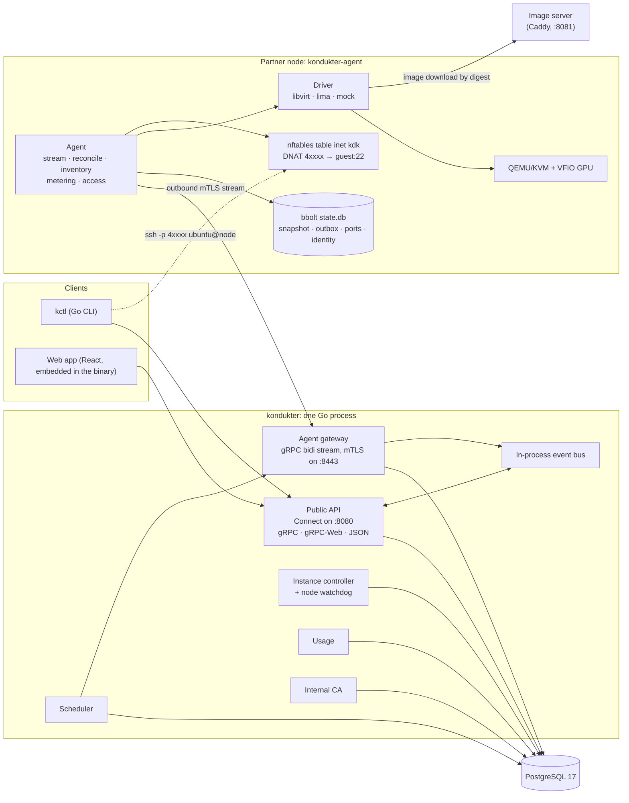
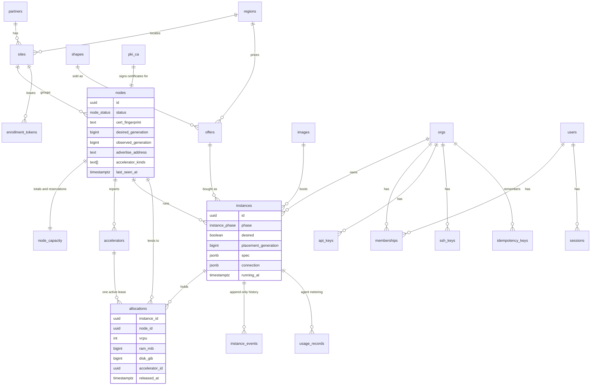
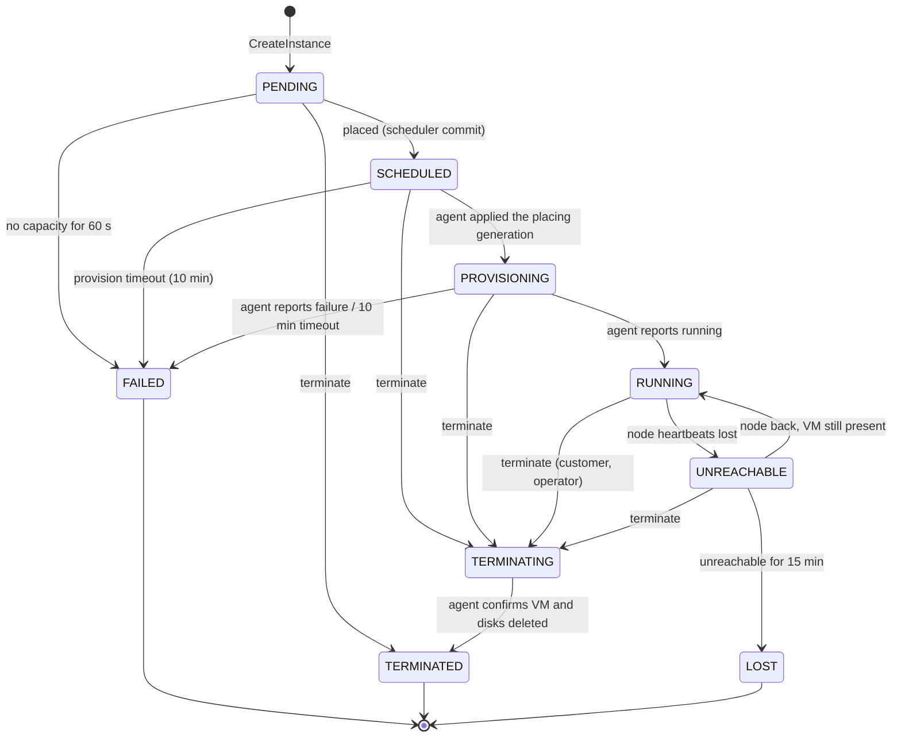
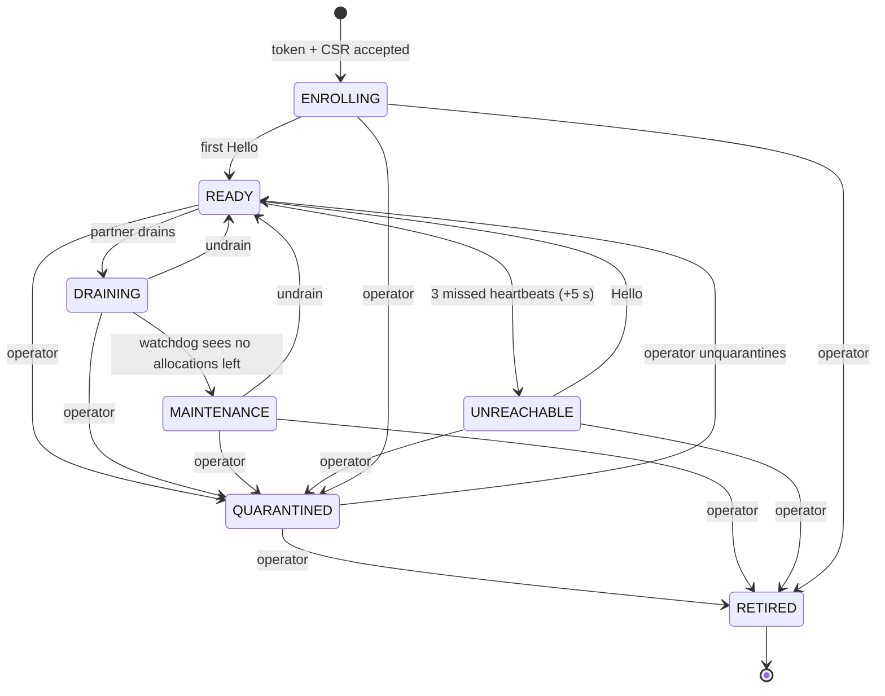
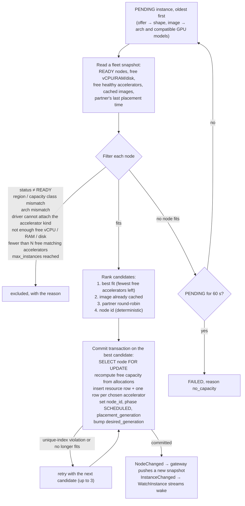
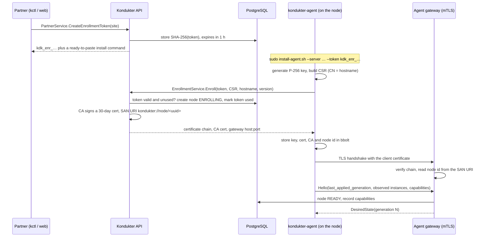
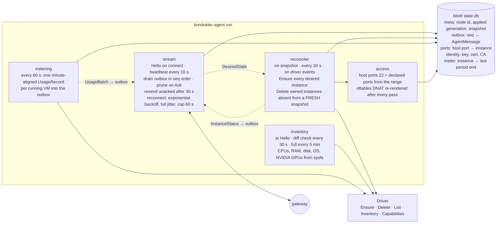
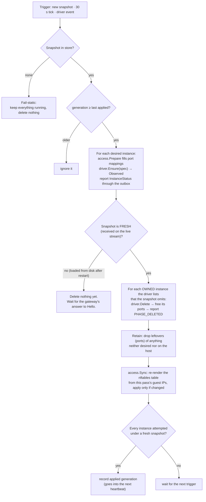
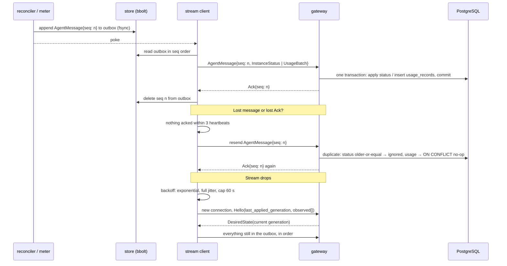
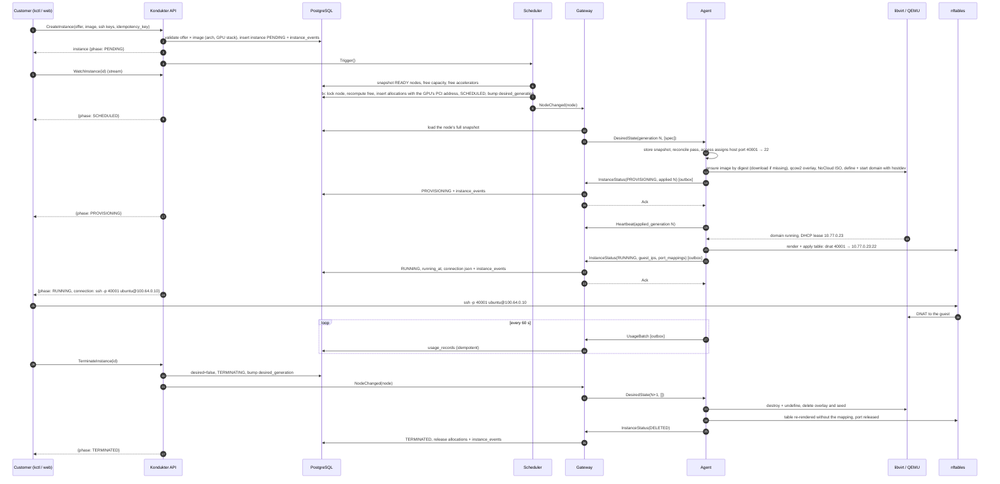

# Kondukter

Kondukter turns idle datacenter capacity, GPUs included, into on-demand SSH-accessible virtual machines.

A partner (a company, university or datacenter operator) dedicates a fixed share of its hosts. Each host runs a small agent that dials **out** to the Kondukter control plane. A customer asks for a VM of a given shape, optionally with a whole GPU. Kondukter picks a node, writes the placement into PostgreSQL, and pushes the node's new desired state down the agent's connection. The agent builds the VM through the local hypervisor, maps a port to it, and reports back. The customer gets an `ssh` command. Billing starts when the VM is running and stops when it is gone.

The product brand in the web app is **Warden**. Kondukter is the name of the backend and stays in code.

> **Status (2026-11-08):** demo scope, not a commercial system. The target is a first external showcase on one Fedora box with a GTX 1060 passed through to guests. 31 of 42 in-scope roadmap items are done. Money, sign-up, certificate rotation, signed self-update, telemetry and the GPU health gate are designed but deferred. See [Scope and what is deferred](#scope-and-what-is-deferred).

---

## Contents

- [Why this design](#why-this-design)
- [Architecture at a glance](#architecture-at-a-glance)
- [The control plane](#the-control-plane)
  - [Modules](#modules)
  - [Public API](#public-api)
  - [Data model](#data-model)
  - [Instance lifecycle](#instance-lifecycle)
  - [Node lifecycle](#node-lifecycle)
  - [Scheduler](#scheduler)
  - [Timers and watchdogs](#timers-and-watchdogs)
  - [Node identity and enrollment](#node-identity-and-enrollment)
  - [Authentication, roles and idempotency](#authentication-roles-and-idempotency)
  - [Usage and estimated cost](#usage-and-estimated-cost)
- [The agent](#the-agent)
  - [Internal structure](#internal-structure)
  - [Reconcile loop](#reconcile-loop)
  - [Stream, outbox and acknowledgements](#stream-outbox-and-acknowledgements)
  - [Drivers](#drivers)
  - [What a libvirt VM looks like](#what-a-libvirt-vm-looks-like)
  - [Access: port-map and nftables](#access-port-map-and-nftables)
  - [Metering](#metering)
  - [Crash safety](#crash-safety)
- [The agent protocol](#the-agent-protocol)
- [End to end: creating an instance](#end-to-end-creating-an-instance)
- [Failure behaviour](#failure-behaviour)
- [Clients: kctl and the web app](#clients-kctl-and-the-web-app)
- [Repository layout](#repository-layout)
- [Development](#development)
- [Testing](#testing)
- [Deployment](#deployment)
- [The demo fleet](#the-demo-fleet)
- [Scope and what is deferred](#scope-and-what-is-deferred)
- [Documentation index](#documentation-index)
- [Glossary](#glossary)

---

## Why this design

Every architectural choice is recorded as an ADR in [docs/adr](docs/adr/README.md). The ones that shape the system most, and what they buy:

| Principle | What it means | Why it is worth it |
|---|---|---|
| **Agents dial out** ([ADR-0001](docs/adr/0001-agents-dial-out.md)) | The agent opens one outbound mTLS gRPC stream and keeps it open. Kondukter never connects into a partner network. | Partners will not open inbound ports to their hosts. NAT, firewalls and dynamic addresses stop being a problem. One Tailscale hop or a public IP on the control plane is enough. |
| **Desired state + reconciliation** ([ADR-0002](docs/adr/0002-desired-state-reconciliation.md)) | Kondukter stores "instance X must exist on node Y with spec Z" and pushes the node a **full snapshot** with a monotonic generation. The agent converges the host to it. | Survives agent restarts, network partitions and duplicated or reordered messages. No imperative RPC can be half-applied. Full snapshots keep agent logic trivial. |
| **Fail-static agents** | With no stream, or only a stale snapshot, the agent keeps everything running and deletes nothing. | A control-plane outage costs visibility, never a customer's VM. |
| **Control plane out of the data path** ([ADR-0010](docs/adr/0010-control-plane-not-in-data-path.md)) | Customers SSH straight to the node. Datasets never cross Kondukter. | If Kondukter is down, VMs keep serving and agents buffer metering. No bandwidth bill, no latency, no liability for customer data. |
| **PostgreSQL is the single source of truth** ([ADR-0009](docs/adr/0009-postgres-source-of-truth.md)) | Free capacity is never stored. It is `total − reserved − Σ active allocations`, recomputed inside the placement transaction with the node row locked. A partial unique index allows one active lease per accelerator. | Over-allocation is impossible by construction, not by careful code. Concurrency tests fire parallel creates at limited capacity and the database refuses the losers. |
| **One protobuf contract** ([ADR-0006](docs/adr/0006-protobuf-connect-grpc.md)) | `proto/` generates the Go server, the Go agent client, the Go CLI client and the TypeScript web client. Connect serves gRPC, gRPC-Web and JSON from the same handlers. `buf breaking` runs in CI. | Browsers need no proxy. A field renumbering fails CI. Every component shares one set of types. |
| **Generic resource model** ([ADR-0007](docs/adr/0007-generic-resource-model.md)) | A GPU is one item in a list of accelerators. Shapes carry vCPU, RAM, disk and zero or more accelerators. | CPU-only VMs cost nothing extra. Apple Metal, mock devices and future accelerators fit the same tables. |
| **The agent owns only what it created** | Drivers list, change and delete only VMs with the `kdk-` name prefix **and** Kondukter metadata in the VM definition. | Safe on partner hosts that run their own VMs next to ours. |
| **Everything is idempotent** | Every mutating public RPC takes an idempotency key. Agent messages carry persisted sequence numbers and are resent until acknowledged. Usage ingest is keyed by `(instance_id, period_start)`. | Any message may be duplicated, reordered or lost without double-creating, double-billing or leaking anything. |
| **No Kubernetes, one binary** ([ADR-0004](docs/adr/0004-no-kubernetes-in-mvp.md)) | The control plane is a modular monolith: one Go process plus Postgres. The agent is a static Go binary. | Kubernetes does not federate across WAN and would be one cluster per site with Kondukter still above it. A tiny team can run a Go binary and a database. |
| **QEMU/KVM via libvirt, not Firecracker** ([ADR-0003](docs/adr/0003-qemu-kvm-libvirt-vmm.md)) | Whole-GPU VFIO passthrough through libvirt, driven by the pure-Go `digitalocean/go-libvirt` binding. | Firecracker has no GPU support. libvirt is the only path NVIDIA supports that also keeps MIG and vGPU open for later. Pure Go keeps the agent `CGO_ENABLED=0`. |

The honest limits: there is one control-plane replica, nodes are trusted to report inventory truthfully (allocation is verified, inventory is not), and a host operator can read tenant memory without confidential computing. All three are documented in [SPEC §13](docs/SPEC.md#13-security-and-trust-model) and deferred on purpose.

---

## Architecture at a glance



Three kinds of traffic exist:

1. **Clients to the API** on port 8080: plain HTTP with h2c, so `kctl`, the browser and `buf curl` all work without TLS termination in the demo.
2. **Agents to the gateway** on port 8443: one long-lived gRPC bidirectional stream per node, mTLS with a client certificate issued at enrollment. Node identity comes only from the certificate's SAN URI, never from a message body.
3. **Customers to their VMs**: SSH to a high port on the node's advertised address, DNAT'd by the node's nftables table to the guest. Kondukter is not on this path.

Everything the control plane knows lives in Postgres. The in-process event bus and the scheduler-to-gateway notifications are optimizations for latency, not for correctness: a subscriber always re-reads the row, and the gateway re-pushes a snapshot whenever a node reports an applied generation that lags its desired one for more than three heartbeats.

---

## The control plane

`cmd/kondukter` is one binary with the subcommands `serve`, `migrate {up,down,status}`, `seed {catalog,accounts}`, `token create`, `healthcheck` and `version`. `serve` applies pending goose migrations, loads or creates the CA, and runs every module below in one errgroup.

### Modules

| Package | Responsibility |
|---|---|
| `internal/controlplane/server` | Wires everything: the API mux on `:8080`, the gRPC gateway on `:8443`, the background loops, graceful shutdown. |
| `internal/controlplane/api` | Connect handlers for every public service. Scopes every query to the caller's org, honors idempotency keys, streams `WatchInstance`, hosts the embedded web app at `/`. |
| `internal/controlplane/gateway` | Terminates agent streams. Authenticates the node from its certificate, answers `Hello` with the current snapshot, ingests inventory, heartbeats, instance statuses and usage inside database transactions, acks each message after commit. |
| `internal/controlplane/scheduler` | Places `PENDING` instances. Pure filter and rank over a fleet snapshot, then a commit transaction. Runs every second and on demand. |
| `internal/controlplane/controller` | The instance and node state machines as pure transition tables, applied inside store transactions together with their `instance_events` row. The instance timer sweep and the node watchdog. |
| `internal/controlplane/usage` | Running time from `instance_events` and estimated cost from the offer price. |
| `internal/controlplane/enrollment` | One-time tokens and the token-plus-CSR to certificate exchange. |
| `internal/controlplane/pki` | The internal CA: created on first start, stored in Postgres with its key sealed under `KONDUKTER_MASTER_KEY`. |
| `internal/controlplane/accounts` | Seeded users, orgs, bcrypt passwords, API keys, sessions. |
| `internal/controlplane/catalog` | Regions, shapes, offers and images, seeded from YAML. |
| `internal/controlplane/events` | The in-process instance change bus behind `WatchInstance`. |
| `internal/store` | pgx pool, goose migrations, sqlc-generated queries in `store/db`, transaction helpers. |

### Public API

All services are in `proto/kondukter/api/v1` and served through Connect. Every mutating RPC except `Login` and `Logout` takes an `idempotency_key`.

| Service | RPCs | Who |
|---|---|---|
| `AuthService` | `Login`, `Logout`, `GetMe` | anyone with a seeded account |
| `AccountService` | `CreateAPIKey`, `ListAPIKeys`, `RevokeAPIKey`, `AddSSHKey`, `ListSSHKeys`, `DeleteSSHKey` | any signed-in user |
| `CatalogService` | `ListOffers` (filters: region, accelerator kind and model, arch, capacity class, minimum vCPU and RAM), `ListImages`, `ListRegions` | customers |
| `InstanceService` | `CreateInstance`, `GetInstance` (with its event timeline), `ListInstances`, `TerminateInstance`, `WatchInstance` (server stream) | customers |
| `UsageService` | `ListUsage` (running minutes, estimated cost, agent-reported seconds for the cross-check) | customers |
| `PartnerService` | `ListSites`, `ListNodes`, `CreateEnrollmentToken`, `DrainNode`, `UndrainNode`, `GetUtilization`. Never returns customer data. | partners, operators |
| `AdminService` | `ListNodes`, `ListInstances`, `QuarantineNode`, `UnquarantineNode`, `ForceTerminateInstance`, `ListAuditLog`, `ListCatalog`. Every mutation writes an `audit_log` row. | operators |
| `EnrollmentService` | `Enroll` (token + CSR → certificate chain, CA, gateway address). Served without a session; the token is the credential. | agents |

`WatchInstance` sends the instance at once, then again on every change until the instance is terminal or the client cancels. It subscribes to the event bus and additionally re-reads the row every 30 seconds, so a coalesced or late signal never shows a stale state. The web app keeps at most a few streams open because a browser allows about six HTTP/1.1 connections per host.

### Data model

Money is in integer minor units. Timestamps are `timestamptz` written in UTC. Strings the API always has are `NOT NULL DEFAULT ''`, and a `NULL` timestamp means "not happened yet". Six goose migrations live in `internal/store/migrations`; sqlc turns `internal/store/queries/*.sql` into `internal/store/db`.



Three details carry most of the correctness:

- **Allocations are split.** One active row per instance carries its vCPU, RAM and disk with `accelerator_id NULL`. Every accelerator gets its own row with zero resources. Sums over active rows are therefore exact, and the partial unique index `one_active_lease_per_accelerator` guards each device.
- **Generations.** `nodes.desired_generation` starts at 1 and is bumped by every change that affects the node's snapshot. `observed_generation` is what the agent last reported applying. `instances.placement_generation` records the generation at placement, so an agent status produced under an older snapshot cannot drive a transition.
- **Append-only tables.** `instance_events` is the billing authority and the audit trail of every phase change. `audit_log` records every operator action with actor, target and payload.

### Instance lifecycle

The transition table lives in `internal/controlplane/controller/instance.go`. Beyond the diagram, **terminate is accepted from every non-terminal phase** so a stuck instance can always be stopped: a `PENDING` instance has nothing to delete and ends `TERMINATED` at once.



When an instance enters `TERMINATING`, its `desired` flag flips to false and the node's generation is bumped. The next snapshot simply omits the instance. The agent notices an owned VM that is absent from a fresh snapshot, deletes it with its disks, releases its ports, and reports `PHASE_DELETED`. That report ends the instance `TERMINATED` and releases its allocations.

### Node lifecycle



Only `READY` is schedulable. A `DRAINING` node keeps its instances and simply stops being a scheduler candidate. A `QUARANTINED` node's reports are dropped by the gateway, which is why the demo run sheet warns never to quarantine the only node while it has instances. When a node leaves quarantine, or was marked `UNREACHABLE` while a stream was still open, the gateway ends the stream so the agent must send a fresh `Hello`, the only message that re-reports every instance.

### Scheduler

The scheduler (`internal/controlplane/scheduler`) runs a pass every second and whenever the API creates an instance. A pass takes up to 100 pending instances, oldest first.



The scheduler, not the agent, chooses the **concrete** accelerator IDs (PCI addresses on a passthrough host). They travel in the snapshot's `InstanceSpec.accelerator_ids`, so every allocation is explicit and verifiable. Any N devices on the same node will do in the MVP; NUMA- and topology-aware choice is deferred ([ADR-0025](docs/adr/0025-mvp-scheduling-semantics.md)).

### Timers and watchdogs

| Loop | Period | What it does |
|---|---|---|
| Scheduler | 1 s, plus on create | Places pending instances. Fails one after 60 s without a fit. |
| Instance timers | 5 s sweep | `SCHEDULED`/`PROVISIONING` for 10 min → `FAILED`. `UNREACHABLE` for 15 min → `LOST`. |
| Node watchdog | 10 s sweep | A `READY` node silent for 35 s (three 10 s heartbeats plus 5 s) → `UNREACHABLE`, and its running instances with it. A `DRAINING` node with no allocations → `MAINTENANCE`. |
| Restart grace | first 95 s after start | The watchdog marks no node unreachable: agents may be in their 60 s maximum reconnect backoff plus the 35 s heartbeat grace. A node that has not reconnected yet is not mistaken for a dead one. |
| Gateway re-push | 30 s | A connected node reporting an applied generation below its desired one for three heartbeats gets the snapshot again. |
| API janitor | hourly | Purges idempotency keys older than 24 h. |
| Usage cross-check | 5 min | For each recently metered instance, compares the agent-reported seconds with the event-derived running time over the same window and logs any difference above a tolerance. |

### Node identity and enrollment

Node identity is an mTLS client certificate from Kondukter's own CA ([ADR-0024](docs/adr/0024-mtls-node-identity-deferred-rotation.md)). The CA is created on first start and stored in Postgres with its private key sealed by AES-256-GCM under a key derived from `KONDUKTER_MASTER_KEY` (HKDF, at least 16 characters). A database dump alone cannot sign certificates. Losing the master key means re-enrolling every node.



The gateway authorizes every message by the node ID in the certificate. Certificate rotation and revocation are deferred for the demo; nodes re-enroll after 30 days.

### Authentication, roles and idempotency

Authentication is deliberately simple for the demo ([ADR-0021](docs/adr/0021-seeded-accounts-sessions-api-keys.md)):

- **Browser sessions**: `AuthService.Login` checks email and bcrypt password and sets an HttpOnly cookie. Only the cookie's SHA-256 is stored.
- **API keys**: `kdk_…` bearer tokens for `kctl` and scripts. The secret is shown once; only its SHA-256 and a display prefix are stored.
- **Roles** are derived from the kind of org a user belongs to: `customer`, `partner` (linked to a `partners` row, scoped to that partner's sites) or `operator` (everything, every action audited).
- **No sign-up.** `kondukter seed accounts` creates `customer@`, `partner@` and `operator@demo.local`.

Idempotency keys are remembered per `(org, method, key)` for 24 hours together with a hash of the request and the stored response. A retry with the same key and the same request replays the response. The same key with a different request is rejected. The claim lives inside the handler's transaction, so a failed call leaves no record and a concurrent duplicate waits for the first one to commit, then replays it.

### Usage and estimated cost

No money moves in the demo ([ADR-0023](docs/adr/0023-demo-metering-no-money.md)), but the metering is real and has two independent sources:

1. **Kondukter's `instance_events` are authoritative.** An instance accrues time from each transition into `RUNNING` until it leaves `RUNNING` (`TERMINATING`, `UNREACHABLE`, `LOST`). An open interval is closed at now. Running minutes are rounded up; estimated cost is minutes times the offer's hourly price divided by 60, in the offer's currency.
2. **Agent `usage_records` are the cross-check.** Every 60 seconds the agent writes a minute-aligned record per running VM into its durable outbox. Kondukter ingests them idempotently by `(instance_id, period_start)` and exposes the sum as `agent_reported_seconds` next to the event-derived figure. They resolve `UNREACHABLE` periods: if the agent later proves the VM kept running, the record is there.

---

## The agent

`cmd/kondukter-agent` runs on every node as a systemd service (root on Fedora, because it owns the nftables table and libvirt's system URI) or a launchd daemon (the `_kondukter` user on macOS, because Lima refuses to run as root). Subcommands: `run`, `enroll`, `inventory`, `version`. Configuration is one YAML file with unknown keys rejected, so a typo never silently falls back to a default.

```yaml
# /etc/kondukter-agent/config.yaml (abridged)
server: http://fedora:8080          # API URL, used by `enroll`
gateway: fedora:8443                # written by `enroll`
driver: libvirt                     # libvirt | lima | mock
data_dir: /var/lib/kondukter-agent  # state.db, image cache, instance disks
reserved: {vcpu: 2, ram_mib: 2048}  # held back for the host
port_range: {first: 40000, last: 49999}
advertise_address: 100.64.0.10      # the address in every ssh command
network: {bridge: kdk-br0, subnet: 10.77.0.0/24}
```

### Internal structure



Every concern is a subpackage under `internal/agent/` with its own tests. The reconciler and the meter never touch the network; the stream client never touches the driver. They meet in the bbolt store.

### Reconcile loop



The **fresh** distinction is what makes a restart safe. After `kill -9` the agent reloads its last snapshot from disk and Ensures everything in it, but it deletes nothing until the gateway has answered its `Hello` with a snapshot over the live stream. A VM the control plane terminated while the agent was down is deleted at that point; a VM the stale snapshot still lists is left alone until then.

Drivers that implement `EventSource` (libvirt, lima) push an event when a background create finishes or a VM dies, so a boot that takes a minute does not wait for the next 30 s tick to be reported.

### Stream, outbox and acknowledgements



Acks are **per message**, sent only after the enclosing transaction commits, and sent again for a duplicate. A lost or reordered message is never confirmed by a later one; the agent resends whatever stays unacknowledged. `Hello`, `Heartbeat` and `Inventory` are rebuilt on every connection, carry `seq 0`, and are never acked or resent. The gateway rejects an incompatible protocol major version with `FAILED_PRECONDITION`. Messages are capped at 4 MiB in both directions.

### Drivers

The reconciler talks only to the `Driver` interface in `internal/agent/driver`:

```go
type Driver interface {
    Name() string
    Capabilities(ctx) (Capabilities, error)   // arch, accelerator kinds, GPU passthrough, max instances
    Inventory(ctx) (Inventory, error)          // totals; the agent applies its reservations
    Ensure(ctx, InstanceSpec) (Observed, error) // idempotent converge
    Delete(ctx, instanceID string) error        // idempotent; deleting a missing instance succeeds
    List(ctx) ([]Observed, error)               // only Kondukter-owned instances
}
```

| Driver | Platform | Status | How it works |
|---|---|---|---|
| `libvirt` | Linux | **Demo path**, verified on FED-D | QEMU/KVM through the pure-Go `digitalocean/go-libvirt` RPC binding over the unix socket. Defines the `kdk-net` open-mode network, builds domains from a template, downloads images by digest into a cache, creates qcow2 overlays, writes a NoCloud seed ISO with a pure-Go iso9660 writer, passes GPUs through as VFIO `hostdev`s. Ownership: `kdk-` prefix plus a `<k:instance>` metadata element. Creates run in the background because an image download may take minutes. |
| `mock` | any | Tests, fleet simulator, stage fallback | Reports the inventory from its config, takes a configurable time to provision, fails at a configurable rate, persists its instances to JSON so `List` survives a restart. |
| `lima` | macOS (Apple Silicon) | Built and tested, out of the demo ([ADR-0026](docs/adr/0026-macs-out-of-scope.md)) | One Lima `vz` VM per instance through `limactl`. Ownership via the `kdk-<id>` name and a `KONDUKTER_INSTANCE` template parameter written into `lima.yaml` at create time. Port forwards through Lima. |

Integration tests for the real hypervisors are behind build tags: `go test -tags libvirt ./internal/agent/driver/libvirt/` on a Linux host with libvirt, `-tags lima` on a Mac.

### What a libvirt VM looks like

The domain template in `internal/agent/driver/libvirt/templates/domain.xml.tmpl` is deliberately minimal:

- `q35` machine, UEFI firmware with secure boot off, `<cpu mode='host-passthrough'>`.
- One virtio disk: a qcow2 overlay with the cached base image as backing file, `discard='unmap'`. Disk quota is the overlay size.
- A read-only SATA CD-ROM with the cloud-init NoCloud seed: the customer's SSH keys for the `ubuntu` user, the hostname, and up to 16 KiB of customer user-data.
- One virtio NIC on the `kdk-net` network with `<port isolated='yes'/>`, so guests on the same bridge cannot see each other.
- Serial console only, a virtio RNG, no memballoon, no graphics, USB or sound.
- One `<hostdev managed='yes'>` per accelerator ID the scheduler chose, plus that GPU's companion functions (its HDMI audio) from the same IOMMU group.

`Observed` is filled from the domain's state and its DHCP lease on `kdk-net`. A `kill -9` of the agent does not touch the domain: QEMU is libvirt's child, not the agent's.

### Access: port-map and nftables

The demo access mode is `port-map` ([ADR-0016](docs/adr/0016-port-map-access-mode.md)). The access module hands each instance host ports from the configured range, always one for `22/tcp` plus one for each declared guest port, picking the lowest free port and persisting the assignment in bbolt so it survives restarts. The mapping goes into the spec before `Ensure` and comes back in the `InstanceStatus` as `port_mappings`, which Kondukter turns into the customer's `ssh -p 4xxxx ubuntu@<advertise_address>`.

On Linux the agent owns one nftables table, `inet kdk`: DNAT from each host port to the guest's leased IP, forward-accept for DNAT'd connections, masquerade for the guest subnet. After every reconcile pass the table is re-rendered from the current mappings and guest IPs and applied with `nft -f` only when it changed, and always once after start. The table stays in the kernel while the agent is down, so a restart re-asserts the rules without a gap. On Fedora the agent also places `kdk-br0` in a firewalld zone at start, the arrangement spike S1 settled.

### Metering

Every 60 seconds the meter lists the driver's running VMs and, for each, appends a minute-aligned `UsageRecord` to the outbox, remembering the end of the last metered period per instance. After a restart it backfills the minutes the VM kept running while the agent was down, up to 24 hours. The outbox holds at most 20,000 unacked messages; past that the oldest are evicted with a warning first.

### Crash safety

The agent must survive `kill -9` at any point without leaking or double-creating VMs. Its only durable state is one bbolt file, `state.db`, which is copy-on-write with an fsync per committed transaction: after a crash it holds exactly the last committed state. On restart the agent rebuilds observed state from `driver.List()` plus the store, sends `Hello` with its last applied generation and observed instances, and resends every un-acked outbox entry. Ports are reassigned from the store, not reallocated. The simulator's chaos tests kill and restart agents mid-provision and assert the invariants in [Testing](#testing).

---

## The agent protocol

`proto/kondukter/agent/v1/agent.proto` defines one RPC, `AgentGateway.Connect(stream AgentMessage) returns (stream ControlMessage)`, opened by the agent and kept open for its lifetime.

| Direction | Message | When | Durable? |
|---|---|---|---|
| agent → gateway | `Hello` (protocol and agent version, driver, capabilities, `last_applied_generation`, every observed instance) | first message on every connection | no, seq 0 |
| agent → gateway | `Inventory` (hostname, arch, OS, kernel, totals, reserved, accelerators with PCI address, IOMMU group, NUMA node, bound host driver and health, cached images, labels, advertise address) | after Hello, on change, every 5 min | no, seq 0 |
| agent → gateway | `Heartbeat` (applied generation, resource summary) | every 10 s | no, seq 0 |
| agent → gateway | `InstanceStatus` (phase, reason, guest IPs, port mappings, applied generation, timestamp) | on every change | yes, outbox |
| agent → gateway | `UsageBatch` (minute-aligned `UsageRecord`s) | every 60 s | yes, outbox |
| gateway → agent | `DesiredState` (generation, full list of `InstanceSpec`) | in answer to Hello, on every change, re-pushed if the node lags 30 s | — |
| gateway → agent | `Ack{seq}` | after the message's transaction commits | — |
| gateway → agent | `DrainRequest` | defined, not sent in the demo: a drain is enforced by the scheduler alone | — |
| gateway → agent | `UpgradeRequest` | defined, not sent or acted on in the demo (signed self-update is deferred) | — |

`InstanceSpec` carries everything the driver needs: id, vCPU, RAM, disk, the concrete `accelerator_ids`, an `ImageRef` (name, version, arch, `sha256:` digest, URL, size, format), SSH public keys, user-data, extra ports and the guest hostname. Status ingest is last-writer-wins by `(applied_generation, at)`.

---

## End to end: creating an instance



Spike S2a measured `nvidia-smi` answering 11 s after `virsh start` with a warm overlay on the GTX 1060, and the GPU image build (S5) measured 28 s to `nvidia-smi` from a cached image. The roadmap's limit from create to `RUNNING` is 120 s.

---

## Failure behaviour

The showcase has three rehearsed drills, each scripted in `hack/demo-failure.sh` with pass/fail checks. They follow directly from the design above.

**Drill 1: `kill -9` the agent under a running GPU VM.** The VM keeps running because QEMU belongs to libvirt, not the agent. The nftables table stays in the kernel, so an open SSH session never notices. After three missed heartbeats plus the watchdog sweep (35–45 s) the node and its instances are `UNREACHABLE`. systemd restarts the agent after 60 s (`RestartSec=60`, deliberately longer than the grace so the demo shows the transition). The agent reloads its snapshot, lists the VM, sends `Hello` with it, and the gateway moves the node to `READY` and the instance back to `RUNNING`. `instance_events` holds exactly `running → unreachable → running`. Measured by hand on FED-D: `UNREACHABLE` at 34 s, `READY` again 64 s after the kill.

**Drill 2: stop the control plane for two minutes.** API, web app and gateway are down. Every VM keeps answering SSH. The agent keeps metering into its outbox and retries the gateway with jittered backoff. On restart, the watchdog's 95 s restart grace stops it from marking nodes unreachable while they are still in backoff. Agents reconnect, send `Hello`, and drain their outboxes. The checks: no `instance_events` during the outage, every placement unchanged, and every running instance's metered usage gap-free and within 60 s of wall-clock time.

**Drill 3: drain the node.** The partner drains it. A new instance stays `PENDING` because no other node fits (or lands on another `READY` node of the same architecture if there is one). The running VM is untouched. Undraining places the pending instance within seconds.

Other paths the state machines handle without a drill: provisioning that never finishes fails after 10 min and releases its allocations; a node unreachable for 15 min moves its instances to `LOST`; a quarantined node is dropped from scheduling and its reports are ignored until an operator lifts the quarantine; `terminate` works from every non-terminal phase.

---

## Clients: kctl and the web app

**`kctl`** (`cmd/kctl`, `internal/kctl`) is the Go client for the same Connect API the browser uses. It stores one server and API key per config file (`~/.config/kctl/config.yaml`, or `--config` / `KCTL_CONFIG` for one file per role).

| Command | Role |
|---|---|
| `login`, `whoami` | anyone |
| `offers`, `images`, `create --offer … --image … --arch … [--ssh-key …] [--wait]`, `get`, `list`, `watch [--until-terminal]`, `terminate`, `ssh [--exec] ID -- …`, `usage` | customer |
| `nodes`, `drain`, `undrain`, `enroll-token --site …` | partner, operator |

**The web app** (`web/`, [ADR-0022](docs/adr/0022-react-vite-typescript-connect-es.md)) is React + Vite + TypeScript with the connect-es client generated from the same protos. `make web` builds it into `web/dist`, which `go:embed` bakes into the `kondukter` binary and serves at `/`. A binary built without the web build answers 503 with a note to run `make web`. Every route, its role, its data and its RPCs are tabulated in [docs/WEB_PAGES.md](docs/WEB_PAGES.md), and a test keeps `src/routes.ts` equal to that table.

| Area | Routes |
|---|---|
| Guest | `/` landing, `/products` catalog, `/login` |
| Customer | `/app/offers`, `/app/instances`, `/app/instances/new`, `/app/instances/:id` (live phase, timeline, copyable ssh command), `/app/keys`, `/app/usage`, `/app/billing` (browser-generated demo data) |
| Partner | `/partner/sites`, `/partner/nodes` (never customer data), `/partner/enroll`, `/partner/utilization`, `/partner/earnings` (demo data) |
| Operator | `/admin/nodes` (with generation lag), `/admin/instances` (force terminate), `/admin/catalog`, `/admin/audit`, `/stage` (projector view for the drills) |

Two helpers exist because the demo runs over plain HTTP on a tailnet, which browsers treat as an insecure context: `newId()` replaces `crypto.randomUUID()` and `copyText()` replaces `navigator.clipboard`. `VITE_MOCK_API=1 pnpm --dir web dev` runs every page on sample data with no backend.

---

## Repository layout

```text
.
├── proto/                      # the single source of truth for every API (buf)
│   └── kondukter/{agent,api}/v1/
├── gen/                        # generated Go and TS; committed, CI fails on drift
├── cmd/
│   ├── kondukter/              # control plane: serve, migrate, seed, token, healthcheck
│   ├── kondukter-agent/        # node agent: run, enroll, inventory
│   ├── kctl/                   # customer / partner / operator CLI
│   ├── kdk-sim/                # fleet of simulated (mock-driver) agents against a real control plane
│   └── kdk-stubgw/             # development gateway that serves desired-state YAML to one agent
├── internal/
│   ├── controlplane/           # api, gateway, scheduler, controller, usage, enrollment, pki, accounts, catalog, events, server
│   ├── agent/                  # agent.go wiring; stream, reconcile, inventory, metering, access, store, enroll, config
│   │   └── driver/{libvirt,lima,mock}/
│   ├── agentproto/             # protocol constants shared by both ends (version, 10 s heartbeat, 60 s backoff cap, 4 MiB)
│   ├── store/                  # pgx pool, goose migrations, sqlc queries → store/db
│   ├── simulator/              # in-process fake fleet, fault injection, convergence invariants, chaos tests
│   ├── kctl/                   # the CLI's commands
│   ├── logging/, version/
├── web/                        # React + Vite + TS app; embed.go serves web/dist from the binary
├── deploy/
│   ├── compose/                # postgres + kondukter + image server for development and the laptop fallback
│   ├── demo/                   # the single-box demo: systemd units, install/up/reset/down scripts
│   ├── nodes/                  # install-agent.sh, Fedora unit + SELinux module + host check, macOS plist + check
│   └── images/                 # ubuntu-gpu build (virt-customize), driver compatibility matrix
├── hack/                       # smoke tests, demo scripts, preflight, spike code (each spike has its own go.mod)
├── docs/
│   ├── SPEC.md                 # the full system specification
│   ├── ROADMAP.md              # 42 items across P0–P6 with acceptance criteria and as-built notes
│   ├── adr/                    # ADR-0001 … 0026
│   ├── spikes/                 # S1 (go-libvirt), S2a (VFIO GTX 1060), S3 (Lima), S5 (GPU image) findings
│   ├── WEB_PAGES.md            # every web route, its data, actions and RPCs
│   ├── DEMO.md, DEMO_CHECKLIST.md
│   └── design/                 # the Warden landing prototype
├── Makefile, Brewfile, buf.yaml, buf.gen.yaml, sqlc.yaml, .golangci.yml, .env.example
└── .github/workflows/ci.yml
```

---

## Development

Go 1.27, pnpm 11 and Node 26, buf, sqlc, golangci-lint and Docker. On macOS with Homebrew:

```sh
make tools       # Brewfile formulae, pinned Go codegen plugins (go.mod tool directives), pinned protoc-gen-es
make gen         # gen/go and gen/ts from proto/ (buf), internal/store/db from SQL (sqlc)
make build       # bin/kondukter, bin/kondukter-agent, bin/kctl, bin/kdk-sim, bin/kdk-stubgw
make web         # install, typecheck, test, build the web app into web/dist; run before `make build` to embed it
make web-dev     # Vite dev server on :5173, proxying /api to a running `kondukter serve`
make test        # go test -race ./... (DB tests skip if Postgres is down)
make lint        # buf lint + breaking, go vet, golangci-lint
make fmt         # golangci-lint fmt
make db-up       # Postgres 17 in docker compose on 127.0.0.1:55432 (db-psql, db-down; V=1 drops the volume)
make migrate-up  # apply the embedded migrations (migrate-down, migrate-status)
make agent-dist  # cross-compile the agent for linux/amd64 and darwin/arm64
make             # list all targets
```

Codegen plugins are pinned outside the Brewfile so `buf generate` is byte-identical on every machine and in CI: the Go plugins as `tool` directives in `go.mod`, `protoc-gen-es` in the root `package.json`, sqlc by version through `go run`.

### A local stack with a mock node

With `KONDUKTER_DATABASE_URL` from `.env.example` and a `KONDUKTER_MASTER_KEY` of at least 16 characters:

```sh
make db-up
bin/kondukter seed catalog                          # demo region, shapes, offers, images
SEED_PASSWORD=… bin/kondukter seed accounts         # customer@, partner@, operator@demo.local; prints one API key each, once
bin/kondukter serve                                 # API and web app on :8080, agent gateway on :8443; migrates on start
bin/kondukter token create                          # one-time enrollment token for site demo-dc/demo
bin/kondukter-agent --config agent.yaml enroll --server http://localhost:8080 --token kdk_enr_…
bin/kondukter-agent --config agent.yaml run         # driver: mock needs no hypervisor (see internal/agent/config/testdata/mock.yaml)
KDK_API_KEY=kdk_… hack/api-smoke.sh                 # list offers → create → watch RUNNING → terminate, over JSON
KDK_API_KEY=kdk_… hack/kctl-smoke.sh                # the same through bin/kctl
```

Instead of a real agent, `bin/kdk-sim --api-key <partner key>` enrolls and runs a fleet of mock-driver nodes (by default two amd64 CPU nodes, two arm64 CPU nodes and one GPU node with a simulated GTX 1060) and takes `--drop`, `--duplicate` and `--reorder` probabilities for fault injection. `bin/kdk-stubgw` serves hand-written desired-state YAML to a single agent for driver development without a control plane.

---

## Testing

| Layer | What | How |
|---|---|---|
| Unit | Scheduler filter and rank, both state machines, usage math, reconcile decisions, port allocation, nftables rendering, inventory parsers against FED-D's recorded sysfs, cloud-init seed, domain XML | Table-driven Go tests, `go test -race` |
| Store | Every sqlc query, migrations up and down, placement transactions | Against a real Postgres; skipped when `KONDUKTER_DATABASE_URL` is unreachable |
| Concurrency | Parallel `CreateInstance` calls against limited capacity never over-allocate | Real Postgres, the unique index does the refusing |
| Fleet simulator and chaos | In-process agents with the mock driver, enrolled through the public API; messages dropped, duplicated, delayed, reordered; agents killed mid-provision and restarted; the control plane restarted | `internal/simulator` asserts after every run: every desired non-terminal instance is `RUNNING` with its VM on exactly its node; no terminal instance has a VM and no VM lacks an instance; no active allocation belongs to a terminal or unplaced instance; every placed instance holds exactly its shape's accelerators and none is held twice; every connected node has observed its desired generation |
| Driver integration | libvirt on a Linux host, Lima on a Mac | `go test -tags libvirt` / `-tags lima`; create, ensure, delete idempotency, crash and restart |
| Web | Components, pages against an in-memory fake API, route table equality with `WEB_PAGES.md` | vitest |
| End to end | The happy path and the three failure drills | `hack/demo-happy.sh [N]` and `hack/demo-failure.sh {agent-kill,cp-outage,drain}`, with timing logs; `hack/preflight.sh` before a showcase |

CI (`.github/workflows/ci.yml`) runs on every push to `main` and every pull request: regenerate and diff `gen/`, `buf lint`, `buf breaking` against the base branch, `go vet`, golangci-lint, build, `go test -race` with a Postgres 17 service container, and a web job that typechecks, tests, builds and verifies the build embeds into the binary. A proto change that renumbers a field fails the lint step; this was verified with a throwaway pull request.

---

## Deployment

**Control plane, docker compose** (`deploy/compose`): `postgres:17` with a named volume, `kondukter` built from a multi-stage Dockerfile (Node builds the web app, Go embeds it, distroless static nonroot runtime) running `serve`, and `caddy` serving built guest images with range requests. `make demo-up` creates `.env` with a random master key and seed password on first run, reads the Mac's MagicDNS name and tailnet IP from `tailscale status`, starts everything, seeds it, and prints logins and an enroll command. `make demo-reset` terminates every instance, undoes drains and quarantines, and empties the instance tables; `make demo-down` stops it (`V=1` also drops the database, and with it the CA and every node identity).

**Control plane, single box** (`deploy/demo`): what the showcase actually runs. Postgres in docker, `kondukter serve` and the image server as systemd services on the Fedora host next to the agent, loopback between them. `install.sh` puts the binaries, units and `/etc/kondukter-demo/demo.env` in place; `up.sh` starts, seeds the catalog with every built image's digest, seeds the accounts once, and prints the enroll command if no node is enrolled; `reset.sh` cleans between runs; `down.sh` stops the control plane while the agent and VMs keep running.

**Nodes** (`deploy/nodes`): `make agent-dist`, then on the node `sudo deploy/nodes/install-agent.sh --server <api url> --token <token>`. The script installs the binary, the unit or plist, a starting config (driver by OS, `advertise_address` from `tailscale ip -4`, ports 40000–49999), enrolls, and starts the service. On Fedora with SELinux enforcing it also installs a small CIL module so libvirt's confined daemons accept the agent. `fedora/bootstrap.sh --check` is a read-only host check of IOMMU, VFIO binding, libvirt, the agent and Tailscale that prints the root command for anything wrong.

**Guest images** (`deploy/images`): `ubuntu-gpu/build.sh` builds the Pascal GPU image with `virt-customize` in about two minutes without root or a GPU: Ubuntu 24.04, the NVIDIA 580 driver as precompiled modules, Docker and the NVIDIA container toolkit. Nothing else; models and serving software are the customer's. `COMPAT.md` says which driver branch serves which GPU generation. The catalog pins every image by `sha256:` digest and the agent verifies the download before using it.

**Control-plane configuration** is by `KONDUKTER_*` environment variables, overridable by flags:

| Variable | Meaning | Default |
|---|---|---|
| `KONDUKTER_DATABASE_URL` | Postgres connection URL | required |
| `KONDUKTER_MASTER_KEY` | seals the CA key in the database; at least 16 characters | required |
| `KONDUKTER_API_ADDR` | Connect API, web app, `/healthz` | `:8080` |
| `KONDUKTER_GATEWAY_ADDR` | mTLS agent gateway | `:8443` |
| `KONDUKTER_GATEWAY_HOSTS` | names and IPs in the gateway's server certificate | `localhost,127.0.0.1,<hostname>` |
| `KONDUKTER_GATEWAY_ADVERTISE` | host:port agents are told to dial at enrollment | |
| `KONDUKTER_PUBLIC_URL` | API URL written into enroll commands | `http://localhost:8080` |
| `KONDUKTER_IMAGE_BASE_URL` | expanded into the demo catalog's image URLs by `seed catalog` | `http://localhost:8081` |

---

## The demo fleet

| Machine | Role |
|---|---|
| **FED-D**, Fedora desktop, GeForce GTX 1060 6GB | The box. Control plane (`kondukter` as a systemd service, Postgres in docker, image server) **and** the GPU node (libvirt/QEMU, the GTX 1060 bound to `vfio-pci` at boot). Enrolled and `READY` with the GPU `ok`. |
| **The presenter's laptop**, Apple Silicon Mac | Client only: the browser and `kctl` over the Tailscale tailnet, and the SSH sessions into guests. Runs no node and no control plane. |
| **FED-L**, Fedora laptop with an RTX | Optional second node if spike S2b passes, otherwise a CPU-only node. Not online yet. |

The Macs that were planned as CPU-only Lima nodes left the demo on 2026-11-08 ([ADR-0026](docs/adr/0026-macs-out-of-scope.md)); the Lima driver and its tests stay in the tree.

The demo catalog: `cpu-2x2` (2 vCPU, 2 GiB, 20 GiB, €0.05/h) and `gpu-gtx1060-1x` (4 vCPU, 8 GiB, 40 GiB, one GTX 1060, €0.40/h), both in region `demo`, dedicated capacity; images `ubuntu-cpu` (amd64 and arm64 Ubuntu 24.04 cloud images) and `ubuntu-gpu-pascal` (Ubuntu 24.04 with the NVIDIA 580 driver and CUDA 12, because Pascal is dropped by the open kernel modules and CUDA 13). The GPU moment on stage is `nvidia-smi` and a llama.cpp prompt with every layer offloaded, inside the VM, on the real card. Spike S2a measured 143 tokens/s generating with a 0.5B Q4 model.

The run sheet, with what to run, show and say, is [docs/DEMO.md](docs/DEMO.md). The day-before and last-30-minutes lists are in [docs/DEMO_CHECKLIST.md](docs/DEMO_CHECKLIST.md).

---

## Scope and what is deferred

**In the demo:** whole-GPU VMs from curated images; SSH access by port-map; CPU and GPU offers on the same node; the full instance and node state machines; scheduler with capacity transactions; mTLS node identity; seeded accounts with sessions and API keys; running time and estimated cost; partner and operator views; audit log; the three failure drills; `kctl` and the web app.

**Designed, deferred** ([ROADMAP §4 Later](docs/ROADMAP.md#4-later)): money (ledger, credits, payments, invoices, partner payouts), sign-up and MFA, certificate rotation and revocation, signed agent self-update, telemetry pipeline, the GPU wipe and health gate on release, NUMA pinning and hugepages, egress controls, Ansible for partner hosts, the production host OS choice, krunkit/Metal GPUs on Macs, preemptible capacity, stop/start, persistent volumes, HA control plane with `LISTEN/NOTIFY` fan-out, multi-GPU topology, overlay access mode, inference endpoints, legal documents.

**Non-goals for the MVP:** GPU slicing (MIG/vGPU), multi-node training, NVLink/HGX passthrough, live migration, snapshots, Kubernetes anywhere in the stack, confidential computing, containers-as-a-service.

---

## Documentation index

Read in this order:

1. [docs/SPEC.md](docs/SPEC.md): the full system specification and architecture brief, including the security and trust model, the Linux GPU host stack, networking, and the open decisions.
2. [docs/ROADMAP.md](docs/ROADMAP.md): 42 in-scope items across P0–P6, each with goal, deliverables, acceptance criteria and an as-built note; the decision log; the Later bucket.
3. [docs/adr/](docs/adr/README.md): one record per decision, ADR-0001 to 0026.
4. [docs/spikes/](docs/spikes/README.md): findings for S1 (pure-Go libvirt on Fedora: go), S2a (VFIO passthrough of the GTX 1060: go), S3 (Lima on an 8 GB Mac), S5 (GPU guest image build: go).
5. [docs/WEB_PAGES.md](docs/WEB_PAGES.md): the web route map and page contents.
6. [docs/DEMO.md](docs/DEMO.md) and [docs/DEMO_CHECKLIST.md](docs/DEMO_CHECKLIST.md): the run sheet and the checklists.
7. Per-directory READMEs: [proto](proto/README.md), [gen](gen/README.md), [web](web/README.md), [hack](hack/README.md), [deploy/compose](deploy/compose/README.md), [deploy/demo](deploy/demo/README.md), [deploy/nodes](deploy/nodes/README.md), [deploy/images](deploy/images/README.md).

---

## Glossary

| Term | Meaning |
|---|---|
| **Kondukter** | The control plane: API, gateway, scheduler, controllers, usage. Also the backend's name. |
| **Warden** | The product brand shown in the web app. |
| **Agent** | `kondukter-agent`, the per-node daemon that manages VMs on one host. |
| **Driver** | The agent's hypervisor plugin: `libvirt`, `lima` or `mock`. |
| **Partner / Site / Node** | A datacenter operator; one of its locations, which groups nodes and owns network settings; one physical host running an agent. |
| **Customer / Operator** | Someone who rents instances; Kondukter staff. |
| **Accelerator** | A passthrough-able device, a whole GPU in practice. Kinds: `nvidia`, `apple-metal`, `mock`. |
| **Shape / Offer / Image** | vCPU + RAM + disk + accelerators; a shape at a price in a region and capacity class; a curated guest image pinned by digest. |
| **Instance** | A customer VM. |
| **Allocation** | A reservation of concrete node resources, and one row per concrete accelerator, for one instance. Free capacity is computed from active allocations, never stored. |
| **Desired state / snapshot** | The full list of instances that should exist on a node, with a generation. |
| **Generation** | A per-node monotonic version of the desired state. `desired` is bumped by Kondukter; `observed` is what the agent reports having applied. |
| **Fresh snapshot** | One received over the live stream, as opposed to reloaded from disk after a restart. Only a fresh snapshot authorizes deletions. |
| **Fail-static** | Without a fresh desired state the agent keeps everything running and deletes nothing. |
| **Capacity class** | `dedicated` (cannot be reclaimed) or `preemptible` (not sold in the demo). |
| **Port-map** | The access mode: a host port in 40000–49999 DNAT'd to a guest port, advertised on the node's tailnet address. |
| **Outbox** | The agent's durable queue of `InstanceStatus` and `UsageBatch` messages awaiting an `Ack`. |
