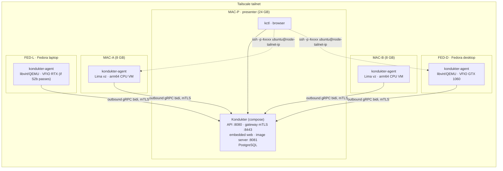

# Kondukter — Roadmap (demo scope)

> **Status:** v1 · 2026-11-08 · generated by the first planning session from [SPEC.md](SPEC.md) §21.
> **Scope:** the first external showcase. A demo, not a commercial system. Everything money-, legal- or production-hardening-related is in [§4 Later](#4-later).
> **Decisions:** every item that blocks Phases 0–4 was put to the owner on 2026-11-08 and is recorded in [docs/adr](adr/README.md). The log is in [§2](#2-decision-log).

---

## Progress

**Done: 21 of 45 items** (about 15 of 35 estimated sessions) · 6 partly done · 21 not started. Updated with every commit that finishes an item.

**P0 — Foundations**
- [x] P0.1 — Planning outputs in place
- [x] P0.2 — Toolchain and repo skeleton
- [x] P0.3 — Protobuf contract v1 and codegen
- [ ] P0.4 — Compose stack and CI · *partly done: CI has not run yet, it needs the branch pushed to GitHub*

**P1 — Spikes**
- [x] P1.1 — S1: libvirt from pure Go on Fedora
- [x] P1.2 — S2a: VFIO passthrough of the GTX 1060 (FED-D)
- [ ] P1.3 — S2b: VFIO passthrough of the laptop RTX (FED-L)
- [ ] P1.4 — S3: Lima `vz` on an 8 GB Mac · *partly done: spike run and findings written; SSH from another tailnet machine waits for a second Mac*
- [ ] P1.5 — S4: gRPC bidi stream with mTLS through Tailscale
- [ ] P1.6 — S5: GPU guest image build
- [ ] P1.7 — Decision gate: hardware roles, images, networking, libvirt binding

**P2 — Agent v0**
- [x] P2.1 — Agent skeleton, config, local store, driver interface
- [x] P2.2 — Stub gateway and stream client
- [x] P2.3 — Mock driver and reconcile loop
- [ ] P2.4 — Inventory · *partly done: the GPU check on FED-D waits for that host*
- [x] P2.5 — libvirt driver
- [ ] P2.6 — Lima driver · *partly done: built and tested against real VMs on an 8 GB Mac; SSH from MAC-P over the tailnet waits for a second Mac*
- [ ] P2.7 — Access module (port-map) · *partly done: the port allocator, the nftables backend (checked in a netns lab) and the Lima backend (checked on an 8 GB Mac) are built; the firewalld arrangement and the Linux hardware checks are not*
- [x] P2.8 — Metering outbox and crash safety
- [ ] P2.9 — Agent packaging · *partly done: built and checked in a Fedora systemd container; the installs on FED-D and MAC-A wait for those hosts and the owner's root install*

**P3 — Kondukter v0**
- [x] P3.1 — Schema, migrations, store layer
- [x] P3.2 — Node identity: CA, enrollment, mTLS gateway listener
- [x] P3.3 — Agent gateway
- [x] P3.4 — Node lifecycle and demo catalog
- [x] P3.5 — Scheduler
- [x] P3.6 — Instance controller
- [x] P3.7 — Public API core and API-key auth
- [x] P3.8 — Partner and Admin services, seeded accounts, sessions, audit log
- [x] P3.9 — `kctl` CLI
- [x] P3.10 — Fleet simulator and chaos tests
- [x] P3.11 — Usage and estimated cost

**P4 — Real fleet end-to-end (CLI)**
- [ ] P4.1 — Fedora GPU node bootstrap
- [ ] P4.2 — Mac node bootstrap
- [ ] P4.3 — Demo deployment of the control plane
- [ ] P4.4 — Enroll the fleet
- [ ] P4.5 — Happy path on hardware
- [ ] P4.6 — Failure path on hardware

**P5 — Web app skeleton**
- [x] P5.1 — Web scaffold, auth, routing, embedding
- [ ] P5.2 — Customer pages (contents only)
- [ ] P5.3 — Partner pages
- [ ] P5.4 — Operator pages
- [ ] P5.5 — Stage view data

**P6 — Showcase**
- [ ] P6.1 — Demo script
- [ ] P6.2 — Pre-flight checklist and reset
- [ ] P6.3 — Dress rehearsals and tag

---

## 0. How to read this

- Items follow SPEC §21.2: **Goal · Deliverables · Acceptance criteria · Depends on · Decisions required · Size**.
- **Size:** S = at most half an implementation session, M = one session. L does not exist; anything bigger was split.
- Every item leaves the repo green (`make build test lint`). Decision gates are items. Spikes are time-boxed to one session and end with a written findings file whatever the outcome.
- Status: the [Progress](#progress) checklist at the top is the summary. Item headings repeat it as ☐ not started · ◐ partly done · ☑ done.
- Hardware legend used throughout:

| Tag | Machine | Role in the demo |
|---|---|---|
| **MAC-P** | Apple Silicon Mac, 24 GB | Presenter laptop. Runs the control plane (docker compose), `kctl`, the browser. |
| **MAC-A**, **MAC-B** | Apple Silicon Macs, 8 GB each | CPU-only arm64 nodes (Lima `vz`), one 2 GiB VM each. |
| **FED-D** | Remote Fedora desktop, GTX 1060 (Pascal) | GPU node: libvirt/QEMU + VFIO passthrough. Primary GPU story. |
| **FED-L** | Fedora laptop, RTX (model TBD, hybrid graphics) | GPU node if spike S2b passes, otherwise CPU-only amd64 libvirt node. |

All five machines sit on one Tailscale tailnet; the control plane is addressed by its MagicDNS name.

---

## 1. Demo target

### 1.1 What the audience sees

**Happy path.** Log in to the web app as a customer, browse offers (an arm64 CPU offer on the Macs, an NVIDIA GPU offer on the Fedora hosts), create a GPU instance with an SSH key, watch it go `PENDING → SCHEDULED → PROVISIONING → RUNNING` live, copy the SSH command, run `nvidia-smi` and a short llama.cpp prompt on the real GPU inside the VM, see usage minutes and estimated cost tick, terminate, see capacity return. The same flow from `kctl` for the terminal crowd.

**Failure path.** With a GPU instance running and an SSH session open: `kill -9` the agent on the GPU node → instance shows `UNREACHABLE` within 45 s → systemd restarts the agent → `RUNNING` again, SSH session never dropped. Then stop the control plane for two minutes: VMs keep serving, agents buffer usage, everything reconciles on restart with no duplicates. Then drain a Mac node and show placement moving to the other one.

**Partner and operator views.** Partner sees its nodes, inventory, utilization and active-instance counts, never customer data; generates an enrollment token. Operator sees the whole fleet, quarantines a node, force-terminates, reads the audit log.

### 1.2 Topology

### 1.3 Demo catalog (draft, frozen at gate P1.7)

| Shape | vCPU | RAM | Disk | Accelerators | Arch / image | Lands on |
|---|---|---|---|---|---|---|
| `cpu-2x2` | 2 | 2 GiB | 20 GiB | — | arm64 `ubuntu-cpu` | MAC-A, MAC-B |
| `cpu-2x2` | 2 | 2 GiB | 20 GiB | — | amd64 `ubuntu-cpu` | FED-L (if CPU-only), FED-D spare capacity |
| `gpu-gtx1060-1x` | 4 | 8 GiB | 40 GiB | 1× nvidia GTX 1060 | amd64 `ubuntu-gpu-pascal` | FED-D |
| `gpu-rtx-1x` (name after S2b) | 4 | 8 GiB | 40 GiB | 1× nvidia RTX | amd64 `ubuntu-gpu` | FED-L (if S2b passes) |

Region `demo`, capacity class `dedicated`, prices in EUR cents per hour, chosen for readable numbers on screen.

### 1.4 Assumptions stated by the planning session

- Go module path `github.com/St1viG/cj` (matches the git remote; rename is a one-line change).
- GTX 1060 is Pascal: the guest needs the NVIDIA **580 driver branch with closed kernel modules and CUDA 12.x** (open modules and CUDA 13 dropped Pascal). If the RTX is Blackwell it needs open modules, so two GPU image variants may be required; spikes S2b and S5 decide. The GPU demo workload is **llama.cpp built with CUDA**, which runs on both, rather than the newest PyTorch.
- 8 GB Macs host at most one 2 GiB VM each; the agent reserves 4 GiB for macOS.
- The owner designs the web UI. P5 delivers page skeletons and contents only (see the P5 preamble).

### 1.5 Explicitly out of the demo

Money (ledger, credits, payments, invoices, partner payouts), sign-up/MFA, certificate rotation and revocation, signed agent self-update, telemetry pipeline, GPU wipe/health gate, NUMA pinning and hugepages, egress controls, Ansible for partners, production host-OS choice, krunkit/Metal, preemptible capacity, stop/start, persistent volumes, HA, multi-GPU topology, overlay access mode, inference endpoints, legal documents. All listed in [§4](#4-later).

---

## 2. Decision log

Status: **Accepted** (ADR written, owner confirmed 2026-11-08) · **Proposed** (ADR written, confirmed at a gate) · **Deferred** (out of demo scope, in §4 Later) · **Open** (needed later, not yet discussed).

| ID | Question | Status | Resolution for the demo |
|---|---|---|---|
| D-01 | Product scope | Deferred | Generic resource model regardless ([ADR-0007](adr/0007-generic-resource-model.md)); positioning after the demo. |
| D-02 | Supply model | Deferred | Demo hosts are bare metal we control. |
| D-03 | Partner commercial model | Deferred | No money in the demo. |
| D-04 | Capacity classes | Accepted | Dedicated only, field kept ([ADR-0025](adr/0025-mvp-scheduling-semantics.md)). |
| D-05 | Market / differentiator | Deferred | |
| D-06 | Customer product form | Accepted | SSH Linux VM ([ADR-0015](adr/0015-ssh-vm-curated-images.md)). |
| D-07 | GPU classes | Deferred | Demo happens to use consumer GPUs (GTX 1060, laptop RTX). |
| D-08 | Pricing granularity | Partially | Per-minute rounding used for *estimated* cost ([ADR-0023](adr/0023-demo-metering-no-money.md)); prepaid deferred. |
| D-09 | Payments, invoicing, VAT | Deferred | |
| D-10 | Legal | Deferred | |
| D-11 | Stop/start | Accepted | Not supported ([ADR-0025](adr/0025-mvp-scheduling-semantics.md)). |
| D-12 | Persistent storage | Deferred | Ephemeral only. |
| D-13 | Default access mode | Accepted | port-map ([ADR-0016](adr/0016-port-map-access-mode.md)); firewalld approach fixed at P1.7. |
| D-14 | Gateway fan-out | Accepted | Single replica, in-process ([ADR-0017](adr/0017-single-replica-in-process-fanout.md)). |
| D-15 | Control-plane HA | Deferred | Single instance. |
| D-16 | Auth implementation | Accepted | Seeded accounts, cookie sessions, API keys ([ADR-0021](adr/0021-seeded-accounts-sessions-api-keys.md)). |
| D-17 | Frontend framework | Accepted | React + Vite + TS, connect-es ([ADR-0022](adr/0022-react-vite-typescript-connect-es.md)). |
| D-18 | Migration tool | Accepted | goose ([ADR-0018](adr/0018-goose-sqlc-pgx-bbolt.md)). |
| D-19 | Agent local store | Accepted | bbolt ([ADR-0018](adr/0018-goose-sqlc-pgx-bbolt.md)). |
| D-20 | libvirt Go binding | **Proposed** | Pure-Go `digitalocean/go-libvirt` ([ADR-0019](adr/0019-pure-go-libvirt-binding.md)); confirmed by spike S1 at gate P1.7. |
| D-21 | Images | Accepted | Curated only + limited user-data ([ADR-0015](adr/0015-ssh-vm-curated-images.md)). |
| D-22 | Billing authority | Partially | Kondukter `instance_events` are authoritative, agent records cross-check ([ADR-0023](adr/0023-demo-metering-no-money.md)). |
| D-23 | Lost/unreachable policy | Partially | State-machine timers per SPEC §6.3 (P3.6); refunds deferred. |
| D-24 | Agent upgrades | Deferred | Self-update not in the demo ([ADR-0024](adr/0024-mtls-node-identity-deferred-rotation.md)). |
| D-25 | Telemetry | Deferred | |
| D-26 | Wipe / GPU health gate | Deferred | Demo deletes disks; no GPU validation. |
| D-27 | Multi-tenancy per node | Accepted | Several customers per node, one tenant per GPU ([ADR-0025](adr/0025-mvp-scheduling-semantics.md)). |
| D-28 | Confidential computing | Deferred | |
| D-29 | Demo hardware | Accepted | 3 Macs + FED-D + FED-L ([ADR-0012](adr/0012-demo-fleet-real-nvidia-passthrough.md)). |
| D-30 | Demo GPU story | Accepted | Real NVIDIA passthrough ([ADR-0012](adr/0012-demo-fleet-real-nvidia-passthrough.md)). Mock driver for tests/simulator/stage fallback. |
| D-31 | Mac node mode | Accepted | CPU VM via Lima `vz`; krunkit dropped ([ADR-0012](adr/0012-demo-fleet-real-nvidia-passthrough.md)). |
| D-32 | Where Kondukter runs | Accepted | docker compose on MAC-P over Tailscale ([ADR-0014](adr/0014-control-plane-compose-on-presenter-mac.md)). |
| D-33 | macOS driver tool | Accepted | Lima ([ADR-0020](adr/0020-lima-macos-driver.md)). |
| D-34 | Linux host OS | Accepted (demo) | Fedora, because that is what the hardware runs ([ADR-0013](adr/0013-fedora-demo-host-os.md)); production OS Open. |
| D-35 | Linux GPU test hardware | Accepted | FED-D and FED-L ([ADR-0012](adr/0012-demo-fleet-real-nvidia-passthrough.md)). |
| — | Node identity | Accepted | mTLS at enrollment; rotation/revocation deferred ([ADR-0024](adr/0024-mtls-node-identity-deferred-rotation.md)). |
| — | Demo surface | Accepted | `kctl` + full web app, skeleton and contents only (P5). |

---

## 3. Phases

### P0 — Foundations

**Exit criterion:** `make gen build test lint` green locally and in GitHub Actions; repo layout per SPEC §19; ADRs merged.

#### ☑ P0.1 — Planning outputs in place
- **Goal:** Make the spec, roadmap and decisions the repo's source of truth.
- **Deliverables:** `docs/SPEC.md` (moved from the root), this file, `docs/adr/0001…0025` + `docs/adr/README.md`, `docs/spikes/README.md`, `docs/WEB_PAGES.md`, `README.md`.
- **Acceptance criteria:** Every bold-"Blocks" decision in SPEC §17 has a row in §2 with an ADR link; `grep -c '\*\*Size:\*\* L' docs/ROADMAP.md` prints `0`; relative links in `README.md` and `docs/*.md` resolve.
- **Depends on:** —
- **Decisions required:** all Phase 0–4 blockers (resolved 2026-11-08).
- **Size:** S

#### ☑ P0.2 — Toolchain and repo skeleton
- **Goal:** A buildable empty monorepo with the SPEC §19 layout and one-command tooling install.
- **Deliverables:** `go.mod` (`github.com/St1viG/cj`, Go 1.27); directories `cmd/{kondukter,kondukter-agent,kctl}`, `internal/{controlplane,agent,store,simulator}`, `proto/`, `gen/`, `web/`, `deploy/{compose,nodes,images}`, `hack/`; `Makefile` with `tools gen build test lint fmt`; `Brewfile` (buf, sqlc, goose, golangci-lint, lima, protoc-gen-go, protoc-gen-connect-go, protoc-gen-es); `.gitignore`, `.editorconfig`, `.golangci.yml`; a `main.go` per binary printing its version.
- **Acceptance criteria:** `make tools && make build` produces three binaries in `bin/`; `make test lint` pass with zero tests; `go vet ./...` clean.
- **Depends on:** P0.1
- **Decisions required:** ADR-0005
- **Size:** S
- **As built (2026-11-08):** `protoc-gen-connect-go` and `protoc-gen-es` are not Homebrew formulae, and protoc-gen-go and protoc-gen-es stamp their version into generated files. So the codegen plugins are pinned outside the Brewfile, which keeps `buf generate` byte-identical across machines and CI. `protoc-gen-go` and `protoc-gen-connect-go` are `tool` directives in `go.mod`, run as `go tool <name>`. `protoc-gen-es` is a devDependency in the root `package.json`, at `node_modules/.bin/protoc-gen-es`. P0.3 adds `protoc-gen-go-grpc` the same way. The Brewfile also lists `go`, `node` and `pnpm`, and `make tools` runs `brew bundle --no-upgrade`, then `go build tool`, then `pnpm install --frozen-lockfile`.

#### ☑ P0.3 — Protobuf contract v1 and codegen
- **Goal:** One proto source of truth generating the Go server, Go agent client and TS web client.
- **Deliverables:** `proto/kondukter/agent/v1/agent.proto` — SPEC §8.2 complete, including the messages the spec omits (`Inventory`, `Accelerator`, `Heartbeat`, `ImageRef`, `PortSpec`, `PortMapping`, `Phase`, `Ack`, `DrainRequest`, `UpgradeRequest`). `proto/kondukter/api/v1/`: `auth.proto` (Login, Logout, GetMe), `account.proto` (API keys, SSH keys), `catalog.proto`, `instance.proto` (Create, Get, List, Terminate, Watch), `usage.proto` (ListUsage), `partner.proto` (ListSites, ListNodes, CreateEnrollmentToken, DrainNode, UndrainNode, GetUtilization), `admin.proto` (ListNodes, ListInstances, QuarantineNode, ForceTerminateInstance, ListAuditLog, ListCatalog), `enrollment.proto` (Enroll: token + CSR → certificate chain). `idempotency_key` on every mutating request. `buf.yaml` (lint STANDARD, breaking FILE), `buf.gen.yaml` → `gen/go` (protoc-gen-go, protoc-gen-go-grpc for the agent stream, protoc-gen-connect-go for the API) and `gen/ts` (protoc-gen-es, connect-es).
- **Acceptance criteria:** `buf lint` clean; `buf generate` twice then `git diff --exit-code gen/` is empty; `go build ./...` compiles generated code; `buf breaking --against '.git#branch=main'` wired into `make lint`.
- **Depends on:** P0.2
- **Decisions required:** ADR-0006
- **Size:** M
- **As built (2026-11-08):** One `buf.gen.yaml` scopes plugins with per-plugin `types`: `protoc-gen-go-grpc` runs on `kondukter.agent.v1` only, `protoc-gen-connect-go` and `protoc-gen-es` on `kondukter.api.v1` only (the web app never sees the agent protocol), and `protoc-gen-go` runs on both. `protoc-gen-go-grpc` v1.6.2 is a `tool` directive in `go.mod`. `buf.yaml` exempts `agent.proto` from `SERVICE_SUFFIX` and the RPC request/response naming rules so the SPEC §8.2 names (`AgentGateway`, `AgentMessage`, `ControlMessage`) stay. `make lint` runs `buf lint`, then `buf breaking --against '.git#ref=$(BUF_AGAINST_REF)'` (default `main`, CI overrides it), skipped while that ref has no `buf.yaml`. Contract choices beyond the spec sketch: shared enums and messages in `api/v1/types.proto`; `GetMe` exists only on `AuthService` and accepts both session cookies and API keys, and `AccountService` gains `ListAPIKeys`; `AdminService.ListNodes`/`ListInstances` use `AdminService`-prefixed message names because `PartnerService` and `InstanceService` own the plain ones; `AdminService.UnquarantineNode` added so `demo-reset` can undo the on-stage quarantine; `Login`/`Logout` carry no idempotency key (they only touch the caller's own session). Agent protocol additions: `Hello.capabilities`, `Phase.PHASE_DELETED` (confirms a termination), `Accelerator.companion_pci_addresses` (the GPU's audio function passed through alongside it), `InstanceSpec.hostname`.

#### ◐ P0.4 — Compose stack and CI
- **Goal:** Local Postgres and CI gates from day one.
- **Deliverables:** `deploy/compose/compose.yaml` with `postgres:17` (named volume, healthcheck) and a `kondukter` service built from `cmd/kondukter` (placeholder until P3); `.env.example`; `make db-up db-down db-psql`; `.github/workflows/ci.yml` running `make lint`, `buf lint`, `buf breaking`, `go test -race ./...` with a Postgres service container, and a `web` job (enabled in P5.1).
- **Acceptance criteria:** `make db-up && make db-psql` connects on the Mac; CI green on a PR; a deliberately field-renumbering proto change fails CI.
- **Depends on:** P0.3
- **Decisions required:** ADR-0009, ADR-0014
- **Size:** S
- **As built (2026-11-08):** Compose publishes Postgres on `127.0.0.1:55432` by default, not 5432, so it never collides with a Postgres installed on the host (the dev Mac runs one). `.env.example` sits at the repo root; the Makefile passes `.env` if present, else `.env.example`, to `docker compose`. `make db-psql` takes piped SQL or `PSQL_ARGS`, and `make db-down V=1` drops the volume. The `kondukter` service builds from `deploy/compose/kondukter.Dockerfile` (golang:1.27 → distroless static, nonroot) and stays in the `app` profile until P4.3. CI (`.github/workflows/ci.yml`) checks generated code is current (`make gen && git diff --exit-code gen/`), then runs `make lint` with `BUF_AGAINST_REF` set to `origin/<base>` on pull requests and `HEAD~1` on pushes to `main`, then `make build test` with `KONDUKTER_DATABASE_URL` pointing at a `postgres:17` service; the `web` job is present with `if: false`. Verified locally: `make db-up && make db-psql` (PostgreSQL 17.11), the image builds and runs, actionlint is clean. **Open:** the CI criteria (green on a PR, a renumbering change fails) need the branch pushed to GitHub, which hasn't happened yet.

---

### P1 — Spikes

Time-boxed to one session each. Stop at the box and write `docs/spikes/S<n>-<name>.md` per the [template](spikes/README.md) whatever happened. Throwaway code lives in `hack/s<n>/` and is excluded from the build.

**Exit criterion:** findings files for S1–S5 exist with an explicit go/no-go each; gate P1.7 passed.

#### ☑ P1.1 — S1: libvirt from pure Go on Fedora
- **Goal:** Prove `digitalocean/go-libvirt` does everything the libvirt driver needs, and settle how DNAT coexists with firewalld on Fedora.
- **Deliverables:** `docs/spikes/S1-go-libvirt-fedora.md`; `hack/s1/` Go program that, on FED-D (or FED-L): connects to `qemu:///system` over the unix socket; defines a `<forward mode='open'/>` network `kdk-net` (10.77.0.0/24, dnsmasq DHCP); defines a q35 + OVMF + `host-passthrough` domain from an Ubuntu 24.04 amd64 cloud image (qcow2 overlay with backing file) plus a NoCloud ISO written with a pure-Go iso9660 library; starts it; reads the guest IP via `DomainInterfaceAddresses` (lease source); installs an nft table `inet kdk` with DNAT `tcp dport 40001 → guest:22`, forward accept for `ct status dnat`, masquerade for 10.77.0.0/24; destroys and undefines. Records SELinux denials (`ausearch -m avc -ts recent`) and the firewalld interaction.
- **Acceptance criteria:** From MAC-P, `ssh -p 40001 ubuntu@<FED-D tailnet ip>` reaches the guest. Running the program twice is idempotent (second run finds the existing domain and returns). After destroy + undefine no overlay, ISO, nft rule or lease remains. The findings file states go/no-go for ADR-0019 and picks one firewalld approach: own nft table with `kdk-br0` in the `trusted` zone · `firewall-cmd --add-forward-port` + masquerade · firewalld disabled on demo nodes.
- **Depends on:** P0.2
- **Decisions required:** D-20 (ADR-0019, Proposed), D-34 (ADR-0013)
- **Size:** M

#### ☑ P1.2 — S2a: VFIO passthrough of the GTX 1060 (FED-D)
- **Goal:** A Linux guest with working CUDA on the desktop's GPU, repeatable without host reboots.
- **Deliverables:** `docs/spikes/S2a-vfio-gtx1060-desktop.md` recording: `lspci -nnk` and IOMMU groups (`find /sys/kernel/iommu_groups/ -type l`); whether the host has an iGPU or runs headless; kernel args (`intel_iommu=on iommu=pt` or `amd_iommu=on iommu=pt`, `vfio-pci.ids=10de:xxxx,10de:yyyy` for GPU + audio function); dracut `force_drivers+=" vfio vfio_iommu_type1 vfio_pci "`, `rd.driver.pre=vfio-pci`, nouveau/nvidia blacklist; libvirt `<hostdev managed='yes'>` entries; guest Ubuntu 24.04 cloud image with `nvidia-driver-580` closed modules and the CUDA 12.x toolkit; `nvidia-smi` and a llama.cpp CUDA run (`-ngl 99`, small GGUF) inside the guest; three destroy → create → `nvidia-smi` cycles (GPU reset behavior); boot-to-`nvidia-smi` time; FED-D's RAM and CPU count for the catalog.
- **Acceptance criteria:** `nvidia-smi` in the guest shows the GTX 1060; llama.cpp reports CUDA offload and generates tokens; three consecutive destroy/create cycles succeed with no host reboot; findings list every host-side change needed (feeds P4.1).
- **Depends on:** P1.1
- **Decisions required:** D-29, D-30, D-35 (ADR-0012)
- **Size:** M

#### ☐ P1.3 — S2b: VFIO passthrough of the laptop RTX (FED-L)
- **Goal:** Decide whether the laptop is a GPU node or a CPU-only node.
- **Deliverables:** `docs/spikes/S2b-vfio-rtx-laptop.md` recording: exact RTX model and architecture (Turing / Ampere / Ada / Blackwell); iGPU present and driving the display; the dGPU's IOMMU group; vfio-pci binding at boot while the iGPU keeps the desktop; whether a ROM file (`<rom file='…'/>`) or ACPI workarounds are needed; runtime power-management side effects (dGPU in D3cold); guest driver flavor (open kernel modules for Turing and newer; mandatory for Blackwell) and CUDA version; `nvidia-smi` in the guest; one destroy / re-create cycle; the laptop's RAM and CPU count.
- **Acceptance criteria:** A written go/no-go. **Go:** `nvidia-smi` works in the guest after a host reboot with the dGPU bound to vfio-pci from boot. **No-go:** FED-L is scheduled as a CPU-only amd64 `libvirt` node and the GPU story is carried by FED-D alone. Either way the file states whether one GPU image serves both GPUs or two variants are needed (feeds P1.6).
- **Depends on:** P1.2
- **Decisions required:** D-29, D-30, D-35 (ADR-0012)
- **Size:** M

#### ◐ P1.4 — S3: Lima `vz` on an 8 GB Mac
- **Goal:** Confirm Lima can be driven non-interactively as the macOS driver within the 8 GB budget.
- **Deliverables:** `docs/spikes/S3-lima-vz-8gb-mac.md`; `hack/s3/kdk.yaml` Lima template: `vmType: vz`, arm64 Ubuntu 24.04 cloud image by URL + digest, `cpus: 2`, `memory: 2GiB`, `disk: 20GiB`, no mounts, containerd disabled, a `provision` script (mode `system`) appending a customer public key to the `ubuntu` user's `authorized_keys`, `portForwards: [{guestPort: 22, hostPort: 40001, hostIP: "0.0.0.0"}]`. Commands exercised on MAC-A: `limactl create --name kdk-test --tty=false`, `limactl start`, `limactl list --json`, `limactl stop`, `limactl delete --force`.
- **Acceptance criteria:** From MAC-P, `ssh -p 40001 ubuntu@<MAC-A tailnet ip>` works with the customer key; the findings list the `limactl list --json` fields used to derive `Observed` (status, name, ports); cold (image download) and cached create-to-SSH times recorded; `kill -9` of the Lima hostagent then `limactl start` recovers the same VM, or the findings say what breaks; memory pressure with one 2 GiB VM on 8 GB judged acceptable.
- **Depends on:** P0.2
- **Decisions required:** D-31, D-33 (ADR-0012, ADR-0020)
- **Size:** S
- **As run (2026-11-08):** on an 8 GB M1 MacBook Air with Lima 2.3.0; findings in [S3-lima-vz-8gb-mac.md](spikes/S3-lima-vz-8gb-mac.md). The non-interactive lifecycle, key injection, `list --json` fields, timings (cold 71 s, cached 21 s from create to customer SSH), `kill -9` of the host agent (the same VM comes back, rebooted) and memory (acceptable) are all answered. Lima rejects a forward of guest port 22, so the template forwards guest 2222 and the customer's sshd also listens there. Two catch-all `ignore` rules stop Lima forwarding every guest listener to the host's loopback. Open issue for P1.7: the guest reaches the node's loopback, LAN and tailnet (finding 3). **Open:** SSH from MAC-P to the Mac node over the tailnet; it was only checked through this Mac's own tailnet address.

#### ☐ P1.5 — S4: gRPC bidi stream with mTLS through Tailscale
- **Goal:** Remove any doubt about the transport before the agent is built.
- **Deliverables:** `docs/spikes/S4-grpc-mtls-tailscale.md`; `hack/s4/`: a self-signed CA, a server cert (SANs: MagicDNS name and tailnet IP), a client cert; a stub gateway in compose on MAC-P accepting `Connect` streams and echoing; a stub agent on FED-D that dials over the tailnet, sends a Hello every 10 s and logs acks; gRPC keepalive 20 s with `PermitWithoutStream`; reconnect with exponential backoff and full jitter capped at 60 s.
- **Acceptance criteria:** Stream stays up 30 minutes idle. `tailscale down` on FED-D for two minutes then `tailscale up` → reconnected within the backoff cap. `docker compose restart` of the stub → agent reconnects. `nc -z <MAC-P tailnet ip> 8443` from FED-D succeeds (Docker Desktop publishes on the tailnet interface). Findings note anything about HTTP/2 through Docker Desktop's port proxy.
- **Depends on:** P0.4
- **Decisions required:** ADR-0001, ADR-0014, ADR-0024
- **Size:** S

#### ☐ P1.6 — S5: GPU guest image build
- **Goal:** A pre-baked qcow2 that boots to a working `nvidia-smi` in under two minutes on the demo GPUs.
- **Deliverables:** `docs/spikes/S5-gpu-guest-image.md`; `deploy/images/ubuntu-gpu/build.sh` using `virt-customize` (libguestfs) on a Fedora host: Ubuntu 24.04 cloud image → NVIDIA driver + CUDA toolkit + Docker + NVIDIA Container Toolkit + a prebuilt llama.cpp CUDA binary + one small GGUF model → `virt-sysprep`. One variant if S2b showed a single driver branch serves both GPUs, otherwise `ubuntu-gpu-pascal` (580 closed modules, CUDA 12.x) and `ubuntu-gpu` (open modules, current CUDA). Outputs `*.qcow2`, `*.sha256`, `manifest.json` (name, version, arch, `accel_stack`, compatible GPU models). `deploy/images/COMPAT.md` — the driver ↔ GPU compatibility matrix.
- **Acceptance criteria:** A VM from the image on FED-D passes `nvidia-smi` within 120 s of `virsh start` with the image cached (measured); image size recorded; the build script is re-runnable with driver and CUDA versions pinned in variables.
- **Depends on:** P1.2, P1.3
- **Decisions required:** D-21 (ADR-0015), ADR-0012
- **Size:** M

#### ☐ P1.7 — Decision gate: hardware roles, images, networking, libvirt binding
- **Goal:** Freeze what P2–P4 build against.
- **Deliverables:** ADR-0012 updated with each host's role, exact GPU models, RAM and CPU; ADR-0019 set to Accepted, or replaced by a cgo-binding ADR; ADR-0016 amended with the firewalld approach from S1; ADR-0015 amended with the image variant list; §1.3 of this file finalized; items P2.5, P2.7, P3.4, P4.1 edited to match.
- **Acceptance criteria:** No item in P2–P4 references an open question; §1.3 lists at least `cpu-2x2` (arm64 and amd64) and one GPU shape per GPU node.
- **Depends on:** P1.1–P1.6
- **Decisions required:** D-20, D-29, D-30, D-31, D-34, D-35
- **Size:** S

---

### P2 — Agent v0

**Exit criterion:** `kondukter-agent` converges to a hand-written desired state served by the stub gateway with the `mock`, `lima` and `libvirt` drivers; survives `kill -9` at any point and stream drops without leaking or double-creating VMs; `go test -race ./internal/agent/...` green.

#### ☑ P2.1 — Agent skeleton, config, local store, driver interface
- **Goal:** The agent process shape with crash-safe local state.
- **Deliverables:** `cmd/kondukter-agent` (cobra: `run`, `enroll`, `version`); config file (`/etc/kondukter-agent/config.yaml`, macOS `/Library/Application Support/kondukter-agent/config.yaml`) with server URL, driver, data dir, reserved CPU/RAM, port range, advertise address, labels, `max_instances`; `log/slog` JSON; `internal/agent/store` on bbolt with buckets `meta` (node id, applied generation, last snapshot), `outbox` (seq → serialized `AgentMessage`), `ports` (host port → instance id), `identity` (key, cert, CA); `internal/agent/driver` with the SPEC §7.3 interface and shared types; a `mock` driver stub reporting configured inventory (full behavior in P2.3).
- **Acceptance criteria:** `kondukter-agent run --config …` starts, logs mock inventory, exits cleanly on SIGTERM. Store tests: outbox write/read/prune, seq monotonic across reopen, snapshot round-trip. A reopen after `kill -9` during writes yields a consistent store.
- **Depends on:** P0.3, P1.7
- **Decisions required:** ADR-0018
- **Size:** S
- **As built (2026-11-08):** Built ahead of gate P1.7, because nothing here depends on the hardware findings. `internal/agent/config` decodes YAML strictly (unknown keys fail), applies defaults (port range 40000–49999, data dir `/var/lib/kondukter-agent` or `/usr/local/var/lib/kondukter-agent` per ADR-0018), validates, and carries a `mock` section (arch, hostname, vCPU/RAM/disk, accelerators, `provision_delay`, `failure_rate`). `internal/agent/store` keeps `state.db` in the data dir. Outbox seq numbers come from the bucket's persisted `NextSequence`, so they never restart even after a full prune. Ports are stored under 2-byte keys, and `SetIdentity` writes key, cert, CA and node id in one transaction. A second process opening the store gets `ErrLocked`. The crash test re-executes the test binary as a writer and SIGKILLs it eight times mid-write. `internal/agent/driver` adds an optional `EventSource` interface for the reconcile triggers, `ErrUnsupported`, and `InstanceSpec.PortMappings` for drivers that forward ports themselves (Lima). `internal/logging` builds the JSON slog logger shared by every binary. `kondukter-agent enroll` exists with its flags and returns "not implemented yet (P3.2)"; `libvirt`/`lima` fail with a pointer to P2.5/P2.6.

#### ☑ P2.2 — Stub gateway and stream client
- **Goal:** A working outbound stream with Hello/resync, heartbeats, acks and reconnect, testable without the control plane.
- **Deliverables:** `internal/simulator/stubgw`: an `AgentGateway` server that loads a per-node desired-state YAML, serves it on Hello and on file change (fsnotify), acks every message, logs statuses; `cmd/kdk-stubgw` (dev tool). `internal/agent/stream`: dial with mTLS using the stored identity (a `--insecure-dev` flag allows plain TLS against the stub); send `Hello` (protocol version, agent version, driver, `last_applied_generation`, observed instances); heartbeat every 10 s; drain the outbox in seq order; prune on cumulative `Ack`; backoff 1 s → 60 s with full jitter; protocol-version mismatch → log and retry slowly.
- **Acceptance criteria:** In-process integration test: Hello → `DesiredState` received. Stub stopped for 20 s → agent reconnects and re-sends un-acked outbox entries exactly once each (asserted by seq). Heartbeats observed at 10 s ± 1 s.
- **Depends on:** P2.1
- **Decisions required:** ADR-0001, ADR-0002
- **Size:** M
- **As built (2026-11-08):** Only `InstanceStatus` and `UsageBatch` go through the outbox and carry a seq. `Hello`, `Heartbeat` and `Inventory` are rebuilt on every connection with seq 0 and are never acked; the proto comments say so. Within one connection each un-acked message is sent once, and a new connection resends everything still in the outbox. `internal/agentproto` holds what both ends share: `ProtocolVersion` "1.0" (same major is compatible; otherwise `FAILED_PRECONDITION`, and the agent waits the full 60 s before retrying), keepalive 20 s, 4 MiB messages, the 10 s heartbeat, the `kondukter://node/` SAN prefix, and the dev-only `kdk-dev-node` metadata key. Only the receive goroutine calls `Recv`; a failed `Send` takes the stream's status from it. Backoff is full jitter from 1 s up to 60 s, reset after any connection that delivered a snapshot. `--insecure-dev` skips server verification and sends the node id (or hostname) as `kdk-dev-node`. The stub reads `<node>.yaml`, then `default.yaml`, else an empty generation 1. YAML uses proto field names, and generation defaults to the file mtime in ms so it stays monotonic across stub restarts. Pushes are debounced 100 ms after fsnotify events. `cmd/kdk-stubgw` uses a self-signed certificate. The stream tests take about 23 s because they use real time: a 20 s outage and 10 s heartbeats.

#### ☑ P2.3 — Mock driver and reconcile loop
- **Goal:** The core convergence logic, proven with the mock driver.
- **Deliverables:** `internal/agent/driver/mock`: instances with configurable provision delay and failure rate, mock accelerators from config, state persisted under the data dir so `List()` survives restart. `internal/agent/reconcile`: triggers (new snapshot, 30 s tick, driver events); snapshots with generation lower than applied are ignored; for each desired instance `Ensure` then report `InstanceStatus`; for each owned instance absent from a fresh snapshot `Delete` then report; the applied generation is recorded only after every desired instance has been attempted; fail-static when no snapshot has ever been received. `InstanceStatus` carries `applied_generation`.
- **Acceptance criteria:** Table-driven tests: add / remove / replace instances across generations; out-of-order snapshot ignored; duplicate snapshot is a no-op; `Ensure` failure → `failed` status with reason, retried on the next tick; no snapshot → nothing deleted; `-race` clean. End-to-end with the stub: editing the desired-state file creates or deletes mock instances within 2 s.
- **Depends on:** P2.2
- **Decisions required:** ADR-0002
- **Size:** M
- **As built (2026-11-08):** "Fresh" means the snapshot was received on the live stream (`stream.Connected()`). Every pass Ensures, but Deletes happen and the applied generation is recorded only on a fresh pass that attempted every instance; a stored snapshot from before a restart keeps everything running. `Offer` ignores snapshots older than the stored or applied generation and treats an applied duplicate as a no-op. A re-sent snapshot that is not yet applied still triggers a pass. Statuses are reported only when they change (phase, reason, generation, IPs, ports). An instance that leaves the snapshot without ever reaching the host, because its create failed, is still reported `PHASE_DELETED`, so the control plane is not left waiting. The mock driver persists `<data_dir>/mock/instances.json` (temp file + rename). An injected failure creates nothing, so the next pass retries. It refuses an unknown or already-attached accelerator and enforces `max_instances`. It implements `driver.EventSource` and fires when provisioning finishes, so RUNNING is reported at once rather than on the next 30 s tick. `reconcile.Config.Prepare` is the hook the access module (P2.7) uses to fill in port mappings. Passes are serial, so one slow Ensure delays the others; fine at the demo's instance counts.

#### ◐ P2.4 — Inventory
- **Goal:** Accurate host resources and accelerators from both platforms.
- **Deliverables:** `internal/agent/inventory`: Linux — online CPUs, `/proc/meminfo`, statfs of the data dir, arch, OS release; accelerators from `/sys/bus/pci/devices/*` with vendor `0x10de` and class `0x03xx`: PCI address, device id → model via a small table in `nvidia_ids.go` (demo GPUs plus common datacenter parts), NUMA node, IOMMU group, bound driver; only devices bound to `vfio-pci` report `health: ok`, others `health: unavailable` with the reason. macOS — `sysctl hw.ncpu hw.memsize`, disk free, arch `arm64`, no accelerators. Reserved CPU/RAM from config subtracted into `allocatable`. Reported at Hello, every 5 minutes, and whenever a diff is detected.
- **Acceptance criteria:** Unit tests over fixture sysfs trees (GTX 1060 bound to vfio-pci → ok; RTX bound to nvidia → unavailable). On FED-D the reported accelerator matches S2a. On MAC-A: 8 vCPU, ~8 GiB total, arm64, no accelerators.
- **Depends on:** P2.1
- **Decisions required:** ADR-0007, ADR-0012
- **Size:** S
- **As built (2026-11-08):** The Linux parsers (`LinuxHost`, `NVIDIAGPUs`) take a root path, so fixture tests run on any OS; `statfs` and `sysctl` sit in build-tagged files. Disk is the size of the data dir's filesystem (use `reserved.disk_gib` for space other data needs). A GPU is `ok` only when it is bound to `vfio-pci`, has an IOMMU group, and every other endpoint in that group (e.g. the HDMI audio function, reported as `companion_pci_addresses`) is bound to `vfio-pci` too; PCI bridges are ignored. Otherwise it is `unavailable` with the reason. `nvidia_ids.go` lists only device ids known for certain (the Pascal family, RTX 3090/4090, V100/T4/A100/H100/L4/L40/L40S); others report as `NVIDIA 10de:<id>`, and FED-L's RTX is added after S2b. The agent sends Inventory at every Hello, after any 30 s check that finds a difference, and at least every 5 minutes. `kondukter-agent inventory` prints the discovered Inventory as JSON (P4.1's `--check` can reuse it). Verified on an 8 GB Apple Silicon Mac: 8 vCPU, 8192 MiB, arm64, no accelerators. **Open:** the FED-D check (reported GPU matches S2a) waits for the Fedora host.

#### ☑ P2.5 — libvirt driver
- **Goal:** Real VMs on Fedora through pure Go, idempotent, with optional GPU passthrough.
- **Deliverables:** `internal/agent/driver/libvirt`: socket connection with reconnect; `templates/domain.xml.tmpl` (q35, OVMF with per-VM NVRAM, `host-passthrough`, vCPU/RAM from spec, virtio-blk overlay with `discard='unmap'`, virtio-net on `kdk-net`, NoCloud ISO as CD-ROM, serial console only, no graphics/USB/sound, `<metadata>` with a `kondukter` namespace carrying instance id and generation, one `<hostdev managed='yes'>` per accelerator PCI address); image cache at `<data>/images/<name>-<version>.qcow2` (fetch by URL, verify sha256, atomic rename); per-instance overlay via `qemu-img create -f qcow2 -b … -F qcow2`; NoCloud ISO (meta-data with instance id and hostname, user-data with `ssh_authorized_keys` plus optional customer user-data merged under a 16 KiB cap); `Ensure` = running? else defined? start : define + start; `Delete` = destroy, undefine with NVRAM, remove overlay and ISO; `List` = domains carrying the kondukter metadata and the `kdk-` prefix only; guest IP from the lease table; driver events from libvirt lifecycle events.
- **Acceptance criteria:** Integration test on FED-D (build tag `libvirt`): `Ensure` twice returns the same running instance; `Delete` twice succeeds; after `Delete` no domain, overlay, ISO or NVRAM file remains; with the GTX 1060's PCI address in `AcceleratorIDs` and the S5 image, `nvidia-smi` works in the guest; a hand-made non-kondukter domain on the host is never listed or touched.
- **Depends on:** P2.3, P1.7
- **Decisions required:** ADR-0003, ADR-0019, ADR-0015
- **Size:** M
- **As built (2026-11-08):** `internal/agent/driver/libvirt`, on FED-D with the spike S1 and S2a setup. Two go-libvirt connections (the qemu and network daemons are separate on Fedora), reconnecting. An image that is not cached is fetched in the background, as in the Lima driver, and the driver fires an event when the create ends; a cached one is created inline. A failed create removes its files and domain. A stopped domain is started again with its disk. `Delete` leaves no domain, overlay or seed ISO; the NVRAM is removed by the undefine flag, and libvirt refuses that undefine if the NVRAM stays, which is the check, since `/var/lib/libvirt/qemu/nvram` is root-only. GPUs come from the inventory: the accelerator and its IOMMU-group companions become `<hostdev>` entries, and an unhealthy or unknown device is `ErrUnsupported`. Integration tests (`-tags libvirt`, see the file header): lifecycle with SSH into the guest, running after 12–16 s; GPU, where a flattened copy of the S2a guest (driver and CUDA installed) runs `nvidia-smi` on the GTX 1060; a hand-made `kdk-` domain without the marker is never listed or touched. Not part of the driver, still open: the `kdk-br0` firewalld zone and `kdk-egress` policy (P2.7), the SELinux access for `unconfined_service_t` (P2.9), and `data_dir` having mode `o+x` for QEMU, which the driver checks at start and the installer must set (P2.9).

#### ◐ P2.6 — Lima driver
- **Goal:** Real arm64 VMs on the Macs via `limactl`.
- **Deliverables:** `internal/agent/driver/lima`: template rendering from `InstanceSpec` (vz, cpus, memory, disk, image URL + digest from `ImageRef`, provision script injecting SSH keys and optional user-data, `portForwards` from the access module, name `kdk-<id>`); `limactl create --tty=false`, `start`, `stop`, `delete --force`, `list --json`; ownership = name prefix plus a marker file in the instance directory; Lima status → `Observed` phase mapping; one `limactl` mutation at a time per host.
- **Acceptance criteria:** Integration test on MAC-A (build tag `lima`): `Ensure` twice idempotent; `Delete` twice idempotent; SSH from MAC-P through the forwarded port with the spec's key; a manually created non-`kdk-` Lima VM is never listed or touched; cached-image create-to-SSH time recorded (target ≤ 90 s).
- **Depends on:** P2.3, P1.4
- **Decisions required:** ADR-0011, ADR-0020
- **Size:** M
- **As built so far (2026-11-08):** `internal/agent/driver/lima` renders a `vz` template per instance (`Render`, golden file, and a test that `limactl validate` accepts it): image by URL and digest, sizes from the spec, no mounts, no containerd, Lima's own key only for its management user, and one idempotent system provision script. The script writes the instance id, sets the hostname, gives `ubuntu` the spec's keys (appended only if missing) and passwordless sudo, serves SSH on 2222 from its own socket unit (`kdk-sshd.socket`, one `sshd -i` per connection), and runs script user-data once in the background. It leaves Lima's `ssh.socket` alone, which S3 restarted on every boot. The script ends with `sync`. Without it, a hard power-off about 15 s after the first boot left the guest's SSH host keys empty (written, not yet on disk). sshd then refused to start, and Lima, locked out, set up no forwards. `TestLima` runs 6 and 7 failed this way; runs 4 and 5 showed the same signature, which I first blamed on the `ssh.socket` restart. A power-off by hand 1 s after ready reproduced it; one 70 s after did not. Making new keys in the guest does not help, because Lima pins the guest's host key. Keys and user-data go in base64, because Lima expands Go templates in scripts. Forwards come from the access module's allocations (guest 22 → 2222), sorted, on `hostIP: 0.0.0.0`, followed by the two S3 ignore rules. Ownership is a template `param` (`KONDUKTER_INSTANCE`), not a marker file: `limactl create` writes it in the same step, so no instance exists without it. Only instances named `kdk-<id>` whose param is that id are listed or touched, and a `kdk-` instance without it is refused. `create` and `start` run in the background: `Ensure` returns `provisioning` at once and the driver's event triggers the next pass, which reports the result or the error once and then retries. `List` includes a create that Lima does not list yet, so the reconciler deletes (and so cancels) it rather than forgetting it. `Delete` cancels a background operation first, and is idempotent. `limactl` mutations run one at a time per host, each in its own process group. Status mapping: Running → running once the host agent has reported the VM ready (`"running": true` in `ha.stdout.log`, a new file on each start), with `StartedAt` from the mtime of `ha.pid`, which survives an agent restart. Before that it is provisioning, because Lima says Running seconds into a boot. Stopped → provisioning, and the driver starts it again (a killed host agent is a hard power-off). Anything else while the host agent runs → provisioning, because Lima reports `Broken` for about 3 s between the host agent starting and the VM running. A VM that never finished its first boot, whether stopped or broken, is re-created, since its disk may lack what that boot wrote. A `kondukter-ready` file in its directory, written once Lima first reports it ready, records that it did. A broken VM that did is left for an operator. `Validate` refuses accelerators, a foreign-arch image, cloud-config user-data and a mapping of guest 2222 as `ErrUnsupported`. The agent config gains `lima.limactl` (else PATH, then the Homebrew locations a launchd job lacks) and `lima.home`. The agent refuses a `LIMA_HOME` longer than 36 bytes, because Lima's socket paths under `kdk-<uuid>` must stay under macOS's 104 bytes; a `$TMPDIR` home fails that way. ADR-0020 has the amendment. Unit tests drive a fake `limactl` with: background create and idempotent `Ensure`; foreign, prefix-only and wrong-param instances; restarting a stopped VM; re-creating a stopped one that never booted; Running reported as provisioning until the host agent says ready; a failed start reported once, then retried by re-creating; `Delete` during a create; `Broken` with and without a live host agent, and with and without the ready file; serialized mutations; the `LIMA_HOME` limit. `TestLima` (build tag `lima`) runs on an 8 GB M1 MacBook Air, a MAC-A-class machine (macOS 26.6.2, Lima 2.3.0, the S3 Ubuntu 24.04 image cached), in a fresh `LIMA_HOME` beside a hand-made, never-started `lab-foreign` instance. Results:
  - **Create to running:** 15 s and 16 s on runs 8 and 9, the two with the final script and ready rule (earlier runs: 28 s and 45 s). SSH answered by 16 s both times, within the 90 s target.
  - **Second `Ensure`:** the same `StartedAt` and no `limactl` mutation.
  - **SSH:** with the generated key, the guest reports `ubuntu`, hostname `it-web`, its instance id, working `sudo -n`, and one user-data run.
  - **Forward and isolation:** the forward listens on `*:<port>`. Guest listeners on 0.0.0.0 and 127.0.0.1 outside the allocation do not reach the Mac.
  - **Restart:** after `kill -9` of the host agent the VM shows `Stopped`. A second agent process starts it and is `SIGKILL`ed mid-start; the host agent survives. A fresh driver reports it provisioning (`Broken` with a live host agent, then `booting`) and running 12 s later, once the host agent says ready. After that boot the key is in `authorized_keys` once and user-data has still run once.
  - **Foreign VM:** never listed or mutated.
  - **Cleanup:** `Delete` twice succeeds and leaves no instance.

  **Boot wait (2026-11-08, from the P2.8 kill checks):** a restarted agent used to report a boot that its killed predecessor began only at the next reconcile tick, up to 30 s after the VM was ready (31 s in three of the first four checks). Now, when Lima lists the VM Running, or anything but Stopped, with a live host agent that has not said ready, `Ensure` returns `provisioning` (`booting`) and waits in the background, checking every second (`Options.PollInterval`). The event fires once the host agent says ready or exits, so the next pass reports `running` (or, after an exit, starts or re-creates the VM) at once. `Delete` cancels the wait. Unit tests: the wait ending on ready, ending on the host agent's exit and then re-creating a never-booted VM, and `Delete` during the wait. With it, the agent-level kill checks reported `running` 8–16 s after the restart.

  **Open:** SSH from MAC-P over the tailnet (needs a second Mac).

#### ◐ P2.7 — Access module (port-map)
- **Goal:** Customers reach their VM on `node-address:port`.
- **Deliverables:** `internal/agent/access`: port allocator over the configured range (default 40000–49999) persisted in the store; port 22 always mapped plus declared `PortSpec`s. Linux backend renders `/run/kondukter-agent/kdk.nft` and applies it with `nft -f`: table `inet kdk` with a prerouting DNAT rule per mapping, a forward chain accepting `ct status dnat` and established traffic, masquerade for the `kdk-net` subnet, drop guest → RFC 1918 and `169.254.0.0/16` except the bridge gateway and DNS (per-tap anti-spoofing is Later); the firewalld arrangement from P1.7. macOS backend hands mappings to the Lima driver (`portForwards`). On startup the full ruleset is re-applied from the store (idempotent); `Delete` releases ports. `PortMapping`s (host address = the configured advertise address, the tailnet IP in the demo) are included in `InstanceStatus`.
- **Acceptance criteria:** Unit tests for allocator persistence and ruleset rendering (golden files). On FED-D two instances get distinct ports and both are reachable from MAC-P; from inside a guest, `nc -zw2 192.168.1.1 22` and `nc -zw2 10.0.0.1 22` fail while `curl https://deb.debian.org` succeeds; after an agent restart `nft list table inet kdk` is unchanged. On MAC-A the forwarded port works.
- **Depends on:** P2.5, P2.6
- **Decisions required:** ADR-0016
- **Size:** M
- **As built so far (2026-11-08, with P3.9):** `internal/agent/access` allocates host ports from `port_range` for 22/tcp plus each declared `PortSpec`. It reuses the ports an instance already holds and otherwise takes the lowest free ones, persists them in the agent store's `ports` bucket (so they survive restarts), frees ports a spec no longer declares, returns `ErrExhausted` when the range is full, and releases on deletion (the reconciler's `Deleted` hook) and for leftovers after a fresh pass (`Retain`). `PortMapping`s carry the configured advertise address and are reported in `InstanceStatus`. Unit tests cover assignment, reuse, persistence across a reopen, release, retain and exhaustion. **nftables backend (2026-11-08):** `access.RenderNFT` renders the whole `inet kdk` table and `ApplyNFT` writes it to `/run/kondukter-agent/kdk.nft` and loads it with `nft -f`. The file starts with `table inet kdk` / `delete table inet kdk`, so every apply replaces the table in one transaction and re-applying is idempotent. Inbound: prerouting skips traffic from the bridge and sends anything addressed to the node (`fib daddr type local`) to a `forwards` chain with one `dnat ip to guest:port` rule per mapping, commented with the instance id. The output chain does the same for connections from the node itself, except to 127.0.0.0/8, which would need `route_localnet`. The forward chain accepts established and DNAT'd traffic toward the bridge and drops everything else toward it. From guests it drops IPv6 and 10/8, 172.16/12, 192.168/16, 169.254/16 and 100.64/10 (the tailnet). The input chain lets guests reach only DHCP and DNS on the gateway, and postrouting masquerades the subnet. `access.Firewall` keeps the table in step: the reconciler's new `Synced` hook passes the guest addresses Ensure reported each pass. Each instance's address is the first IPv4 address inside the subnet, and an instance whose Ensure failed keeps its last one. The table is re-rendered from the allocator's mappings and applied only when it changed, and always on the first pass after a start, so a restarted agent re-asserts it. A failed apply is retried on the next pass. The agent config gains `network` (bridge `kdk-br0`, subnet 10.77.0.0/24 from S1; the gateway defaults to the subnet's first address and DNS to the gateway), validated when `driver: libvirt`. Only a libvirt node runs the firewall. Tests: golden files for two instances and for an empty table; `Firewall.Sync` (address picking, no apply when nothing changed, rules kept across a failed Ensure, release, apply errors retried); the reconciler hook; an agent test with a libvirt config on the mock driver, where the rule for `40000 → 10.77.0.2:22` appears when the instance runs and goes when it is deleted. Against the golden table in an Alpine container (nftables, network namespaces for a guest and an outside client), `nft -c` passes, a repeated apply leaves `nft list table inet kdk` unchanged, and all 14 lab checks pass: both DNAT'd ports answer from a client and from the node, the guest's own address and unmapped ports are blocked from outside, the guest reaches a public address masqueraded but neither a private address nor other node services, gateway DNS answers, and replacing with the empty table closes the port. **Lima backend (2026-11-08, with P2.6):** on macOS the allocations reach the Lima driver through `InstanceSpec.PortMappings` (the reconciler's `Prepare` hook), and the driver renders them as `portForwards` on `0.0.0.0`, followed by the ignore rules; `TestLima` reaches the guest's SSH through the forwarded port on an 8 GB Mac. **Open:** the firewalld arrangement (P1.7) and every Linux hardware check.

#### ☑ P2.8 — Metering outbox and crash safety
- **Goal:** Usage is never lost or double-counted, and a crash never leaks or duplicates a VM.
- **Deliverables:** `internal/agent/metering`: every 60 s, for each running instance, append `UsageRecord(instance_id, period_start, period_end, running_seconds)` to the outbox with periods aligned to the minute (idempotent key `(instance_id, period_start)`); outbox size cap with a warning before oldest-first eviction. `internal/agent/chaos_test.go`: runs the agent as a subprocess against the stub, `SIGKILL`s it at randomized points (before/after `Ensure`, before ack, during port apply), restarts it, and asserts via `driver.List()` that exactly the desired instances exist and each usage period arrived once.
- **Acceptance criteria:** Chaos test passes 20 iterations with the mock driver under `-race`. Manual run on MAC-A with Lima: `kill -9` mid-provision → restart → one VM, no orphan Lima instance. Stub log shows each `(instance_id, period_start)` exactly once.
- **Depends on:** P2.7
- **Decisions required:** ADR-0002, ADR-0023
- **Size:** M
- **As built (2026-11-08):** `internal/agent/metering` wakes at every period boundary (60 s; `agent.Options.MeterPeriod` for tests). For each running VM it emits one minute-aligned `UsageRecord` per complete period since that instance's mark (or since `StartedAt`, so the first period is partial), up to 500 records per `UsageBatch`. The records and the new marks are written in one bbolt transaction (`store.AppendUsage`, bucket `meter`). A crash can therefore re-send a period, which Kondukter's `(instance_id, period_start)` key absorbs, but never lose one. A restarted agent backfills the minutes a VM kept running while the agent was down, at most 24 h back; marks of vanished instances are dropped. The outbox cap (20 000 messages) warns from 80 % and then evicts the oldest. Unit tests use a fake clock and driver: a partial first minute, no records within a minute, backfill after a restart without duplicates, a deleted instance, the 24 h bound, and eviction. `internal/agent/chaos_test.go` runs the real agent as a subprocess against the stub gateway. It `SIGKILL`s it 20 times after random 0.1–1 s delays (during start-up, provisioning, metering and acks) and changes the desired set after the 10th kill. Afterwards the mock host holds exactly the desired three VMs, the removed one is no longer metered, and both continuously desired instances have every 1 s period with no gaps (each counted once after the idempotent key; about 15 s under `-race`).

  **Manual Lima check (2026-11-08):** on the 8 GB M1 MacBook Air that P2.6 ran on (MAC-A class, Lima 2.3.0, the image cached). `hack/lima-kill-check.sh` builds the agent and `kdk-stubgw`, runs them with `driver: lima` in a fresh `LIMA_HOME`, `SIGKILL`s the agent at the given points of `limactl create` and `limactl start`, restarts it, and checks the outcome. Eight trials killed it at 0 and 50 ms into `create`, and at 0, 2, 3, 5 and 10 s into `start`. Five trials had two kills, one of them two starts in a row. Every trial ended the same way:
  - **One VM:** exactly one `kdk-` instance, `Running`, with one host agent. No other instance directory and no `limactl` process was left.
  - **SSH:** answered on the forwarded port with the spec's key, which was in `authorized_keys` once, after one boot.
  - **Deletion:** removed from the desired state, the VM was gone within 1–2 s.
  - **Errors:** no agent `ERROR` line.

  **Why kills are survivable:** each `limactl` runs in its own process group, so it outlives a killed agent until it next writes to the dead pipe. A killed `create` usually completes, and a killed `start` leaves the host agent booting. That boot was reported 31 s after the restart in three of the first four trials, so P2.6 gained the boot wait; afterwards it took 8–16 s.

  **Half-written instance:** the worst case is a `create` that dies between writing `lima.yaml` and the disk. Killing the reader of `limactl create`'s output at random points 30 times gave:
  - 21 complete instances;
  - 2 with nothing created;
  - 7 with `lima.yaml` but no disk, which Lima lists as `Stopped` and the driver re-creates, because the VM never booted.

  An instance directory without `lima.yaml`, which the driver could not recognise as its own, never appeared.

  **Metering across a kill (`METER=1`, two trials):** the agent was `SIGKILL`ed for 40 s while the VM ran, across a period boundary. The stub received each minute once and with no gap: 06:50–06:54Z in trial 7 and 06:56–06:59Z in trial 8. The minutes missed while the agent was down were backfilled at the first boundary after the restart. The VM kept running throughout. In trial 7 the first record, for the partial minute of the boot, carried 0 s, because `StartedAt` fell under a second before the boundary.

#### ◐ P2.9 — Agent packaging
- **As built so far (2026-11-08):**
  - **Build:** `make agent-dist` cross-compiles to `bin/kondukter-agent-<os>-<arch>` for `AGENT_PLATFORMS` (default `linux/amd64 darwin/arm64`). `file` reports the Linux binary as "ELF 64-bit LSB executable, x86-64 … statically linked". `kondukter-agent version` prints the `git describe` version, e.g. `c74263e-dirty (linux/amd64, go1.27.3)`. That run was under emulation on the 8 GB development Mac.
  - **Fedora unit:** `deploy/nodes/fedora/kondukter-agent.service` runs the agent as root with `Restart=always`. It orders after `libvirtd.service` and also after Fedora's modular `virtqemud`/`virtnetworkd` sockets. It sets `StateDirectory` and `RuntimeDirectory` (`/run/kondukter-agent` for `kdk.nft`).
    - `RestartSec=60` makes a killed agent show as UNREACHABLE before it returns, as Drill 1 of P4.6 expects. VMs keep running meanwhile.
  - **macOS plist:** `deploy/nodes/macos/io.kondukter.agent.plist` is a LaunchDaemon run as `_kondukter`, with `HOME=/Users/_kondukter` and Homebrew on `PATH`. It sets `KeepAlive` and logs to `/usr/local/var/log/kondukter-agent/agent.log`.
    - `AbandonProcessGroup` stops launchd from killing the Lima host agents with the agent.
  - **Install script:** `deploy/nodes/install-agent.sh` installs the binary and the unit or plist. On macOS it creates the hidden role account `_kondukter` (first free uid/gid from 300, no shell).
    - It writes a config template only if none exists, with the advertise address from `tailscale ip -4`.
    - With `--token`, it stops the service and enrolls as the service user, then starts the service. Root-owned stores on Macs are avoided this way.
    - `DESTDIR=` makes it a dry run that prints the root commands. The enrollment token's paste-ready command now runs this script instead of a bare `kondukter-agent enroll`.
  - **Checked in a Fedora 45 container with systemd as PID 1 (linux/arm64 build):**
    - `systemd-analyze verify` passes.
    - An install with `--no-start` leaves the unit enabled and inactive. A re-install keeps the config, and the service goes `active`. The state and runtime directories are created 0700 and 0750.
    - With the mock driver and the stub gateway, the instance reached `PHASE_RUNNING`.
    - After `kill -9`, systemd restarted the agent 61 s later (`NRestarts=1`), and the instance stayed `RUNNING`.
    - `systemctl stop` ended with `Result=success`, exit 0, and no ERROR lines.
  - **Checked on the 8 GB development Mac (MAC-A class):** a macOS `DESTDIR` dry run gave the expected file layout and root commands. `plutil -lint` passes.
- **Open:**
  - `systemctl is-active` on FED-D (needs that host).
  - `launchctl print system/io.kondukter.agent` on MAC-A, which needs the owner to run the root install that creates `_kondukter`.
  - Also on MAC-A: whether `vz` VMs start from the LaunchDaemon's user context, and whether they survive a launchd restart.
- **Goal:** Installable agent on Fedora and macOS.
- **Deliverables:** `make agent-dist` cross-compiling with `CGO_ENABLED=0` for `linux/amd64` and `darwin/arm64`, version from `git describe`; `deploy/nodes/fedora/kondukter-agent.service` (`Restart=always`, `After=libvirtd.service`, root, `StateDirectory=kondukter-agent`); `deploy/nodes/macos/io.kondukter.agent.plist` (LaunchDaemon, `KeepAlive`, log paths); `deploy/nodes/install-agent.sh` (copy binary, write config template, enable service).
- **Note (from P2.6):** Lima refuses to run as root, so the LaunchDaemon sets `UserName` to a dedicated regular user, whose short home keeps `~/.lima` within the 36-byte `LIMA_HOME` limit (ADR-0020 amendment). The data dir must be writable by that user.
- **Acceptance criteria:** `systemctl is-active kondukter-agent` → `active` on FED-D after install; `launchctl print system/io.kondukter.agent` shows it running on MAC-A; `kondukter-agent version` prints the git version; `file bin/kondukter-agent-linux-amd64` reports a statically linked binary.
- **Depends on:** P2.8
- **Decisions required:** ADR-0005, ADR-0019
- **Size:** S

---

### P3 — Kondukter v0

**Exit criterion:** `kctl create` and `kctl terminate` work against the fleet simulator; the concurrency test proves no over-allocation; `UNREACHABLE → RUNNING` recovery works; usage and estimated cost are visible in `kctl`; `go test -race ./...` green with Postgres in CI.

#### ☑ P3.1 — Schema, migrations, store layer
- **Goal:** The SPEC §6.2 data model as the single source of truth.
- **Deliverables:** goose migrations in `internal/store/migrations/` creating `partners, sites, nodes, node_capacity, accelerators, images, shapes, offers, orgs, users, memberships, api_keys, ssh_keys, sessions, instances, allocations, instance_events, usage_records, enrollment_tokens, audit_log` (no `ledger_entries`); the partial unique index `one_active_lease_per_accelerator`; `instances.phase` as a Postgres enum; `sqlc.yaml` with queries per module in `internal/store/queries/*.sql`; `internal/store` with a pgx pool, a `WithTx` helper and the generated code; `make migrate-up migrate-down sqlc`.
- **Acceptance criteria:** `make migrate-up` against the compose Postgres; `make sqlc` then `git diff --exit-code` empty; store tests: a second active allocation for the same accelerator fails with a unique violation; migrations down then up round-trip cleanly.
- **Depends on:** P0.4
- **Decisions required:** ADR-0009, ADR-0018
- **Size:** M
- **As built (2026-11-08):** One migration, `00001_init.sql`, holds the listed tables plus a small `regions` table (name, description) that `sites.region` and `offers.region` reference and `ListRegions` reads. `instances.phase` and `nodes.status` are Postgres enums with lowercase values. Allocation rows follow one rule: per instance, one row carries vCPU, RAM and disk with `accelerator_id` NULL, and each accelerator gets its own zero-resource row (enforced by a CHECK), so resource sums are exact and the partial unique index guards each device. `accelerators.local_id` is the agent's device id (the PCI address), echoed in `InstanceSpec.accelerator_ids`. `instances.placement_generation` records the node generation at placement for P3.3's gating. `nodes.desired_generation` starts at 1. sqlc maps uuid to `google/uuid` and timestamptz to `time.Time`, with pointers for nullable columns. `make sqlc` and `make gen` run sqlc v1.31.1 through `go run`, so no machine depends on the Homebrew version. Migrations are embedded (`store.Migrations()`) and applied by `kondukter migrate up|down|reset|status` (cobra), which `make migrate-up`, `migrate-down` and `migrate-status` call with `DATABASE_URL` (environment first, then the env file). `store.Store` wraps the pgx pool and the generated queries; `WithTx` hands out `store.Tx` (queries plus the raw `pgx.Tx`); `IsUniqueViolation(err, constraint)` and `IsRetryable` classify errors. `internal/store/storetest` gives each test a fresh database cloned from a template keyed by the migration hash, built under an advisory lock, plus `Seed`, `AddNode` and `AddInstance` fixtures. DB tests skip locally when Postgres is down and fail in CI.

#### ☑ P3.2 — Node identity: CA, enrollment, mTLS gateway listener
- **Goal:** Nodes are known only by the certificate they received at enrollment.
- **Deliverables:** `internal/controlplane/pki`: internal CA generated at first start (key encrypted with `KONDUKTER_MASTER_KEY` and stored in Postgres), 30-day node certificates with SAN URI `kondukter://node/<uuid>`. `EnrollmentService.Enroll` on the API port: validates a one-time token (hashed at rest, 1 h TTL), creates the `nodes` row in `ENROLLING`, signs the CSR, returns certificate and CA. `PartnerService.CreateEnrollmentToken`. Gateway listener on a second port with `RequireAndVerifyClientCert` against the CA; an interceptor extracts the node id from the SAN and rejects any message whose body claims another node. `kondukter-agent enroll --server … --token …` stores key, cert and CA and writes the gateway address to config.
- **Acceptance criteria:** End-to-end test: token → `agent enroll` → node row `ENROLLING` with the certificate fingerprint; reusing the token fails; a client certificate from another CA is rejected at the TLS layer; a Hello for node B over node A's certificate is rejected (interceptor unit test).
- **Depends on:** P3.1, P2.1
- **Decisions required:** ADR-0024
- **Size:** M
- **As built (2026-11-08):** Migration `00002_pki.sql` adds a one-row `pki_ca`. The CA (ECDSA P-256, 10 years) key is sealed with AES-256-GCM under an HKDF-SHA256 key derived from `KONDUKTER_MASTER_KEY` (at least 16 characters); a wrong master key fails with `pki.ErrMasterKey`. The gateway's server certificate is minted in memory at every start for the configured hosts, so nothing but the CA is persisted. Tokens are `kdk_enr_` plus 32 random bytes; unknown, used and expired tokens all return the same `Unauthenticated` error. `Enroll` locks the token row, picks the node id first (it goes into the SAN), signs, inserts the node in `enrolling` and consumes the token in one transaction. The gateway interceptor goes further than the item asked: the certificate fingerprint must equal `nodes.cert_fingerprint` (an old certificate stops working after a re-enroll), and retired nodes are refused. Message bodies carry no node id by design (SPEC §6.8), so "a Hello for node B over node A's certificate" is a stream whose metadata (`kdk-dev-node` or `kdk-node-id`) names B; it gets `PermissionDenied`. Per-instance ownership of statuses and usage is checked at ingest in P3.3. `kondukter-agent enroll` verifies the response (our key, chains to the returned CA for client auth, names the returned node id), refuses to replace an identity without `--force`, and rewrites `server`/`gateway` in the config while keeping comments and file mode. The token-creating logic is `enrollment.Service.CreateToken`; the `PartnerService.CreateEnrollmentToken` RPC wraps it in P3.8, when role checks exist. `kondukter serve` arrives with the gateway handler in P3.3.

#### ☑ P3.3 — Agent gateway
- **Goal:** The server side of the SPEC §8 protocol.
- **Deliverables:** `internal/controlplane/gateway`: `Connect` handler with a registry of live streams by node id (a second stream for the same node closes the first); Hello → node `READY` (from `ENROLLING` or `UNREACHABLE`), `agent_version` stored, `last_applied_generation` compared with `desired_generation`, current snapshot always sent; snapshot builder (all non-terminal instances with `node_id = N`, specs from `instances.spec`, image refs with URL and digest, port specs); idempotent ingest — `Inventory` upserts `node_capacity` and `accelerators` (an accelerator with an active allocation is never deleted, only marked `missing`), `Heartbeat` updates `last_seen_at` and `observed_generation`, `InstanceStatus` updates `instances.connection` and drives the controller's transitions only when `applied_generation` is at least the placing generation, `UsageBatch` → `INSERT … ON CONFLICT DO NOTHING`; cumulative `Ack(seq)` sent after the enclosing transaction commits; `Notifier` interface with an in-process implementation (`NodeChanged(nodeID)` rebuilds and pushes the snapshot if the node is connected).
- **Acceptance criteria:** Integration test with the real agent (mock driver) against gateway + Postgres: enroll → connect → Hello → snapshot delivered; an instance inserted for that node plus `NodeChanged` → the agent creates it → `RUNNING` stored; a duplicated `UsageBatch` yields one row; replaying the agent's outbox after a forced reconnect creates no duplicates; `observed_generation` follows heartbeats.
- **Depends on:** P3.2, P2.3
- **Decisions required:** ADR-0001, ADR-0002, ADR-0017
- **Size:** M
- **As built (2026-11-08):** Snapshots are built in a repeatable-read, read-only transaction so the generation always matches the instance list. Spec, image ref and ports come from `instances.spec` (`store.InstanceSpec`, the jsonb model shared with P3.7); accelerator ids come from active allocations. Hello moves `enrolling`/`unreachable` nodes to `ready`, records version and driver, and ingests `Hello.observed`. If the agent's last applied generation is ahead of `desired_generation` (a re-enrolled node keeping an old local store), the generation jumps past it; otherwise the agent would ignore every snapshot. Each sequenced message is processed in its own transaction and acked after commit; an ingest error closes the stream, so nothing un-stored is acked. Status ingest ignores reports for instances not placed on the node, older than `instances.agent_status_at` (migration `00003`), or produced under a generation below `placement_generation`. It maps (current phase, reported phase) to events: RUNNING seen while still SCHEDULED is "applied, then running". Usage ingest checks ownership and idempotency in one `INSERT … SELECT … WHERE EXISTS … ON CONFLICT DO NOTHING`. Quarantined nodes are acked but not ingested (ADR-0024). `internal/controlplane/controller` already has the pure `(phase, event)` table and `Transition`, which writes the event row and handles the side effects of TERMINATING and terminal phases; P3.6 adds timers and the full edge tests. A second stream from a node aborts the first with `Aborted`. `gateway.Hooks.InstanceChanged` is the seam for P3.7's event bus. `kondukter serve` (`internal/controlplane/server`) migrates at startup, then serves the API (HTTP/1.1 + h2c, `/healthz`, EnrollmentService) and the mTLS gateway. It is configured from `KONDUKTER_*` env vars with flags overriding. `storetest.Place` does the scheduler's commit for tests.

#### ☑ P3.4 — Node lifecycle and demo catalog
- **Goal:** Node states the scheduler can trust, and something to schedule.
- **Deliverables:** `internal/controlplane/controller/node.go`: heartbeat watchdog every 10 s (`READY` nodes with `last_seen_at` older than three intervals plus 5 s → `UNREACHABLE`, and their non-terminal instances → `UNREACHABLE` through the instance controller); `DRAINING`, `MAINTENANCE`, `QUARANTINED`, `RETIRED` transitions as store functions used by the Partner and Admin services. `kondukter seed catalog`: region `demo`; shapes and offers from §1.3 (prices in EUR cents per hour); images `ubuntu-cpu` (amd64 and arm64 URLs + digests) and the GPU image variant(s) from S5 with `accel_stack` and compatible GPU models.
- **Acceptance criteria:** Unit test with an injectable clock: a silent node is `UNREACHABLE` within 45 s and `READY` again on the next Hello. `seed catalog` is idempotent. After P3.7, `ListOffers` returns the seeded offers.
- **Depends on:** P3.3
- **Decisions required:** ADR-0025, ADR-0012, ADR-0015
- **Size:** S
- **As built (2026-11-08):** `controller/node.go` holds the node transition table (`NextNode`, `SetNodeStatus`, `ErrNodeTransition`) that the Partner and Admin services will call; `Schedulable` is true for `READY` only. `NodeWatchdog` sweeps every 10 s, locking rows `FOR UPDATE`: a `READY` node silent for longer than `HeartbeatGrace` (3 × 10 s + 5 s = 35 s) becomes `UNREACHABLE`, and its `RUNNING` instances become `UNREACHABLE` through the instance controller. `SCHEDULED` and `PROVISIONING` instances on that node are left to the provisioning timeout (P3.6), because SPEC §6.3 has no lost-node edge for them. The next Hello makes the node `READY`, and an agent status report of a running VM brings each instance back to `RUNNING`. The watchdog also moves a `DRAINING` node with no active allocations to `MAINTENANCE`. The catalog is `controlplane/catalog/demo.yaml`, embedded in the binary (`kondukter seed catalog --file` overrides it): region `demo`, shapes `cpu-2x2` (2 vCPU, 2 GiB, 20 GiB) and `gpu-gtx1060-1x` (4 vCPU, 8 GiB, 40 GiB, one GTX 1060 6GB), offers at 5 and 40 EUR cents per hour, and `ubuntu-cpu` 24.04 for amd64 and arm64 pinned to the Ubuntu `release-20261017` cloud images with their sha256 digests and sizes. The GPU image entry has no digest yet, so seeding skips it with a message until S5 produces it, and the RTX shape waits for S2b. `seed catalog` migrates first, then upserts; running it twice gives the same rows (verified against the compose database). Tests: the full node transition table, the watchdog with a fake clock (still `READY` at 34 s, `UNREACHABLE` at 36 s with its instance, `READY` again after Hello; worst-case detection is 35 s plus one 10 s sweep, inside the 45 s criterion), drain to maintenance and back, and catalog parsing and idempotent seeding.

#### ☑ P3.5 — Scheduler
- **Goal:** Correct placement under concurrency.
- **Deliverables:** `internal/controlplane/scheduler`: **filter** (node `READY`; region and capacity class match the offer; node arch matches the image; driver supports the accelerator kind; free vCPU/RAM/disk ≥ shape where free = total − reserved − Σ active allocations; ≥ N healthy unallocated accelerators of the requested model; image `accel_stack` compatible with the accelerator model); **score** (fewest remaining free accelerators that still fit, then image already cached on the node per inventory, then round-robin across partners); **commit** in one transaction (`SELECT … FOR UPDATE` on the node row, recompute free from `allocations`, insert allocations with concrete `accelerator_id`s, set `instances.node_id` and phase `SCHEDULED`, bump `nodes.desired_generation`), retrying the next candidate on unique violation or capacity race; invoked by the controller for `PENDING` instances; emits `NodeChanged`.
- **Acceptance criteria:** Table-driven filter and score tests. Concurrency test against Postgres: 50 goroutines create GPU instances against three simulated nodes with one GPU each → exactly three `SCHEDULED`, the rest `PENDING` then `FAILED(no_capacity)`, and `SELECT accelerator_id FROM allocations WHERE released_at IS NULL GROUP BY 1 HAVING count(*) > 1` is empty; repeated 20× under `-race`. An arm64 image never lands on an amd64 node and vice versa.
- **Depends on:** P3.4
- **Decisions required:** ADR-0007, ADR-0009, ADR-0025
- **Size:** M
- **As built (2026-11-08):** `internal/controlplane/scheduler` keeps filter and score pure: `Filter(Request, Node)` returns the first reason a node is rejected, `Rank` filters and orders, and `Pick` takes the first N matching accelerators by local id. Candidates come from one query (`ListPlacementNodes`: READY nodes of the region, with free = total − reserved − active allocations, the active instance count, and the partner's latest placement) plus `ListFreeAccelerators`. Score order: fewest free accelerators on the node (which equals fewest left over, since N is fixed per request), then image cached, then the partner that least recently got a placement (round-robin computed from `instances.scheduled_at`, so it holds across restarts), then node id. SPEC §6.5's NUMA preference is left for Later (ADR-0025). The filter also honors the driver's `max_instances`. To filter on the accelerator kinds the driver can attach, migration `00004` adds `nodes.accelerator_kinds` and `nodes.max_instances`, which the gateway now fills from Hello's `Capabilities`. The commit transaction locks the instance and then the node (`FOR UPDATE`), recomputes free capacity with the same query, writes the resource row and one row per accelerator, bumps the generation, sets `SCHEDULED` and appends the `instance_events` row. A capacity race or a `one_active_lease_per_accelerator` violation moves on to the next candidate; a serialization failure or deadlock retries the same one up to three times. After commit it calls `NodeChanged` (the gateway pushes a snapshot). `Scheduler.Run` makes a pass every second and on `Trigger()`, which the gateway and watchdog hooks call whenever an instance changes. The pass places PENDING instances oldest first, and it owns the PENDING > 60 s → `FAILED(no_capacity)` timer: it fails an instance only when no node fits, so P3.6's sweep handles the other timers. Tests: table-driven `Filter` (23 cases) and `Rank`; the acceptance test passes 20 rounds under `-race` (50 goroutines each create and place a GPU instance on three single-GPU nodes: exactly 3 `SCHEDULED`, one per node, and 47 `PENDING`, then `FAILED(no_capacity)` with an event each after the timeout); a vCPU race (a 4-vCPU node takes exactly two 2-vCPU instances); arm64 and amd64 never cross; the commit's rows, generation and hooks. The gateway end-to-end test now places through the real scheduler. The roadmap's duplicate check as written also counts the resource rows, whose NULL `accelerator_id` values all group together, so the test adds `AND accelerator_id IS NOT NULL`.

#### ☑ P3.6 — Instance controller
- **Goal:** The SPEC §6.3 state machine with timers and events.
- **Deliverables:** `internal/controlplane/controller/instance.go`: transitions as a table-driven pure function `(phase, event) → phase`; every transition appends to `instance_events` in the same transaction; a 5 s sweep applies timers — `PENDING` > 60 s → `FAILED(no_capacity)`; `SCHEDULED`/`PROVISIONING` > 10 min → `FAILED(provision_timeout)` with allocations released and the node generation bumped so the agent deletes; `UNREACHABLE` > 15 min → `LOST` with allocations released. Terminate: `RUNNING → TERMINATING` marks the instance undesired and bumps the generation (snapshot omits it); the agent's deletion report → `TERMINATED` and allocations released. Node `UNREACHABLE` → its instances `UNREACHABLE`; a Hello still observing the instance running → `RUNNING`. `connection` jsonb filled from `PortMapping`s on `RUNNING`.
- **Acceptance criteria:** Transition tests cover every edge in SPEC §6.3 and reject every other pair. Integration with gateway and agent (mock driver with configurable delay): create → `RUNNING` in under 5 s; terminate → `TERMINATED` with `allocations.released_at` set; agent stopped → `UNREACHABLE` within 45 s → agent started → `RUNNING`; mock provisioning failure → `FAILED` carrying the driver's reason; timers tested with an injectable clock.
- **Depends on:** P3.5
- **Decisions required:** ADR-0002, ADR-0025, D-23 (timers only)
- **Size:** M
- **As built (2026-11-08):** The transition table, `Transition` and agent status ingest landed with P3.3. P3.6 adds `controller.InstanceController`. Its `Terminate` locks the instance: a placed instance goes to TERMINATING (undesired, generation bumped, node notified), a PENDING one ends TERMINATED at once, a repeat is a no-op, and an ended instance returns `ErrTerminal`. Its 5 s sweep (`Sweep`, injectable `Now`) runs the timers: SCHEDULED or PROVISIONING for more than 10 min counted from `scheduled_at` → `FAILED(provision_timeout)`, and UNREACHABLE for more than 15 min → `LOST(unreachable_timeout)`. Both release allocations and bump the generation, so the agent deletes the VM if it still has it. The PENDING → `FAILED(no_capacity)` timer lives in the scheduler (P3.5). The table now also lists SCHEDULED + provision_timeout, because the timer runs from placement. Fixes found on the way: migration `00005` lets a TERMINATED instance have no node (terminating a PENDING one violated the schema's check), and a heartbeat from a node the watchdog marked UNREACHABLE while its stream was still open now ends the stream with `Unavailable`. The agent reconnects and its Hello re-reports every instance; before this fix the node stayed UNREACHABLE and its instances would have gone LOST. `kondukter serve` runs the controller beside the scheduler and watchdog, and every hook that changes an instance wakes the scheduler. Tests: every (phase, event) pair is checked against the SPEC §6.3 edges plus the documented extensions, and every other pair must be rejected; the timers with a fake clock (nothing at 9 or 14 min, expired at 11 or 16 min, allocations released, generation bumped); `Terminate` from each phase. A full-wiring test through `server.Serve` with two enrolled mock agents covers: a CPU instance on the failing node ends `FAILED` with the driver's reason; a GPU instance reaches RUNNING in about 0.6 s; stopping its agent with the watchdog clock skewed by 45 s gives node and instance UNREACHABLE; restarting the agent brings both back to READY and RUNNING; terminating ends TERMINATED with both allocations released; the freed GPU takes the next instance. A second test covers the marked-unreachable-while-connected recovery and fails without the fix. Connection info from port mappings is covered at ingest; real mappings arrive with the access module (P2.7).

#### ☑ P3.7 — Public API core and API-key auth
- **Goal:** Customers can do everything the demo needs over Connect.
- **Deliverables:** `internal/controlplane/api`: `CatalogService` (ListOffers with filters, ListImages, ListRegions); `InstanceService` (CreateInstance validating offer/image arch and accelerator compatibility, SSH keys, ports, user-data ≤ 16 KiB, with idempotency key → same instance; GetInstance; ListInstances; TerminateInstance; WatchInstance server stream fed by an in-process event bus); `AccountService` (Create/List/RevokeAPIKey, Add/List/DeleteSSHKey); `AuthService.GetMe` for API-key callers (P3.8 adds sessions to it). Auth interceptor: `Authorization: Bearer kdk_…` → hashed lookup in `api_keys` → org and role; org scoping on every query; idempotency keys stored per org with a 24 h TTL. JSON and gRPC served on the same API port.
- **Acceptance criteria:** `hack/api-smoke.sh` (`buf curl`): list offers → create → watch to `RUNNING` on the simulator → terminate. A repeated `CreateInstance` with the same idempotency key returns the same id. Org B gets `NotFound` for org A's instance. A bad API key gets `Unauthenticated`. Handler tests run against the store.
- **Depends on:** P3.6
- **Decisions required:** ADR-0006, ADR-0021
- **Size:** M
- **As built (2026-11-08):** `internal/controlplane/api` mounts `CatalogService`, `InstanceService`, `AccountService` and `AuthService` on the API port behind one Connect interceptor. Connect serves Connect JSON, gRPC and gRPC-Web on that port; plain `curl` with JSON and `buf curl --protocol grpc` were both checked against the live server. **Auth:** `Authorization: Bearer kdk_…` (`kdk_` plus 40 base32 characters, 200 random bits). The SHA-256 of the secret is looked up in `api_keys`, joined to the user, the org and the membership. Revoked or unknown keys get `Unauthenticated`. The role comes from the org kind, `last_used_at` is written at most once a minute, `InstanceService` is customer-only (`PermissionDenied` otherwise), and Enroll, Login and Logout are public. **Org scoping:** instances, SSH keys and API keys are read only through org-scoped queries, so another org's id, or a malformed one, is `NotFound`. **Idempotency** (migration `00006`, `idempotency_keys`): per org, method and key, the hash of the first request (excluding the key) and its response are stored inside the RPC's own transaction. A replay returns the stored response, the same key with a different request gets `InvalidArgument`, concurrent duplicates wait on the row and then replay, keys expire after 24 h (an hourly janitor purges them), and a failed request leaves no record. `CreateAPIKey` stores its response without the secret, so a replay returns the key without it. **CreateInstance** checks that the offer exists and is active, and that the image is active and compatible: an accelerator shape needs an image whose stack lists its model, and a CPU shape needs an image without a stack. It also checks SSH keys (account key ids and/or inline OpenSSH keys, at least one, deduplicated by fingerprint), ports (1–65535, no 22/tcp, no duplicates, at most 16), user data of at most 16 KiB, and a name of at most 63 characters, which also becomes the hostname when it is a DNS label. It writes the spec, a `created` event, wakes the scheduler and publishes on the bus. **TerminateInstance** runs `controller.TerminateTx` in the idempotent transaction, and terminating an already-ended instance succeeds. **WatchInstance** subscribes to the in-process `events.Bus` before its first read, then sends the instance at once and again whenever it changes. A signal carries only the id, so the handler re-reads the row and never sends a stale state. It also re-reads every 30 s, and ends at a terminal phase. The scheduler, gateway, watchdog and instance timers all publish to the bus. `ListInstances` is newest first with keyset page tokens. `AuthService.Login` and `Logout` return `Unimplemented` until P3.8. Pulled forward from P3.8 so the smoke test can run: `kondukter seed accounts` (partner `demo-dc` with site `demo`, orgs `acme`, `demo-dc` and `kondukter`, the three demo users with argon2id hashes of `SEED_PASSWORD`, and an API key printed once for each user that has none; a second run creates nothing). Also added: `kondukter token create [--partner --site]`, which prints an enrollment token and the enroll command. `hack/api-smoke.sh` passed against a live stack (`serve`, both seeds, a mock-driver agent enrolled with `token create`): a bad key got `Unauthenticated`, then GetMe, list offers, create twice with one idempotency key (same id), watch to RUNNING, terminate, and watch to TERMINATED. The real simulator replaces the single mock agent in P3.10. `accounts` tests cover argon2id hashing and verification, the key format, and seeding twice. Handler tests against Postgres cover authentication (no key, a malformed key, an unknown key, the Basic scheme, a revoked key, a partner denied instances), catalog filters, create (the spec, the event, replay, a reused key, the same key in another org, 8 concurrent duplicates) with 20 validation cases, org scoping (Get, Terminate, Watch and List all `NotFound` or empty for org B), watch from PENDING through RUNNING to TERMINATED with the subscription released, terminate replay, pagination, API key and SSH key lifecycles, key expiry and purge, and no internal details in error messages.

#### ☑ P3.8 — Partner and Admin services, seeded accounts, sessions, audit log
- **Goal:** The partner and operator sides of the demo, and a way to log in from a browser.
- **Deliverables:** `PartnerService` (ListSites; ListNodes with inventory, health, utilization and active-instance count, never customer data; CreateEnrollmentToken; DrainNode; UndrainNode; GetUtilization). `AdminService` (ListNodes, ListInstances across orgs, QuarantineNode, ForceTerminateInstance, ListAuditLog, ListCatalog). `AuthService` (Login with email and password → `HttpOnly` cookie session, Logout, GetMe) backed by `sessions`. `kondukter seed accounts`: partner `demo-dc` with site `demo`; customer org `acme`; users `customer@demo.local`, `partner@demo.local`, `operator@demo.local` with passwords from `SEED_PASSWORD`; one API key per user printed once. An `audit_log` row for every Partner and Admin mutation and for TerminateInstance. Role checks (customer / partner of the site / operator) in the interceptor.
- **Acceptance criteria:** Handler tests: a partner user sees only its site's nodes and no instance owner data; a customer calling Admin RPCs gets `PermissionDenied`; every Admin mutation leaves an audit row with actor and target; `seed accounts` is idempotent; Login sets a cookie that GetMe accepts.
- **Depends on:** P3.7
- **Decisions required:** ADR-0021
- **Size:** M
- **As built (2026-11-08):** `kondukter seed accounts` landed in P3.7 (see there). **Roles** are checked in the interceptor: `PartnerService` is open to partners and operators, `AdminService` to operators only, and `InstanceService` to customers only; any other caller gets `PermissionDenied`. A partner's scope is its org's `partner_id`, an operator's is every partner, and another partner's site or node is `NotFound`. **PartnerService:** `ListSites` with node counts by status. `ListNodes` returns inventory, capacity (total, reserved, allocated, free), accelerators with their allocated flag, and the active instance count, and nothing about customers (the test checks the response for the org's name and id, the user and the instance id). `CreateEnrollmentToken` creates the token inside the audited transaction (`enrollment.CreateTokenTx`), and a replay returns the expiry without the token. `DrainNode` and `UndrainNode` go through the P3.4 node transition table, so an invalid change gets `FailedPrecondition`, and every change wakes the scheduler. `GetUtilization` returns allocatable vs allocated, accelerators allocated of total, and instance minutes summed from `usage_records` over periods that overlap the window (default: the last 24 h). **AdminService:** `ListNodes` (site and status filters; statuses are passed as `text[]` because pgx cannot encode enum arrays), `ListInstances` across orgs (org and node filters, keyset pages), `QuarantineNode`, `UnquarantineNode` (READY if the gateway has the node's stream, otherwise UNREACHABLE until its next Hello), `ForceTerminateInstance` (any org; reason recorded), `ListAuditLog` (actor and action filters, newest first, pages), and `ListCatalog` with inactive entries. **Audit:** one `audit_log` row per Partner or Admin mutation and per customer `TerminateInstance`, written in the same transaction as the change. Each row records actor type (`api_key` or `user`), user id and email, action (`partner.drain_node`, `admin.quarantine_node`, `instance.terminate`, …), target (`node/<id>`, `site/<id>`, `instance/<id>`) and a payload (from and to status, reason, key id). All mutations take idempotency keys. **Sessions:** `Login` verifies the argon2id hash (an unknown email costs the same as a wrong password) and stores only the SHA-256 of a 256-bit token. It sets `kdk_session` with `HttpOnly`, `SameSite=Lax` and `Path=/`, plus `Secure` when `KONDUKTER_PUBLIC_URL` is https. The authenticator takes the cookie when there is no `Authorization` header, sessions slide by 12 h on use (written at most once a minute), and `Logout` deletes the session and clears the cookie. Tests cover: the partner sees only its own site's nodes and no customer data; the operator sees everything; another partner's site, node and token are `NotFound`; utilization figures; partner and admin mutations produce exactly the expected audit rows (actor, action, target), with payload, filters and pagination; 7 role checks (a customer calling Admin or Partner gets `PermissionDenied`); quarantine and unquarantine with the node connected and not; force terminate; admin filters; login failures, cookie attributes, GetMe and an Admin call with the cookie, a forged cookie, logout, an expired session, and that only the token hash is stored.

#### ☑ P3.9 — `kctl` CLI
- **Goal:** The demo driver and the first client of the API.
- **Deliverables:** `cmd/kctl` (cobra, generated Connect client): `login` (API key → `~/.config/kctl/config.yaml`, `--server`), `offers [--accel nvidia] [--arch arm64] …`, `images`, `create --offer … --image … --ssh-key … [--port 8080] [--user-data file]`, `get <id>` (phase, node, connection, running minutes, estimated cost), `list`, `watch <id>` (streams phase changes until terminal or `RUNNING`), `terminate <id>`, `ssh <id>` (prints, or with `--exec` runs, `ssh -p <port> ubuntu@<host>`), `nodes` (partner/operator), `enroll-token --site demo`, `usage [--instance id]`; `--output json` everywhere.
- **Acceptance criteria:** `hack/kctl-smoke.sh` against the simulator: create → watch → `RUNNING` → `ssh` prints a valid command → terminate → `TERMINATED`. `--output json` parses with `jq`. API errors print as one line with the Connect code.
- **Depends on:** P3.8
- **Decisions required:** ADR-0005
- **Size:** S
- **As built (2026-11-08):** `internal/kctl` (cobra; `cmd/kctl` is a thin main) uses the generated Connect clients over HTTP/1.1. Server streaming works there, so `watch` needs no h2c. `login --server URL [--api-key K | stdin]` checks the key with GetMe before writing `$XDG_CONFIG_HOME/kctl/config.yaml` (default `~/.config/kctl/config.yaml`, mode 0600); `--server`, `--api-key` and `--config` can also come from `KCTL_SERVER`, `KCTL_API_KEY` and `KCTL_CONFIG`. Commands: `login`, `whoami`, `offers [--accel nvidia|none] [--model] [--arch] [--region] [--min-vcpu] [--min-ram] [--all]`, `images [--offer] [--arch]`, `create --offer <id|shape> --image <id|name[:version]> [--arch] [--ssh-key <account key id|file|key>]… [--port 8080|53/udp]… [--user-data file] [--name] [--wait]`, `get`, `list [--all]`, `watch [--until-terminal]`, `terminate [--wait]`, `ssh [--exec] [-i key] [-- args]`, `nodes [--site]`, `enroll-token --site`, and `usage [--instance]` (needs P3.11). Details: `create` defaults to `~/.ssh/id_*.pub`, generates an idempotency key, and retries `Unavailable` with it; `watch` exits 2 when the instance ends FAILED or LOST. `--output json` prints protojson, one object per line (watch is a stream of lines). Errors print as one line, `kctl: <connect code>: <message>`. `kctl ssh` refuses server-supplied users or hosts that could read as ssh options, and ends options with `--`. For `ssh` to print anything, the agent must report port mappings, so the port allocator from P2.7 was built here: `internal/agent/access`, wired as the reconciler's `Prepare` / `Deleted` / `Retain` hooks. The full lifecycle test now checks `ssh -p 40000 ubuntu@<advertise address>`. `hack/kctl-smoke.sh` passed against a live stack (`serve`, seeds, an arm64 mock agent): create → watch PENDING → SCHEDULED → PROVISIONING → RUNNING, `ssh -p 40000 ubuntu@127.0.0.1`, `get`, terminate → TERMINATED, JSON through `jq`, and a one-line `not_found`. (A first run requested amd64 on the arm64-only node and correctly ended `FAILED(no_capacity)` after 60 s; the script documents `KDK_ARCH`.) The real simulator replaces the single agent in P3.10. Tests run kctl in-process against the API: login and config mode, one-line errors, the full lifecycle with watch and ssh, the hostile ssh endpoint, and watch ending FAILED with exit 2 and JSON lines.

#### ☑ P3.10 — Fleet simulator and chaos tests
- **Goal:** Confidence in the control loop at scale and under faults before touching hardware.
- **Deliverables:** `internal/simulator`: N in-process agents (mock driver, temp data dirs) enrolled against a real Kondukter and Postgres, each with configurable inventory (e.g. 20 CPU nodes and 5 GPU nodes); fault hooks in the stream layer (drop, duplicate, delay, reorder); kill and restart an agent; stop and start Kondukter; `cmd/kdk-sim` for manual runs. Chaos tests asserting convergence: every desired instance ends `RUNNING` on exactly one node; no allocation without an instance; no non-terminal instance without allocations; `desired_generation == observed_generation` on every connected node within 30 s of quiescence.
- **Acceptance criteria:** `go test -race -run Chaos ./internal/simulator/...` passes with 100 agents and 200 create/terminate operations under 10 % drop plus duplication; an agent killed mid-provision ends with one `RUNNING` VM; a Kondukter restart mid-run reconnects all streams within 60 s with the invariants holding; a reconnect storm of 100 agents produces no errors.
- **Depends on:** P3.9
- **Decisions required:** ADR-0002, ADR-0009
- **Size:** M
- **As built (2026-11-08):** `internal/simulator` enrolls in-process agents (real `agent.Agent`, real stream client with mTLS, real reconciler, mock driver with persisted state) through the public enrollment API. Each has its own data dir and a configurable inventory (`CPUNode`, `GPUNode`); an agent can be stopped (killed) and started again, and `VMs()` reads the simulated host whether or not its agent runs. `Check` and `WaitConverged` implement the invariants: every desired instance is RUNNING with exactly one VM, on its node; no terminal instance has a VM, and no VM lacks an instance; no allocation belongs to a terminal or pending instance; every placed instance holds one resource row and exactly its shape's accelerators, and none is double-held; every running agent's node has observed its desired generation. `cmd/kdk-sim` runs a fleet against a live Kondukter, enrolling through `PartnerService` with a partner or operator key; `--drop`, `--duplicate` and `--reorder` turn on faults, and its data dir makes reruns reuse the same nodes. `hack/kctl-smoke.sh` passed against it. **The faults exposed protocol gaps, now fixed:**
  1. `Ack` is now per message, not cumulative (agent.proto). Before, a lost status was silently confirmed by the ack of a later one.
  2. The stream client resends any outbox message still unacked `RetransmitAfter` (3 heartbeats) after it was sent on the same connection.
  3. The gateway re-pushes the snapshot when a heartbeat shows the agent behind `desired_generation` for `RepushAfter` (3 heartbeats). Before, a lost snapshot was only corrected by the next change.
  4. On shutdown the gateway ends agent streams with `Unavailable` and the API ends WatchInstance streams, instead of `GracefulStop` waiting its full 10 s for streams that never end.
  5. A stream canceled mid-ingest ends quietly instead of logging "ingest failed".
  6. A scheduler pass now reads the fleet once per region and caches offers and images: placement p50 went from 8 s to 4.5 s with 100 nodes under `-race`.

  `stream.Faults` (outbound and inbound hooks; Hello and Inventory, the handshake, are exempt) is implemented by `simulator.Chaos` (drop, duplicate, reorder, delay). **Results** (`go test -race -run Chaos ./internal/simulator/...`, about 46 s on the 8 GB Mac):
  - 100 agents (40 amd64 CPU, 40 arm64 CPU, 20 GPU with 3 GPUs each) took 143 creates and 57 terminates from 10 concurrent API clients under 10 % drop and 10 % duplication in both directions, 5 % reorder and up to 10 ms delay (about 280 messages dropped and 270 duplicated per run), and converged about 15 s after the last operation. No instance failed.
  - An agent killed while its instance was PROVISIONING and restarted after 1 s ends with exactly one RUNNING VM.
  - A Kondukter stopped while 30 instances were being placed and provisioned, and started again 2 s later, had all 20 streams back about 4 s after it started (agents on the default 1 s → 60 s backoff); the invariants held and all 30 instances were RUNNING.
  - A reconnect storm of 100 agents, once at start-up and again after a gateway restart (back in about 1 s), produced zero error log records on the control plane and on the agents.

#### ☑ P3.11 — Usage and estimated cost
- **Goal:** "Usage accrues" is visible and explainable.
- **Deliverables:** `internal/controlplane/usage`: running time per instance = sum of `RUNNING → (TERMINATING | UNREACHABLE | LOST)` intervals from `instance_events`, open interval closed at `now()`; cross-check against the sum of agent `usage_records.running_seconds`, logging discrepancies over two minutes; estimated cost = `ceil(minutes) × price_per_hour_minor / 60` in the offer's currency; `UsageService.ListUsage` (per org, optional instance and period filters) and the fields `running_minutes`, `estimated_cost_minor`, `currency` on `GetInstance`; shown by `kctl get` and `kctl usage`.
- **Acceptance criteria:** Unit tests with synthetic events (including an `UNREACHABLE` gap and recovery) match expected minutes; on the simulator, after three minutes `RUNNING`, `kctl get` shows 3–4 minutes and the matching cost; the agent cross-check equals the event figure within one minute.
- **Depends on:** P3.10
- **Decisions required:** ADR-0023
- **Size:** S
- **As built (2026-11-08):** `internal/controlplane/usage`: `RunningSeconds` sums each move to RUNNING until the next event leaves it (TERMINATING, UNREACHABLE, LOST, …), clips to an optional window, and closes an open interval at now. An UNREACHABLE gap stops the clock and a recovery restarts it, as the roadmap states; ADR-0023's use of agent records to cover UNREACHABLE periods is not applied in the demo. `Minutes` = ceil(seconds / 60); `CostMinor` = minutes × price per hour / 60 rounded up to a whole cent, so a running instance never shows as free. Every `Instance` the API returns (Create, Get, List, Watch, Terminate, Admin) carries `usage` (`running_seconds`, `running_minutes`, `estimated_cost`), computed with one events query per batch. `UsageService.ListUsage` (customers; optional instance filter and period window) returns per-instance figures, `agent_reported_seconds`, and totals per currency. The cross-check (`usage.CrossCheck`, every 5 min in `kondukter serve`) compares each recently metered instance's `usage_records` with the event figure over the span the records cover, and logs a warning above 2 min. The agent's meter is P2.8. Tests: synthetic events (still running, terminated, an UNREACHABLE gap with recovery, UNREACHABLE → LOST, window clipping) and the rounding of minutes and cost; the cross-check with a matching agent, a shorter agent span, and three lost records (600 vs 420 s); the API (`GetInstance` usage after 3 minutes, `ListUsage` rows, totals and agent seconds, an empty early window, org B, partner denied); and a live server test where a real agent metering every 1 s agrees with the events to within 1 s. **On the simulator** (`kondukter serve` + `kdk-sim` with the default 60 s meter, live): after 3 min 5 s RUNNING, `kctl get` showed `running: 4 min` and `estimated cost: 0.01 EUR` (4 min at 5 cents per hour, rounded up). Over the agent's three metered periods (05:59–06:02) the agent reported 137 s and the events gave 138 s, within the required minute. No errors were logged.

---

### P4 — Real fleet end-to-end (CLI)

**Exit criterion:** SPEC §3.2 happy path and failure path pass on MAC-A, MAC-B, FED-D and FED-L driven by `kctl`, three times in a row from `make demo-reset`.

#### ☐ P4.1 — Fedora GPU node bootstrap
- **Goal:** Turn a fresh Fedora host into a node with one idempotent script.
- **Deliverables:** `deploy/nodes/fedora/bootstrap.sh` with `README.md` and a per-host `host.env` (vfio ids, images to pre-pull, advertise address, reserved resources): installs `qemu-kvm libvirt edk2-ovmf nftables`, enables `libvirtd`; sets kernel args (IOMMU on, `iommu=pt`, `vfio-pci.ids=…`), dracut config forcing `vfio vfio_iommu_type1 vfio_pci` early with `rd.driver.pre=vfio-pci`, blacklists `nouveau` and `nvidia` on passthrough hosts, regenerates the initramfs; defines `kdk-net` (open mode, autostart); applies the firewalld arrangement decided at P1.7; creates `/var/lib/kondukter-agent/images` and pre-pulls listed images with sha256 verification; installs the agent (P2.9) with config (driver `libvirt`, reserved 2 vCPU and 2 GiB); prints the `enroll` command. A `--check` mode prints IOMMU groups, vfio bindings, libvirt and agent status without changing anything.
- **Acceptance criteria:** On FED-D and FED-L (per their P1.7 roles): after reboot `bootstrap.sh --check` is all green; `kondukter-agent` active; a second run changes nothing; the host desktop, where present, still works on the iGPU.
- **Depends on:** P2.9, P1.7
- **Decisions required:** ADR-0012, ADR-0013, ADR-0016
- **Size:** M

#### ☐ P4.2 — Mac node bootstrap
- **Goal:** A Mac becomes a node in five minutes.
- **Deliverables:** `deploy/nodes/macos/bootstrap.sh`: `brew install lima` pinned to at least the S3 version; agent binary and LaunchDaemon (P2.9); config (driver `lima`, advertise address = tailnet IP, `max_instances: 1`, reserved 4 GiB on 8 GB hosts); warms the Lima image cache with one `limactl create` + `delete` of the demo image; `demo-sleep.sh on|off` wrapping `sudo pmset -a disablesleep 1|0`; checks `tailscale status` and that the gateway MagicDNS name resolves.
- **Acceptance criteria:** On MAC-A and MAC-B: agent running, enrollment succeeds, inventory shows arm64, no accelerators and the expected allocatable RAM; with `demo-sleep.sh on` and the lid closed for five minutes the agent stays connected.
- **Depends on:** P2.9
- **Decisions required:** ADR-0011, ADR-0020
- **Size:** S

#### ☐ P4.3 — Demo deployment of the control plane
- **Goal:** The compose stack on MAC-P, reachable by every node over the tailnet.
- **Deliverables:** `deploy/compose/compose.yaml` extended: `kondukter` (API `:8080` plain HTTP on the tailnet, gateway `:8443` mTLS, `KONDUKTER_PUBLIC_URL=http://<magicdns>:8080`), `images` (static file server for `deploy/images/dist/*.qcow2|*.img|*.sha256` on `:8081`), Postgres with a named volume; gateway server certificate with SANs for the MagicDNS name and tailnet IP; `make demo-up` (compose up, migrate, seed catalog and accounts, print API keys and the enroll-token command); `make demo-reset` (terminate all instances through the API, wait for `TERMINATED`, truncate instance tables, keep nodes, identities and catalog); `make demo-down`.
- **Acceptance criteria:** From FED-D, `curl http://<magicdns>:8080/healthz` and `nc -z <magicdns> 8443` succeed; `make demo-up` from an empty volume finishes in under two minutes; `make demo-reset` leaves all nodes `READY` and zero instances.
- **Depends on:** P3.11, P1.5
- **Decisions required:** ADR-0014
- **Size:** S

#### ☐ P4.4 — Enroll the fleet
- **Goal:** All four nodes `READY` with correct inventory.
- **Deliverables:** One token per node from `kctl enroll-token --site demo`; `kondukter-agent enroll` run on MAC-A, MAC-B, FED-D, FED-L; `docs/DEMO_FLEET.md` recording per node: hostname, tailnet IP, role, inventory as reported, cached images.
- **Acceptance criteria:** `kctl nodes` lists four `READY` nodes; FED-D reports one `nvidia` accelerator model GTX 1060 with `health: ok`; FED-L reports its RTX, or none if CPU-only per P1.7; the Macs report arm64 and no accelerators; inventories show the pre-pulled image digests.
- **Depends on:** P4.1, P4.2, P4.3
- **Decisions required:** ADR-0012
- **Size:** S

#### ☐ P4.5 — Happy path on hardware
- **Goal:** The showcase's main storyline works end-to-end on real machines.
- **Deliverables:** `hack/demo-happy.sh` using `kctl`: create `cpu-2x2` arm64 → lands on a Mac → `kctl ssh --exec … uname -m` prints `aarch64`; create the GPU offer → lands on FED-D → `nvidia-smi` and a short llama.cpp prompt with `-ngl 99` over SSH; `kctl get` shows minutes and cost growing; terminate both → `TERMINATED` and `kctl nodes` shows capacity back; a timing log per node type.
- **Acceptance criteria:** The script passes three times in a row after `make demo-reset`; with cached images, create → `RUNNING` ≤ 90 s on the Macs and ≤ 120 s on FED-D; afterwards `virsh list --all`, `limactl list`, the overlay directories and `nft list table inet kdk` show nothing left; the GPU provisions successfully on the third run.
- **Depends on:** P4.4
- **Decisions required:** ADR-0012, ADR-0016
- **Size:** M

#### ☐ P4.6 — Failure path on hardware
- **Goal:** The resilience story is real, not slides.
- **Deliverables:** `hack/demo-failure.sh` plus the drill text that P6.1 folds into `docs/DEMO.md`. **Drill 1:** with a GPU instance `RUNNING` and an SSH session open, `sudo kill -9 $(pidof kondukter-agent)` on FED-D → `kctl watch` shows `UNREACHABLE` within 45 s → systemd restarts the agent → `RUNNING` again, the SSH session never dropped. **Drill 2:** `docker compose stop kondukter` for two minutes → VMs keep serving SSH, agents log buffered usage → `docker compose start kondukter` → nodes `READY`, no duplicate VMs, usage minutes continuous. **Drill 3:** `kctl drain <mac-node>` → a new `cpu-2x2` lands on the other Mac; undrain.
- **Acceptance criteria:** All three drills pass on the real fleet twice; `instance_events` shows `RUNNING → UNREACHABLE → RUNNING` for drill 1 and no spurious transitions for drill 2; usage after drill 2 matches wall-clock running time within one minute.
- **Depends on:** P4.5
- **Decisions required:** ADR-0002, ADR-0010
- **Size:** M

---

### P5 — Web app skeleton

> **Owner constraint: no visual design work in this roadmap.** The owner designs the UI. P5 delivers the **skeleton** (routing, auth, data hooks, generated client, embedding) and the **contents of each page**: which data is shown, which actions exist, which RPCs back them, and loading / empty / error states. Markup is plain and unstyled: no component library, no theme, no layout polish, no CSS beyond a reset. Each page is described in [docs/WEB_PAGES.md](WEB_PAGES.md) (route → role → data → actions → RPCs), which is the hand-off point for the design pass.

**Exit criterion:** every in-scope §4 customer, partner and operator flow works in the browser against the real fleet with live updates; `docs/WEB_PAGES.md` matches what the pages render; `pnpm typecheck` clean.

#### ☑ P5.1 — Web scaffold, auth, routing, embedding
- **Goal:** A running SPA wired to the API with login and role-based routes, ready for the owner's design pass.
- **Deliverables:** `web/` (Vite + React + TypeScript, pnpm); `@connectrpc/connect-web` transport to `/api` with cookie credentials; generated client from `gen/ts`; TanStack Query provider; React Router routes per `docs/WEB_PAGES.md` (`/login`, `/app/*`, `/partner/*`, `/admin/*`, `/stage`); `useMe()` on `AuthService.GetMe` and role guards; a `useWatchInstance()` hook over the server stream; plain unstyled `DataTable`, `Form`, `Field`, `Confirm` primitives; `go:embed web/dist` served by `kondukter` at `/` with SPA fallback; `make web` (install, typecheck, build) and the CI `web` job enabled; `docs/WEB_PAGES.md` filled in.
- **Acceptance criteria:** `make web && make build` embeds the SPA; each seeded user lands in the right area after login; unauthenticated `/app` redirects to `/login`; `pnpm typecheck` clean; `web/src/` contains no CSS beyond `reset.css` and no UI library dependency.
- **Depends on:** P3.8, P0.3
- **Decisions required:** ADR-0022, ADR-0021
- **Size:** M
- **As built (2026-11-08):** `web/` is a pnpm workspace package beside the root one (`pnpm-workspace.yaml`, one lockfile). Both pin `@bufbuild/protobuf` at 2.16.0, the version `protoc-gen-es` generated `gen/ts` for, so the generated client and the app share a single copy; the app imports the client through an `@gen/*` alias. Vite 8, React 19, React Router 8, TanStack Query 5, connect-es 2 and TypeScript 7, all at exact versions. `src/routes.ts` is the `docs/WEB_PAGES.md` table as data: the router, the area navigation and the placeholder pages read it, and `routes.test.ts` fails if a route or its RPC list differs from the document, or names an RPC the generated services lack. Every page is a placeholder naming its RPCs until P5.2–P5.5 set its `element`. Each area belongs to one role (`/app` customer, `/partner` partner, `/admin` and `/stage` operator). Another role's area redirects to the user's own home; a signed-out visit, an unknown path inside an area included, goes to `/login` and returns after login only if the role may open it. Any Unauthenticated answer from any call clears the session. A `GetMe` failure that is not a 401 shows the error with Retry instead of logging the user out. `useWatchInstance` reopens a broken stream, and one the server closes while the instance is live, with jittered backoff that restarts on every message. It stops on a terminal phase or a permanent error, and writes each update into the cached detail and list results. The Go server now answers the services under `/api` as well as at the root (`kctl` and agents keep the root), through `http.StripPrefix` on the same mux, and serves the app at `/` from `web/embed.go`. An existing file is served as it is, a path without an extension that matches nothing gets `index.html`, a missing asset is a 404, and only GET and HEAD are answered. Hashed assets are cached as immutable and `index.html` as `no-cache`. `web/dist` is ignored except `.gitkeep`, which the Vite build puts back, so `go build` works without Node. A binary built that way logs a warning and answers 503 with a note to run `make web`. `make web` runs install, typecheck, tests and build; `make web-dev` starts Vite with `/api` proxied to `kondukter serve`. The CI `web` job is enabled and also builds the binary and runs `go test ./web/` against the real build. The compose Dockerfile gains a Node stage that builds the app first. Checked: 65 Vitest tests (guards and redirects per role, login errors, logout, the stream loop against an in-memory server, the primitives, the document/route sync); `go test -race ./...` and `golangci-lint` green. Against a real `kondukter serve` with the seeded accounts, headless Chrome ran 19 checks on the embedded production bundle: signed-out redirects, a wrong password, each user's landing page, wrong-role redirects, a hard load of a deep link with the session cookie, and logout, with no uncaught page exceptions. In the same setup, a mock-driver agent let an instance be followed from `PENDING` through `RUNNING` to `TERMINATED` by `runWatch`, over plain HTTP/1.1. **Open:** the changed Dockerfile has not been built (only its Node-stage commands, on their own, in a scratch directory); the CI `web` job has not run; nobody has clicked through the app in a normal, headed browser.

#### ☐ P5.2 — Customer pages (contents only)
- **Goal:** C-2 … C-6 (minus money) in the browser as data and actions.
- **Deliverables:** `/app/offers`: table (accelerator kind / model / count, vCPU, RAM, disk, region, capacity class, price per hour) with filter controls bound to `ListOffers`. `/app/instances/new`: form (offer → images compatible by arch and accelerator, SSH keys multi-select, ports list, optional user-data) → `CreateInstance` → detail. `/app/instances`: list (id, phase, offer, region, running minutes, estimated cost, created) with live phase. `/app/instances/:id`: phase and reason, timeline from events, connection info (`ssh` command with copy), port mappings, usage and cost, terminate with confirm. `/app/keys`: SSH keys and API keys with add / delete / revoke. Loading, empty and error states on every page.
- **Acceptance criteria:** Against the real fleet: create an instance in the browser, watch it reach `RUNNING` without refresh, copy the SSH command and log in, terminate it; `docs/WEB_PAGES.md` entries match the rendered pages.
- **Depends on:** P5.1
- **Decisions required:** ADR-0022, ADR-0023
- **Size:** M

#### ☐ P5.3 — Partner pages
- **Goal:** P-1 … P-4 as data and actions.
- **Deliverables:** `/partner/sites`: sites list. `/partner/nodes`: table (hostname, status, arch, driver, agent version, vCPU / RAM / disk free vs total, accelerators with health, active instance count, last seen; never instance owners or specs) with Drain / Undrain actions. `/partner/enroll`: Create token → shows the one-time `kondukter-agent enroll …` command. `/partner/utilization`: per-node figures from `GetUtilization` as a table.
- **Acceptance criteria:** The partner user sees only `demo-dc` nodes; a drain from the browser shows in `kctl nodes` and blocks placement; a token generated in the browser enrolls a node.
- **Depends on:** P5.1
- **Decisions required:** ADR-0022
- **Size:** S

#### ☐ P5.4 — Operator pages
- **Goal:** O-1, O-2 (read-only), O-3 (quarantine, force-terminate) and O-5.
- **Deliverables:** `/admin/nodes`: all nodes with status and Quarantine / Drain actions. `/admin/instances`: all instances with phase, node, org and Force terminate. `/admin/catalog`: shapes, offers, images (read-only). `/admin/audit`: audit log table (actor, action, target, time, expandable payload).
- **Acceptance criteria:** Quarantining a node in the browser shows `QUARANTINED` in `kctl nodes` and an audit row; the customer user cannot load `/admin/*`.
- **Depends on:** P5.1
- **Decisions required:** ADR-0022
- **Size:** S

#### ☐ P5.5 — Stage view data
- **Goal:** The data stream the projector page needs during the failure drill.
- **Deliverables:** `/stage` (operator role): nodes grouped by site with status, last seen and their non-terminal instances with phase and phase age, updated from a server stream (`AdminService.WatchFleet` added to the proto if 2 s polling of `ListInstances` proves insufficient); plain nested lists; `?demo=1` shortens ids.
- **Acceptance criteria:** During drill 1 the page shows `RUNNING → UNREACHABLE → RUNNING` and the node status change without refresh.
- **Depends on:** P5.4
- **Decisions required:** ADR-0022
- **Size:** S

---

### P6 — Showcase

**Exit criterion:** two consecutive dress rehearsals pass from `make demo-reset`.

#### ☐ P6.1 — Demo script
- **Goal:** Anyone on the team can run the demo from the document.
- **Deliverables:** `docs/DEMO.md`: narrative (problem, partners, the fleet on screen); the exact sequence of commands and clicks with expected on-screen results; what to say during the 60–120 s provisioning waits; the three failure drills from P4.6 with timings; the GPU moment (`nvidia-smi` + llama.cpp prompt); fallbacks (FED-L as CPU-only; FED-D unavailable → `kdk-sim` GPU node with the mock driver, labeled as simulated; Tailscale trouble → everything on one LAN); a "do not" list (no sleep, no Wi-Fi switch, no OS updates).
- **Acceptance criteria:** A team member who did not build the system runs the happy path from the document alone.
- **Depends on:** P4.6, P5.5
- **Decisions required:** —
- **Size:** S

#### ☐ P6.2 — Pre-flight checklist and reset
- **Goal:** Zero surprises on the day.
- **Deliverables:** `docs/DEMO_CHECKLIST.md`: T-1 day (OS updates frozen, images pre-pulled and digests verified, `make demo-reset`, seeded accounts verified, one rehearsal); T-30 min (`tailscale status` shows all five online, `demo-sleep.sh on`, chargers, FED-D reachable, `bootstrap.sh --check` green, `kctl nodes` four `READY`, a browser window logged in per role, terminal font size); T-0 (reset once more); after (`demo-sleep.sh off`). `hack/preflight.sh` automating the checkable items. A known-issues sheet with workarounds collected during P4 and P5.
- **Acceptance criteria:** `hack/preflight.sh` exits 0 on rehearsal day; every manual item names an owner.
- **Depends on:** P6.1
- **Decisions required:** —
- **Size:** S

#### ☐ P6.3 — Dress rehearsals and tag
- **Goal:** Prove it twice, then freeze.
- **Deliverables:** Two full timed run-throughs from `make demo-reset` following `docs/DEMO.md`, issues fixed between them and logged; `git tag demo-v1`; this file updated with ☑ marks and sessions actually spent per phase.
- **Acceptance criteria:** Both rehearsals pass the happy path and all three drills without manual intervention; total run time recorded and within the slot.
- **Depends on:** P6.2
- **Decisions required:** —
- **Size:** M

---

## 4. Later

Not scheduled. Collected so nothing is forgotten.

- **Money:** ledger, prepaid credits, pre-authorization, enforcement loop and zero-balance termination, payments and invoicing (D-09), partner payouts and reports (D-03), pricing granularity final (D-08), refunds for `LOST` (D-23).
- **Identity and access:** sign-up, email verification, MFA, IdP integration (D-16 production), certificate rotation and revocation, deny-list for `QUARANTINED`/`RETIRED` certificates, signed agent self-update with offline key (D-24).
- **Operations:** telemetry push pipeline and alerts (D-25), Postgres PITR, runbooks, game days, Ansible for partner bootstrap, production host OS (Ubuntu 24.04 vs Rocky/Alma 9).
- **Node hardening:** wipe and GPU health gate with validator VM (D-26), hugepages and NUMA pinning, sVirt/seccomp review, per-tap anti-spoofing, egress controls and abuse auto-suspend, ACS/IOMMU audit.
- **Product:** overlay access mode (Tailscale in guest) and public-ip mode, preemptible class (D-04), stop/start (D-11), persistent volumes (D-12), inference endpoints (C-8, D-06), customer-supplied images, multi-GPU topology-aware placement, NVLink/HGX, MIG/vGPU.
- **Platform:** HA control plane (D-15) with `LISTEN/NOTIFY` fan-out (D-14), Cloud Hypervisor driver, OpenStack/Proxmox/OpenNebula/KubeVirt adapters (D-02), confidential computing (D-28), krunkit/Metal on Macs, native Mac inference endpoints.
- **Business and legal:** target market and differentiator (D-05), supply model (D-02), partner commercial model (D-03), ToS/AUP/partner agreement/GDPR/KYC (D-10), GPU classes (D-07).

---

## 5. Session order and totals

| Phase | Items | M | S | Sessions | Done |
|---|---|---|---|---|---|
| P0 Foundations | 4 | 1 | 3 | 2.5 | 3 (+1 partly) |
| P1 Spikes | 7 | 4 | 3 | 5.5 | 0 (+1 partly) |
| P2 Agent v0 | 9 | 6 | 3 | 7.5 | 3 (+3 partly) |
| P3 Kondukter v0 | 11 | 8 | 3 | 9.5 | 11 |
| P4 Real fleet (CLI) | 6 | 3 | 3 | 4.5 | 0 |
| P5 Web app skeleton | 5 | 2 | 3 | 3.5 | 1 |
| P6 Showcase | 3 | 1 | 2 | 2 | 0 |
| **Total** | **45** | **25** | **20** | **35** | **18 (+5 partly)** |

Critical path to a CLI-only demo (everything except P5): about 31 sessions.

**Suggested order.** P0 → P1 with S1, S3 and S4 on different machines in the same week, S2a before S2b, S5 last → P1.7 → P2.1–P2.4 and P3.1–P3.3 interleaved (they share only P0) → P2.5–P2.9 on the hardware → P3.4–P3.11 on the simulator → P4 → P5 → P6. Hardware-dependent items (P1.1–P1.4, P1.6, P2.5–P2.7, P4) need the relevant machine online and on the tailnet; everything else runs on MAC-P alone.
