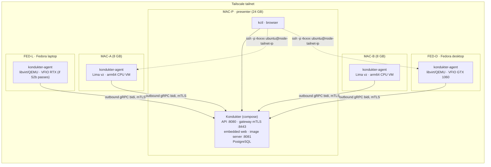

# Kondukter — Roadmap (demo scope)

> **Status:** v1 · 2026-11-08 · generated by the first planning session from [SPEC.md](SPEC.md) §21.
> **Scope:** the first external showcase. A demo, not a commercial system. Everything money-, legal- or production-hardening-related is in [§4 Later](#4-later).
> **Decisions:** every item that blocks Phases 0–4 was put to the owner on 2026-11-08 and is recorded in [docs/adr](adr/README.md). The log is in [§2](#2-decision-log).

---

## 0. How to read this

- Items follow SPEC §21.2: **Goal · Deliverables · Acceptance criteria · Depends on · Decisions required · Size**.
- **Size:** S = at most half an implementation session, M = one session. L does not exist; anything bigger was split.
- Every item leaves the repo green (`make build test lint`). Decision gates are items. Spikes are time-boxed to one session and end with a written findings file whatever the outcome.
- Status marks in headings: ☐ not started · ◐ in progress · ☑ done.
- Hardware legend used throughout:

| Tag | Machine | Role in the demo |
|---|---|---|
| **MAC-P** | Apple Silicon Mac, 24 GB | Presenter laptop. Runs the control plane (docker compose), `kctl`, the browser. |
| **MAC-A**, **MAC-B** | Apple Silicon Macs, 8 GB each | CPU-only arm64 nodes (Lima `vz`), one 2 GiB VM each. |
| **FED-D** | Remote Fedora desktop, GTX 1060 (Pascal) | GPU node: libvirt/QEMU + VFIO passthrough. Primary GPU story. |
| **FED-L** | Fedora laptop, RTX (model TBD, hybrid graphics) | GPU node if spike S2b passes, otherwise CPU-only amd64 libvirt node. |

All five machines sit on one Tailscale tailnet; the control plane is addressed by its MagicDNS name.

---

## 1. Demo target

### 1.1 What the audience sees

**Happy path.** Log in to the web app as a customer, browse offers (an arm64 CPU offer on the Macs, an NVIDIA GPU offer on the Fedora hosts), create a GPU instance with an SSH key, watch it go `PENDING → SCHEDULED → PROVISIONING → RUNNING` live, copy the SSH command, run `nvidia-smi` and a short llama.cpp prompt on the real GPU inside the VM, see usage minutes and estimated cost tick, terminate, see capacity return. The same flow from `kctl` for the terminal crowd.

**Failure path.** With a GPU instance running and an SSH session open: `kill -9` the agent on the GPU node → instance shows `UNREACHABLE` within 45 s → systemd restarts the agent → `RUNNING` again, SSH session never dropped. Then stop the control plane for two minutes: VMs keep serving, agents buffer usage, everything reconciles on restart with no duplicates. Then drain a Mac node and show placement moving to the other one.

**Partner and operator views.** Partner sees its nodes, inventory, utilization and active-instance counts, never customer data; generates an enrollment token. Operator sees the whole fleet, quarantines a node, force-terminates, reads the audit log.

### 1.2 Topology

### 1.3 Demo catalog (draft, frozen at gate P1.7)

| Shape | vCPU | RAM | Disk | Accelerators | Arch / image | Lands on |
|---|---|---|---|---|---|---|
| `cpu-2x2` | 2 | 2 GiB | 20 GiB | — | arm64 `ubuntu-cpu` | MAC-A, MAC-B |
| `cpu-2x2` | 2 | 2 GiB | 20 GiB | — | amd64 `ubuntu-cpu` | FED-L (if CPU-only), FED-D spare capacity |
| `gpu-gtx1060-1x` | 4 | 8 GiB | 40 GiB | 1× nvidia GTX 1060 | amd64 `ubuntu-gpu-pascal` | FED-D |
| `gpu-rtx-1x` (name after S2b) | 4 | 8 GiB | 40 GiB | 1× nvidia RTX | amd64 `ubuntu-gpu` | FED-L (if S2b passes) |

Region `demo`, capacity class `dedicated`, prices in EUR cents per hour, chosen for readable numbers on screen.

### 1.4 Assumptions stated by the planning session

- Go module path `github.com/St1viG/cj` (matches the git remote; rename is a one-line change).
- GTX 1060 is Pascal: the guest needs the NVIDIA **580 driver branch with closed kernel modules and CUDA 12.x** (open modules and CUDA 13 dropped Pascal). If the RTX is Blackwell it needs open modules, so two GPU image variants may be required; spikes S2b and S5 decide. The GPU demo workload is **llama.cpp built with CUDA**, which runs on both, rather than the newest PyTorch.
- 8 GB Macs host at most one 2 GiB VM each; the agent reserves 4 GiB for macOS.
- The owner designs the web UI. P5 delivers page skeletons and contents only (see the P5 preamble).

### 1.5 Explicitly out of the demo

Money (ledger, credits, payments, invoices, partner payouts), sign-up/MFA, certificate rotation and revocation, signed agent self-update, telemetry pipeline, GPU wipe/health gate, NUMA pinning and hugepages, egress controls, Ansible for partners, production host-OS choice, krunkit/Metal, preemptible capacity, stop/start, persistent volumes, HA, multi-GPU topology, overlay access mode, inference endpoints, legal documents. All listed in [§4](#4-later).

---

## 2. Decision log

Status: **Accepted** (ADR written, owner confirmed 2026-11-08) · **Proposed** (ADR written, confirmed at a gate) · **Deferred** (out of demo scope, in §4 Later) · **Open** (needed later, not yet discussed).

| ID | Question | Status | Resolution for the demo |
|---|---|---|---|
| D-01 | Product scope | Deferred | Generic resource model regardless ([ADR-0007](adr/0007-generic-resource-model.md)); positioning after the demo. |
| D-02 | Supply model | Deferred | Demo hosts are bare metal we control. |
| D-03 | Partner commercial model | Deferred | No money in the demo. |
| D-04 | Capacity classes | Accepted | Dedicated only, field kept ([ADR-0025](adr/0025-mvp-scheduling-semantics.md)). |
| D-05 | Market / differentiator | Deferred | |
| D-06 | Customer product form | Accepted | SSH Linux VM ([ADR-0015](adr/0015-ssh-vm-curated-images.md)). |
| D-07 | GPU classes | Deferred | Demo happens to use consumer GPUs (GTX 1060, laptop RTX). |
| D-08 | Pricing granularity | Partially | Per-minute rounding used for *estimated* cost ([ADR-0023](adr/0023-demo-metering-no-money.md)); prepaid deferred. |
| D-09 | Payments, invoicing, VAT | Deferred | |
| D-10 | Legal | Deferred | |
| D-11 | Stop/start | Accepted | Not supported ([ADR-0025](adr/0025-mvp-scheduling-semantics.md)). |
| D-12 | Persistent storage | Deferred | Ephemeral only. |
| D-13 | Default access mode | Accepted | port-map ([ADR-0016](adr/0016-port-map-access-mode.md)); firewalld approach fixed at P1.7. |
| D-14 | Gateway fan-out | Accepted | Single replica, in-process ([ADR-0017](adr/0017-single-replica-in-process-fanout.md)). |
| D-15 | Control-plane HA | Deferred | Single instance. |
| D-16 | Auth implementation | Accepted | Seeded accounts, cookie sessions, API keys ([ADR-0021](adr/0021-seeded-accounts-sessions-api-keys.md)). |
| D-17 | Frontend framework | Accepted | React + Vite + TS, connect-es ([ADR-0022](adr/0022-react-vite-typescript-connect-es.md)). |
| D-18 | Migration tool | Accepted | goose ([ADR-0018](adr/0018-goose-sqlc-pgx-bbolt.md)). |
| D-19 | Agent local store | Accepted | bbolt ([ADR-0018](adr/0018-goose-sqlc-pgx-bbolt.md)). |
| D-20 | libvirt Go binding | **Proposed** | Pure-Go `digitalocean/go-libvirt` ([ADR-0019](adr/0019-pure-go-libvirt-binding.md)); confirmed by spike S1 at gate P1.7. |
| D-21 | Images | Accepted | Curated only + limited user-data ([ADR-0015](adr/0015-ssh-vm-curated-images.md)). |
| D-22 | Billing authority | Partially | Kondukter `instance_events` are authoritative, agent records cross-check ([ADR-0023](adr/0023-demo-metering-no-money.md)). |
| D-23 | Lost/unreachable policy | Partially | State-machine timers per SPEC §6.3 (P3.6); refunds deferred. |
| D-24 | Agent upgrades | Deferred | Self-update not in the demo ([ADR-0024](adr/0024-mtls-node-identity-deferred-rotation.md)). |
| D-25 | Telemetry | Deferred | |
| D-26 | Wipe / GPU health gate | Deferred | Demo deletes disks; no GPU validation. |
| D-27 | Multi-tenancy per node | Accepted | Several customers per node, one tenant per GPU ([ADR-0025](adr/0025-mvp-scheduling-semantics.md)). |
| D-28 | Confidential computing | Deferred | |
| D-29 | Demo hardware | Accepted | 3 Macs + FED-D + FED-L ([ADR-0012](adr/0012-demo-fleet-real-nvidia-passthrough.md)). |
| D-30 | Demo GPU story | Accepted | Real NVIDIA passthrough ([ADR-0012](adr/0012-demo-fleet-real-nvidia-passthrough.md)). Mock driver for tests/simulator/stage fallback. |
| D-31 | Mac node mode | Accepted | CPU VM via Lima `vz`; krunkit dropped ([ADR-0012](adr/0012-demo-fleet-real-nvidia-passthrough.md)). |
| D-32 | Where Kondukter runs | Accepted | docker compose on MAC-P over Tailscale ([ADR-0014](adr/0014-control-plane-compose-on-presenter-mac.md)). |
| D-33 | macOS driver tool | Accepted | Lima ([ADR-0020](adr/0020-lima-macos-driver.md)). |
| D-34 | Linux host OS | Accepted (demo) | Fedora, because that is what the hardware runs ([ADR-0013](adr/0013-fedora-demo-host-os.md)); production OS Open. |
| D-35 | Linux GPU test hardware | Accepted | FED-D and FED-L ([ADR-0012](adr/0012-demo-fleet-real-nvidia-passthrough.md)). |
| — | Node identity | Accepted | mTLS at enrollment; rotation/revocation deferred ([ADR-0024](adr/0024-mtls-node-identity-deferred-rotation.md)). |
| — | Demo surface | Accepted | `kctl` + full web app, skeleton and contents only (P5). |

---

## 3. Phases

### P0 — Foundations

**Exit criterion:** `make gen build test lint` green locally and in GitHub Actions; repo layout per SPEC §19; ADRs merged.

#### ☑ P0.1 — Planning outputs in place
- **Goal:** Make the spec, roadmap and decisions the repo's source of truth.
- **Deliverables:** `docs/SPEC.md` (moved from the root), this file, `docs/adr/0001…0025` + `docs/adr/README.md`, `docs/spikes/README.md`, `docs/WEB_PAGES.md`, `README.md`.
- **Acceptance criteria:** Every bold-"Blocks" decision in SPEC §17 has a row in §2 with an ADR link; `grep -c '\*\*Size:\*\* L' docs/ROADMAP.md` prints `0`; relative links in `README.md` and `docs/*.md` resolve.
- **Depends on:** —
- **Decisions required:** all Phase 0–4 blockers (resolved 2026-11-08).
- **Size:** S

#### ☑ P0.2 — Toolchain and repo skeleton
- **Goal:** A buildable empty monorepo with the SPEC §19 layout and one-command tooling install.
- **Deliverables:** `go.mod` (`github.com/St1viG/cj`, Go 1.27); directories `cmd/{kondukter,kondukter-agent,kctl}`, `internal/{controlplane,agent,store,simulator}`, `proto/`, `gen/`, `web/`, `deploy/{compose,nodes,images}`, `hack/`; `Makefile` with `tools gen build test lint fmt`; `Brewfile` (buf, sqlc, goose, golangci-lint, lima, protoc-gen-go, protoc-gen-connect-go, protoc-gen-es); `.gitignore`, `.editorconfig`, `.golangci.yml`; a `main.go` per binary printing its version.
- **Acceptance criteria:** `make tools && make build` produces three binaries in `bin/`; `make test lint` pass with zero tests; `go vet ./...` clean.
- **Depends on:** P0.1
- **Decisions required:** ADR-0005
- **Size:** S
- **As built (2026-11-08):** `protoc-gen-connect-go` and `protoc-gen-es` are not Homebrew formulae, and protoc-gen-go and protoc-gen-es stamp their version into generated files. So the codegen plugins are pinned outside the Brewfile, which keeps `buf generate` byte-identical across machines and CI. `protoc-gen-go` and `protoc-gen-connect-go` are `tool` directives in `go.mod`, run as `go tool <name>`. `protoc-gen-es` is a devDependency in the root `package.json`, at `node_modules/.bin/protoc-gen-es`. P0.3 adds `protoc-gen-go-grpc` the same way. The Brewfile also lists `go`, `node` and `pnpm`, and `make tools` runs `brew bundle --no-upgrade`, then `go build tool`, then `pnpm install --frozen-lockfile`.

#### ☐ P0.3 — Protobuf contract v1 and codegen
- **Goal:** One proto source of truth generating the Go server, Go agent client and TS web client.
- **Deliverables:** `proto/kondukter/agent/v1/agent.proto` — SPEC §8.2 complete, including the messages the spec omits (`Inventory`, `Accelerator`, `Heartbeat`, `ImageRef`, `PortSpec`, `PortMapping`, `Phase`, `Ack`, `DrainRequest`, `UpgradeRequest`). `proto/kondukter/api/v1/`: `auth.proto` (Login, Logout, GetMe), `account.proto` (API keys, SSH keys), `catalog.proto`, `instance.proto` (Create, Get, List, Terminate, Watch), `usage.proto` (ListUsage), `partner.proto` (ListSites, ListNodes, CreateEnrollmentToken, DrainNode, UndrainNode, GetUtilization), `admin.proto` (ListNodes, ListInstances, QuarantineNode, ForceTerminateInstance, ListAuditLog, ListCatalog), `enrollment.proto` (Enroll: token + CSR → certificate chain). `idempotency_key` on every mutating request. `buf.yaml` (lint STANDARD, breaking FILE), `buf.gen.yaml` → `gen/go` (protoc-gen-go, protoc-gen-go-grpc for the agent stream, protoc-gen-connect-go for the API) and `gen/ts` (protoc-gen-es, connect-es).
- **Acceptance criteria:** `buf lint` clean; `buf generate` twice then `git diff --exit-code gen/` is empty; `go build ./...` compiles generated code; `buf breaking --against '.git#branch=main'` wired into `make lint`.
- **Depends on:** P0.2
- **Decisions required:** ADR-0006
- **Size:** M

#### ☐ P0.4 — Compose stack and CI
- **Goal:** Local Postgres and CI gates from day one.
- **Deliverables:** `deploy/compose/compose.yaml` with `postgres:17` (named volume, healthcheck) and a `kondukter` service built from `cmd/kondukter` (placeholder until P3); `.env.example`; `make db-up db-down db-psql`; `.github/workflows/ci.yml` running `make lint`, `buf lint`, `buf breaking`, `go test -race ./...` with a Postgres service container, and a `web` job (enabled in P5.1).
- **Acceptance criteria:** `make db-up && make db-psql` connects on the Mac; CI green on a PR; a deliberately field-renumbering proto change fails CI.
- **Depends on:** P0.3
- **Decisions required:** ADR-0009, ADR-0014
- **Size:** S

---

### P1 — Spikes

Time-boxed to one session each. Stop at the box and write `docs/spikes/S<n>-<name>.md` per the [template](spikes/README.md) whatever happened. Throwaway code lives in `hack/s<n>/` and is excluded from the build.

**Exit criterion:** findings files for S1–S5 exist with an explicit go/no-go each; gate P1.7 passed.

#### ☐ P1.1 — S1: libvirt from pure Go on Fedora
- **Goal:** Prove `digitalocean/go-libvirt` does everything the libvirt driver needs, and settle how DNAT coexists with firewalld on Fedora.
- **Deliverables:** `docs/spikes/S1-go-libvirt-fedora.md`; `hack/s1/` Go program that, on FED-D (or FED-L): connects to `qemu:///system` over the unix socket; defines a `<forward mode='open'/>` network `kdk-net` (10.77.0.0/24, dnsmasq DHCP); defines a q35 + OVMF + `host-passthrough` domain from an Ubuntu 24.04 amd64 cloud image (qcow2 overlay with backing file) plus a NoCloud ISO written with a pure-Go iso9660 library; starts it; reads the guest IP via `DomainInterfaceAddresses` (lease source); installs an nft table `inet kdk` with DNAT `tcp dport 40001 → guest:22`, forward accept for `ct status dnat`, masquerade for 10.77.0.0/24; destroys and undefines. Records SELinux denials (`ausearch -m avc -ts recent`) and the firewalld interaction.
- **Acceptance criteria:** From MAC-P, `ssh -p 40001 ubuntu@<FED-D tailnet ip>` reaches the guest. Running the program twice is idempotent (second run finds the existing domain and returns). After destroy + undefine no overlay, ISO, nft rule or lease remains. The findings file states go/no-go for ADR-0019 and picks one firewalld approach: own nft table with `kdk-br0` in the `trusted` zone · `firewall-cmd --add-forward-port` + masquerade · firewalld disabled on demo nodes.
- **Depends on:** P0.2
- **Decisions required:** D-20 (ADR-0019, Proposed), D-34 (ADR-0013)
- **Size:** M

#### ☐ P1.2 — S2a: VFIO passthrough of the GTX 1060 (FED-D)
- **Goal:** A Linux guest with working CUDA on the desktop's GPU, repeatable without host reboots.
- **Deliverables:** `docs/spikes/S2a-vfio-gtx1060-desktop.md` recording: `lspci -nnk` and IOMMU groups (`find /sys/kernel/iommu_groups/ -type l`); whether the host has an iGPU or runs headless; kernel args (`intel_iommu=on iommu=pt` or `amd_iommu=on iommu=pt`, `vfio-pci.ids=10de:xxxx,10de:yyyy` for GPU + audio function); dracut `force_drivers+=" vfio vfio_iommu_type1 vfio_pci "`, `rd.driver.pre=vfio-pci`, nouveau/nvidia blacklist; libvirt `<hostdev managed='yes'>` entries; guest Ubuntu 24.04 cloud image with `nvidia-driver-580` closed modules and the CUDA 12.x toolkit; `nvidia-smi` and a llama.cpp CUDA run (`-ngl 99`, small GGUF) inside the guest; three destroy → create → `nvidia-smi` cycles (GPU reset behavior); boot-to-`nvidia-smi` time; FED-D's RAM and CPU count for the catalog.
- **Acceptance criteria:** `nvidia-smi` in the guest shows the GTX 1060; llama.cpp reports CUDA offload and generates tokens; three consecutive destroy/create cycles succeed with no host reboot; findings list every host-side change needed (feeds P4.1).
- **Depends on:** P1.1
- **Decisions required:** D-29, D-30, D-35 (ADR-0012)
- **Size:** M

#### ☐ P1.3 — S2b: VFIO passthrough of the laptop RTX (FED-L)
- **Goal:** Decide whether the laptop is a GPU node or a CPU-only node.
- **Deliverables:** `docs/spikes/S2b-vfio-rtx-laptop.md` recording: exact RTX model and architecture (Turing / Ampere / Ada / Blackwell); iGPU present and driving the display; the dGPU's IOMMU group; vfio-pci binding at boot while the iGPU keeps the desktop; whether a ROM file (`<rom file='…'/>`) or ACPI workarounds are needed; runtime power-management side effects (dGPU in D3cold); guest driver flavor (open kernel modules for Turing and newer; mandatory for Blackwell) and CUDA version; `nvidia-smi` in the guest; one destroy / re-create cycle; the laptop's RAM and CPU count.
- **Acceptance criteria:** A written go/no-go. **Go:** `nvidia-smi` works in the guest after a host reboot with the dGPU bound to vfio-pci from boot. **No-go:** FED-L is scheduled as a CPU-only amd64 `libvirt` node and the GPU story is carried by FED-D alone. Either way the file states whether one GPU image serves both GPUs or two variants are needed (feeds P1.6).
- **Depends on:** P1.2
- **Decisions required:** D-29, D-30, D-35 (ADR-0012)
- **Size:** M

#### ☐ P1.4 — S3: Lima `vz` on an 8 GB Mac
- **Goal:** Confirm Lima can be driven non-interactively as the macOS driver within the 8 GB budget.
- **Deliverables:** `docs/spikes/S3-lima-vz-8gb-mac.md`; `hack/s3/kdk.yaml` Lima template: `vmType: vz`, arm64 Ubuntu 24.04 cloud image by URL + digest, `cpus: 2`, `memory: 2GiB`, `disk: 20GiB`, no mounts, containerd disabled, a `provision` script (mode `system`) appending a customer public key to the `ubuntu` user's `authorized_keys`, `portForwards: [{guestPort: 22, hostPort: 40001, hostIP: "0.0.0.0"}]`. Commands exercised on MAC-A: `limactl create --name kdk-test --tty=false`, `limactl start`, `limactl list --json`, `limactl stop`, `limactl delete --force`.
- **Acceptance criteria:** From MAC-P, `ssh -p 40001 ubuntu@<MAC-A tailnet ip>` works with the customer key; the findings list the `limactl list --json` fields used to derive `Observed` (status, name, ports); cold (image download) and cached create-to-SSH times recorded; `kill -9` of the Lima hostagent then `limactl start` recovers the same VM, or the findings say what breaks; memory pressure with one 2 GiB VM on 8 GB judged acceptable.
- **Depends on:** P0.2
- **Decisions required:** D-31, D-33 (ADR-0012, ADR-0020)
- **Size:** S

#### ☐ P1.5 — S4: gRPC bidi stream with mTLS through Tailscale
- **Goal:** Remove any doubt about the transport before the agent is built.
- **Deliverables:** `docs/spikes/S4-grpc-mtls-tailscale.md`; `hack/s4/`: a self-signed CA, a server cert (SANs: MagicDNS name and tailnet IP), a client cert; a stub gateway in compose on MAC-P accepting `Connect` streams and echoing; a stub agent on FED-D that dials over the tailnet, sends a Hello every 10 s and logs acks; gRPC keepalive 20 s with `PermitWithoutStream`; reconnect with exponential backoff and full jitter capped at 60 s.
- **Acceptance criteria:** Stream stays up 30 minutes idle. `tailscale down` on FED-D for two minutes then `tailscale up` → reconnected within the backoff cap. `docker compose restart` of the stub → agent reconnects. `nc -z <MAC-P tailnet ip> 8443` from FED-D succeeds (Docker Desktop publishes on the tailnet interface). Findings note anything about HTTP/2 through Docker Desktop's port proxy.
- **Depends on:** P0.4
- **Decisions required:** ADR-0001, ADR-0014, ADR-0024
- **Size:** S

#### ☐ P1.6 — S5: GPU guest image build
- **Goal:** A pre-baked qcow2 that boots to a working `nvidia-smi` in under two minutes on the demo GPUs.
- **Deliverables:** `docs/spikes/S5-gpu-guest-image.md`; `deploy/images/ubuntu-gpu/build.sh` using `virt-customize` (libguestfs) on a Fedora host: Ubuntu 24.04 cloud image → NVIDIA driver + CUDA toolkit + Docker + NVIDIA Container Toolkit + a prebuilt llama.cpp CUDA binary + one small GGUF model → `virt-sysprep`. One variant if S2b showed a single driver branch serves both GPUs, otherwise `ubuntu-gpu-pascal` (580 closed modules, CUDA 12.x) and `ubuntu-gpu` (open modules, current CUDA). Outputs `*.qcow2`, `*.sha256`, `manifest.json` (name, version, arch, `accel_stack`, compatible GPU models). `deploy/images/COMPAT.md` — the driver ↔ GPU compatibility matrix.
- **Acceptance criteria:** A VM from the image on FED-D passes `nvidia-smi` within 120 s of `virsh start` with the image cached (measured); image size recorded; the build script is re-runnable with driver and CUDA versions pinned in variables.
- **Depends on:** P1.2, P1.3
- **Decisions required:** D-21 (ADR-0015), ADR-0012
- **Size:** M

#### ☐ P1.7 — Decision gate: hardware roles, images, networking, libvirt binding
- **Goal:** Freeze what P2–P4 build against.
- **Deliverables:** ADR-0012 updated with each host's role, exact GPU models, RAM and CPU; ADR-0019 set to Accepted, or replaced by a cgo-binding ADR; ADR-0016 amended with the firewalld approach from S1; ADR-0015 amended with the image variant list; §1.3 of this file finalized; items P2.5, P2.7, P3.4, P4.1 edited to match.
- **Acceptance criteria:** No item in P2–P4 references an open question; §1.3 lists at least `cpu-2x2` (arm64 and amd64) and one GPU shape per GPU node.
- **Depends on:** P1.1–P1.6
- **Decisions required:** D-20, D-29, D-30, D-31, D-34, D-35
- **Size:** S

---

### P2 — Agent v0

**Exit criterion:** `kondukter-agent` converges to a hand-written desired state served by the stub gateway with the `mock`, `lima` and `libvirt` drivers; survives `kill -9` at any point and stream drops without leaking or double-creating VMs; `go test -race ./internal/agent/...` green.

#### ☐ P2.1 — Agent skeleton, config, local store, driver interface
- **Goal:** The agent process shape with crash-safe local state.
- **Deliverables:** `cmd/kondukter-agent` (cobra: `run`, `enroll`, `version`); config file (`/etc/kondukter-agent/config.yaml`, macOS `/Library/Application Support/kondukter-agent/config.yaml`) with server URL, driver, data dir, reserved CPU/RAM, port range, advertise address, labels, `max_instances`; `log/slog` JSON; `internal/agent/store` on bbolt with buckets `meta` (node id, applied generation, last snapshot), `outbox` (seq → serialized `AgentMessage`), `ports` (host port → instance id), `identity` (key, cert, CA); `internal/agent/driver` with the SPEC §7.3 interface and shared types; a `mock` driver stub reporting configured inventory (full behavior in P2.3).
- **Acceptance criteria:** `kondukter-agent run --config …` starts, logs mock inventory, exits cleanly on SIGTERM. Store tests: outbox write/read/prune, seq monotonic across reopen, snapshot round-trip. A reopen after `kill -9` during writes yields a consistent store.
- **Depends on:** P0.3, P1.7
- **Decisions required:** ADR-0018
- **Size:** S

#### ☐ P2.2 — Stub gateway and stream client
- **Goal:** A working outbound stream with Hello/resync, heartbeats, acks and reconnect, testable without the control plane.
- **Deliverables:** `internal/simulator/stubgw`: an `AgentGateway` server that loads a per-node desired-state YAML, serves it on Hello and on file change (fsnotify), acks every message, logs statuses; `cmd/kdk-stubgw` (dev tool). `internal/agent/stream`: dial with mTLS using the stored identity (a `--insecure-dev` flag allows plain TLS against the stub); send `Hello` (protocol version, agent version, driver, `last_applied_generation`, observed instances); heartbeat every 10 s; drain the outbox in seq order; prune on cumulative `Ack`; backoff 1 s → 60 s with full jitter; protocol-version mismatch → log and retry slowly.
- **Acceptance criteria:** In-process integration test: Hello → `DesiredState` received. Stub stopped for 20 s → agent reconnects and re-sends un-acked outbox entries exactly once each (asserted by seq). Heartbeats observed at 10 s ± 1 s.
- **Depends on:** P2.1
- **Decisions required:** ADR-0001, ADR-0002
- **Size:** M

#### ☐ P2.3 — Mock driver and reconcile loop
- **Goal:** The core convergence logic, proven with the mock driver.
- **Deliverables:** `internal/agent/driver/mock`: instances with configurable provision delay and failure rate, mock accelerators from config, state persisted under the data dir so `List()` survives restart. `internal/agent/reconcile`: triggers (new snapshot, 30 s tick, driver events); snapshots with generation lower than applied are ignored; for each desired instance `Ensure` then report `InstanceStatus`; for each owned instance absent from a fresh snapshot `Delete` then report; the applied generation is recorded only after every desired instance has been attempted; fail-static when no snapshot has ever been received. `InstanceStatus` carries `applied_generation`.
- **Acceptance criteria:** Table-driven tests: add / remove / replace instances across generations; out-of-order snapshot ignored; duplicate snapshot is a no-op; `Ensure` failure → `failed` status with reason, retried on the next tick; no snapshot → nothing deleted; `-race` clean. End-to-end with the stub: editing the desired-state file creates or deletes mock instances within 2 s.
- **Depends on:** P2.2
- **Decisions required:** ADR-0002
- **Size:** M

#### ☐ P2.4 — Inventory
- **Goal:** Accurate host resources and accelerators from both platforms.
- **Deliverables:** `internal/agent/inventory`: Linux — online CPUs, `/proc/meminfo`, statfs of the data dir, arch, OS release; accelerators from `/sys/bus/pci/devices/*` with vendor `0x10de` and class `0x03xx`: PCI address, device id → model via a small table in `nvidia_ids.go` (demo GPUs plus common datacenter parts), NUMA node, IOMMU group, bound driver; only devices bound to `vfio-pci` report `health: ok`, others `health: unavailable` with the reason. macOS — `sysctl hw.ncpu hw.memsize`, disk free, arch `arm64`, no accelerators. Reserved CPU/RAM from config subtracted into `allocatable`. Reported at Hello, every 5 minutes, and whenever a diff is detected.
- **Acceptance criteria:** Unit tests over fixture sysfs trees (GTX 1060 bound to vfio-pci → ok; RTX bound to nvidia → unavailable). On FED-D the reported accelerator matches S2a. On MAC-A: 8 vCPU, ~8 GiB total, arm64, no accelerators.
- **Depends on:** P2.1
- **Decisions required:** ADR-0007, ADR-0012
- **Size:** S

#### ☐ P2.5 — libvirt driver
- **Goal:** Real VMs on Fedora through pure Go, idempotent, with optional GPU passthrough.
- **Deliverables:** `internal/agent/driver/libvirt`: socket connection with reconnect; `templates/domain.xml.tmpl` (q35, OVMF with per-VM NVRAM, `host-passthrough`, vCPU/RAM from spec, virtio-blk overlay with `discard='unmap'`, virtio-net on `kdk-net`, NoCloud ISO as CD-ROM, serial console only, no graphics/USB/sound, `<metadata>` with a `kondukter` namespace carrying instance id and generation, one `<hostdev managed='yes'>` per accelerator PCI address); image cache at `<data>/images/<name>-<version>.qcow2` (fetch by URL, verify sha256, atomic rename); per-instance overlay via `qemu-img create -f qcow2 -b … -F qcow2`; NoCloud ISO (meta-data with instance id and hostname, user-data with `ssh_authorized_keys` plus optional customer user-data merged under a 16 KiB cap); `Ensure` = running? else defined? start : define + start; `Delete` = destroy, undefine with NVRAM, remove overlay and ISO; `List` = domains carrying the kondukter metadata and the `kdk-` prefix only; guest IP from the lease table; driver events from libvirt lifecycle events.
- **Acceptance criteria:** Integration test on FED-D (build tag `libvirt`): `Ensure` twice returns the same running instance; `Delete` twice succeeds; after `Delete` no domain, overlay, ISO or NVRAM file remains; with the GTX 1060's PCI address in `AcceleratorIDs` and the S5 image, `nvidia-smi` works in the guest; a hand-made non-kondukter domain on the host is never listed or touched.
- **Depends on:** P2.3, P1.7
- **Decisions required:** ADR-0003, ADR-0019, ADR-0015
- **Size:** M

#### ☐ P2.6 — Lima driver
- **Goal:** Real arm64 VMs on the Macs via `limactl`.
- **Deliverables:** `internal/agent/driver/lima`: template rendering from `InstanceSpec` (vz, cpus, memory, disk, image URL + digest from `ImageRef`, provision script injecting SSH keys and optional user-data, `portForwards` from the access module, name `kdk-<id>`); `limactl create --tty=false`, `start`, `stop`, `delete --force`, `list --json`; ownership = name prefix plus a marker file in the instance directory; Lima status → `Observed` phase mapping; one `limactl` mutation at a time per host.
- **Acceptance criteria:** Integration test on MAC-A (build tag `lima`): `Ensure` twice idempotent; `Delete` twice idempotent; SSH from MAC-P through the forwarded port with the spec's key; a manually created non-`kdk-` Lima VM is never listed or touched; cached-image create-to-SSH time recorded (target ≤ 90 s).
- **Depends on:** P2.3, P1.4
- **Decisions required:** ADR-0011, ADR-0020
- **Size:** M

#### ☐ P2.7 — Access module (port-map)
- **Goal:** Customers reach their VM on `node-address:port`.
- **Deliverables:** `internal/agent/access`: port allocator over the configured range (default 40000–49999) persisted in the store; port 22 always mapped plus declared `PortSpec`s. Linux backend renders `/run/kondukter-agent/kdk.nft` and applies it with `nft -f`: table `inet kdk` with a prerouting DNAT rule per mapping, a forward chain accepting `ct status dnat` and established traffic, masquerade for the `kdk-net` subnet, drop guest → RFC 1918 and `169.254.0.0/16` except the bridge gateway and DNS (per-tap anti-spoofing is Later); the firewalld arrangement from P1.7. macOS backend hands mappings to the Lima driver (`portForwards`). On startup the full ruleset is re-applied from the store (idempotent); `Delete` releases ports. `PortMapping`s (host address = the configured advertise address, the tailnet IP in the demo) are included in `InstanceStatus`.
- **Acceptance criteria:** Unit tests for allocator persistence and ruleset rendering (golden files). On FED-D two instances get distinct ports and both are reachable from MAC-P; from inside a guest, `nc -zw2 192.168.1.1 22` and `nc -zw2 10.0.0.1 22` fail while `curl https://deb.debian.org` succeeds; after an agent restart `nft list table inet kdk` is unchanged. On MAC-A the forwarded port works.
- **Depends on:** P2.5, P2.6
- **Decisions required:** ADR-0016
- **Size:** M

#### ☐ P2.8 — Metering outbox and crash safety
- **Goal:** Usage is never lost or double-counted, and a crash never leaks or duplicates a VM.
- **Deliverables:** `internal/agent/metering`: every 60 s, for each running instance, append `UsageRecord(instance_id, period_start, period_end, running_seconds)` to the outbox with periods aligned to the minute (idempotent key `(instance_id, period_start)`); outbox size cap with a warning before oldest-first eviction. `internal/agent/chaos_test.go`: runs the agent as a subprocess against the stub, `SIGKILL`s it at randomized points (before/after `Ensure`, before ack, during port apply), restarts it, and asserts via `driver.List()` that exactly the desired instances exist and each usage period arrived once.
- **Acceptance criteria:** Chaos test passes 20 iterations with the mock driver under `-race`. Manual run on MAC-A with Lima: `kill -9` mid-provision → restart → one VM, no orphan Lima instance. Stub log shows each `(instance_id, period_start)` exactly once.
- **Depends on:** P2.7
- **Decisions required:** ADR-0002, ADR-0023
- **Size:** M

#### ☐ P2.9 — Agent packaging
- **Goal:** Installable agent on Fedora and macOS.
- **Deliverables:** `make agent-dist` cross-compiling with `CGO_ENABLED=0` for `linux/amd64` and `darwin/arm64`, version from `git describe`; `deploy/nodes/fedora/kondukter-agent.service` (`Restart=always`, `After=libvirtd.service`, root, `StateDirectory=kondukter-agent`); `deploy/nodes/macos/io.kondukter.agent.plist` (LaunchDaemon, `KeepAlive`, log paths); `deploy/nodes/install-agent.sh` (copy binary, write config template, enable service).
- **Acceptance criteria:** `systemctl is-active kondukter-agent` → `active` on FED-D after install; `launchctl print system/io.kondukter.agent` shows it running on MAC-A; `kondukter-agent version` prints the git version; `file bin/kondukter-agent-linux-amd64` reports a statically linked binary.
- **Depends on:** P2.8
- **Decisions required:** ADR-0005, ADR-0019
- **Size:** S

---

### P3 — Kondukter v0

**Exit criterion:** `kctl create` and `kctl terminate` work against the fleet simulator; the concurrency test proves no over-allocation; `UNREACHABLE → RUNNING` recovery works; usage and estimated cost are visible in `kctl`; `go test -race ./...` green with Postgres in CI.

#### ☐ P3.1 — Schema, migrations, store layer
- **Goal:** The SPEC §6.2 data model as the single source of truth.
- **Deliverables:** goose migrations in `internal/store/migrations/` creating `partners, sites, nodes, node_capacity, accelerators, images, shapes, offers, orgs, users, memberships, api_keys, ssh_keys, sessions, instances, allocations, instance_events, usage_records, enrollment_tokens, audit_log` (no `ledger_entries`); the partial unique index `one_active_lease_per_accelerator`; `instances.phase` as a Postgres enum; `sqlc.yaml` with queries per module in `internal/store/queries/*.sql`; `internal/store` with a pgx pool, a `WithTx` helper and the generated code; `make migrate-up migrate-down sqlc`.
- **Acceptance criteria:** `make migrate-up` against the compose Postgres; `make sqlc` then `git diff --exit-code` empty; store tests: a second active allocation for the same accelerator fails with a unique violation; migrations down then up round-trip cleanly.
- **Depends on:** P0.4
- **Decisions required:** ADR-0009, ADR-0018
- **Size:** M

#### ☐ P3.2 — Node identity: CA, enrollment, mTLS gateway listener
- **Goal:** Nodes are known only by the certificate they received at enrollment.
- **Deliverables:** `internal/controlplane/pki`: internal CA generated at first start (key encrypted with `KONDUKTER_MASTER_KEY` and stored in Postgres), 30-day node certificates with SAN URI `kondukter://node/<uuid>`. `EnrollmentService.Enroll` on the API port: validates a one-time token (hashed at rest, 1 h TTL), creates the `nodes` row in `ENROLLING`, signs the CSR, returns certificate and CA. `PartnerService.CreateEnrollmentToken`. Gateway listener on a second port with `RequireAndVerifyClientCert` against the CA; an interceptor extracts the node id from the SAN and rejects any message whose body claims another node. `kondukter-agent enroll --server … --token …` stores key, cert and CA and writes the gateway address to config.
- **Acceptance criteria:** End-to-end test: token → `agent enroll` → node row `ENROLLING` with the certificate fingerprint; reusing the token fails; a client certificate from another CA is rejected at the TLS layer; a Hello for node B over node A's certificate is rejected (interceptor unit test).
- **Depends on:** P3.1, P2.1
- **Decisions required:** ADR-0024
- **Size:** M

#### ☐ P3.3 — Agent gateway
- **Goal:** The server side of the SPEC §8 protocol.
- **Deliverables:** `internal/controlplane/gateway`: `Connect` handler with a registry of live streams by node id (a second stream for the same node closes the first); Hello → node `READY` (from `ENROLLING` or `UNREACHABLE`), `agent_version` stored, `last_applied_generation` compared with `desired_generation`, current snapshot always sent; snapshot builder (all non-terminal instances with `node_id = N`, specs from `instances.spec`, image refs with URL and digest, port specs); idempotent ingest — `Inventory` upserts `node_capacity` and `accelerators` (an accelerator with an active allocation is never deleted, only marked `missing`), `Heartbeat` updates `last_seen_at` and `observed_generation`, `InstanceStatus` updates `instances.connection` and drives the controller's transitions only when `applied_generation` is at least the placing generation, `UsageBatch` → `INSERT … ON CONFLICT DO NOTHING`; cumulative `Ack(seq)` sent after the enclosing transaction commits; `Notifier` interface with an in-process implementation (`NodeChanged(nodeID)` rebuilds and pushes the snapshot if the node is connected).
- **Acceptance criteria:** Integration test with the real agent (mock driver) against gateway + Postgres: enroll → connect → Hello → snapshot delivered; an instance inserted for that node plus `NodeChanged` → the agent creates it → `RUNNING` stored; a duplicated `UsageBatch` yields one row; replaying the agent's outbox after a forced reconnect creates no duplicates; `observed_generation` follows heartbeats.
- **Depends on:** P3.2, P2.3
- **Decisions required:** ADR-0001, ADR-0002, ADR-0017
- **Size:** M

#### ☐ P3.4 — Node lifecycle and demo catalog
- **Goal:** Node states the scheduler can trust, and something to schedule.
- **Deliverables:** `internal/controlplane/controller/node.go`: heartbeat watchdog every 10 s (`READY` nodes with `last_seen_at` older than three intervals plus 5 s → `UNREACHABLE`, and their non-terminal instances → `UNREACHABLE` through the instance controller); `DRAINING`, `MAINTENANCE`, `QUARANTINED`, `RETIRED` transitions as store functions used by the Partner and Admin services. `kondukter seed catalog`: region `demo`; shapes and offers from §1.3 (prices in EUR cents per hour); images `ubuntu-cpu` (amd64 and arm64 URLs + digests) and the GPU image variant(s) from S5 with `accel_stack` and compatible GPU models.
- **Acceptance criteria:** Unit test with an injectable clock: a silent node is `UNREACHABLE` within 45 s and `READY` again on the next Hello. `seed catalog` is idempotent. After P3.7, `ListOffers` returns the seeded offers.
- **Depends on:** P3.3
- **Decisions required:** ADR-0025, ADR-0012, ADR-0015
- **Size:** S

#### ☐ P3.5 — Scheduler
- **Goal:** Correct placement under concurrency.
- **Deliverables:** `internal/controlplane/scheduler`: **filter** (node `READY`; region and capacity class match the offer; node arch matches the image; driver supports the accelerator kind; free vCPU/RAM/disk ≥ shape where free = total − reserved − Σ active allocations; ≥ N healthy unallocated accelerators of the requested model; image `accel_stack` compatible with the accelerator model); **score** (fewest remaining free accelerators that still fit, then image already cached on the node per inventory, then round-robin across partners); **commit** in one transaction (`SELECT … FOR UPDATE` on the node row, recompute free from `allocations`, insert allocations with concrete `accelerator_id`s, set `instances.node_id` and phase `SCHEDULED`, bump `nodes.desired_generation`), retrying the next candidate on unique violation or capacity race; invoked by the controller for `PENDING` instances; emits `NodeChanged`.
- **Acceptance criteria:** Table-driven filter and score tests. Concurrency test against Postgres: 50 goroutines create GPU instances against three simulated nodes with one GPU each → exactly three `SCHEDULED`, the rest `PENDING` then `FAILED(no_capacity)`, and `SELECT accelerator_id FROM allocations WHERE released_at IS NULL GROUP BY 1 HAVING count(*) > 1` is empty; repeated 20× under `-race`. An arm64 image never lands on an amd64 node and vice versa.
- **Depends on:** P3.4
- **Decisions required:** ADR-0007, ADR-0009, ADR-0025
- **Size:** M

#### ☐ P3.6 — Instance controller
- **Goal:** The SPEC §6.3 state machine with timers and events.
- **Deliverables:** `internal/controlplane/controller/instance.go`: transitions as a table-driven pure function `(phase, event) → phase`; every transition appends to `instance_events` in the same transaction; a 5 s sweep applies timers — `PENDING` > 60 s → `FAILED(no_capacity)`; `SCHEDULED`/`PROVISIONING` > 10 min → `FAILED(provision_timeout)` with allocations released and the node generation bumped so the agent deletes; `UNREACHABLE` > 15 min → `LOST` with allocations released. Terminate: `RUNNING → TERMINATING` marks the instance undesired and bumps the generation (snapshot omits it); the agent's deletion report → `TERMINATED` and allocations released. Node `UNREACHABLE` → its instances `UNREACHABLE`; a Hello still observing the instance running → `RUNNING`. `connection` jsonb filled from `PortMapping`s on `RUNNING`.
- **Acceptance criteria:** Transition tests cover every edge in SPEC §6.3 and reject every other pair. Integration with gateway and agent (mock driver with configurable delay): create → `RUNNING` in under 5 s; terminate → `TERMINATED` with `allocations.released_at` set; agent stopped → `UNREACHABLE` within 45 s → agent started → `RUNNING`; mock provisioning failure → `FAILED` carrying the driver's reason; timers tested with an injectable clock.
- **Depends on:** P3.5
- **Decisions required:** ADR-0002, ADR-0025, D-23 (timers only)
- **Size:** M

#### ☐ P3.7 — Public API core and API-key auth
- **Goal:** Customers can do everything the demo needs over Connect.
- **Deliverables:** `internal/controlplane/api`: `CatalogService` (ListOffers with filters, ListImages, ListRegions); `InstanceService` (CreateInstance validating offer/image arch and accelerator compatibility, SSH keys, ports, user-data ≤ 16 KiB, with idempotency key → same instance; GetInstance; ListInstances; TerminateInstance; WatchInstance server stream fed by an in-process event bus); `AccountService` (GetMe, Create/List/RevokeAPIKey, Add/List/DeleteSSHKey). Auth interceptor: `Authorization: Bearer kdk_…` → hashed lookup in `api_keys` → org and role; org scoping on every query; idempotency keys stored per org with a 24 h TTL. JSON and gRPC served on the same API port.
- **Acceptance criteria:** `hack/api-smoke.sh` (`buf curl`): list offers → create → watch to `RUNNING` on the simulator → terminate. A repeated `CreateInstance` with the same idempotency key returns the same id. Org B gets `NotFound` for org A's instance. A bad API key gets `Unauthenticated`. Handler tests run against the store.
- **Depends on:** P3.6
- **Decisions required:** ADR-0006, ADR-0021
- **Size:** M

#### ☐ P3.8 — Partner and Admin services, seeded accounts, sessions, audit log
- **Goal:** The partner and operator sides of the demo, and a way to log in from a browser.
- **Deliverables:** `PartnerService` (ListSites; ListNodes with inventory, health, utilization and active-instance count, never customer data; CreateEnrollmentToken; DrainNode; UndrainNode; GetUtilization). `AdminService` (ListNodes, ListInstances across orgs, QuarantineNode, ForceTerminateInstance, ListAuditLog, ListCatalog). `AuthService` (Login with email and password → `HttpOnly` cookie session, Logout, GetMe) backed by `sessions`. `kondukter seed accounts`: partner `demo-dc` with site `demo`; customer org `acme`; users `customer@demo.local`, `partner@demo.local`, `operator@demo.local` with passwords from `SEED_PASSWORD`; one API key per user printed once. An `audit_log` row for every Partner and Admin mutation and for TerminateInstance. Role checks (customer / partner of the site / operator) in the interceptor.
- **Acceptance criteria:** Handler tests: a partner user sees only its site's nodes and no instance owner data; a customer calling Admin RPCs gets `PermissionDenied`; every Admin mutation leaves an audit row with actor and target; `seed accounts` is idempotent; Login sets a cookie that GetMe accepts.
- **Depends on:** P3.7
- **Decisions required:** ADR-0021
- **Size:** M

#### ☐ P3.9 — `kctl` CLI
- **Goal:** The demo driver and the first client of the API.
- **Deliverables:** `cmd/kctl` (cobra, generated Connect client): `login` (API key → `~/.config/kctl/config.yaml`, `--server`), `offers [--accel nvidia] [--arch arm64] …`, `images`, `create --offer … --image … --ssh-key … [--port 8080] [--user-data file]`, `get <id>` (phase, node, connection, running minutes, estimated cost), `list`, `watch <id>` (streams phase changes until terminal or `RUNNING`), `terminate <id>`, `ssh <id>` (prints, or with `--exec` runs, `ssh -p <port> ubuntu@<host>`), `nodes` (partner/operator), `enroll-token --site demo`, `usage [--instance id]`; `--output json` everywhere.
- **Acceptance criteria:** `hack/kctl-smoke.sh` against the simulator: create → watch → `RUNNING` → `ssh` prints a valid command → terminate → `TERMINATED`. `--output json` parses with `jq`. API errors print as one line with the Connect code.
- **Depends on:** P3.8
- **Decisions required:** ADR-0005
- **Size:** S

#### ☐ P3.10 — Fleet simulator and chaos tests
- **Goal:** Confidence in the control loop at scale and under faults before touching hardware.
- **Deliverables:** `internal/simulator`: N in-process agents (mock driver, temp data dirs) enrolled against a real Kondukter and Postgres, each with configurable inventory (e.g. 20 CPU nodes and 5 GPU nodes); fault hooks in the stream layer (drop, duplicate, delay, reorder); kill and restart an agent; stop and start Kondukter; `cmd/kdk-sim` for manual runs. Chaos tests asserting convergence: every desired instance ends `RUNNING` on exactly one node; no allocation without an instance; no non-terminal instance without allocations; `desired_generation == observed_generation` on every connected node within 30 s of quiescence.
- **Acceptance criteria:** `go test -race -run Chaos ./internal/simulator/...` passes with 100 agents and 200 create/terminate operations under 10 % drop plus duplication; an agent killed mid-provision ends with one `RUNNING` VM; a Kondukter restart mid-run reconnects all streams within 60 s with the invariants holding; a reconnect storm of 100 agents produces no errors.
- **Depends on:** P3.9
- **Decisions required:** ADR-0002, ADR-0009
- **Size:** M

#### ☐ P3.11 — Usage and estimated cost
- **Goal:** "Usage accrues" is visible and explainable.
- **Deliverables:** `internal/controlplane/usage`: running time per instance = sum of `RUNNING → (TERMINATING | UNREACHABLE | LOST)` intervals from `instance_events`, open interval closed at `now()`; cross-check against the sum of agent `usage_records.running_seconds`, logging discrepancies over two minutes; estimated cost = `ceil(minutes) × price_per_hour_minor / 60` in the offer's currency; `UsageService.ListUsage` (per org, optional instance and period filters) and the fields `running_minutes`, `estimated_cost_minor`, `currency` on `GetInstance`; shown by `kctl get` and `kctl usage`.
- **Acceptance criteria:** Unit tests with synthetic events (including an `UNREACHABLE` gap and recovery) match expected minutes; on the simulator, after three minutes `RUNNING`, `kctl get` shows 3–4 minutes and the matching cost; the agent cross-check equals the event figure within one minute.
- **Depends on:** P3.10
- **Decisions required:** ADR-0023
- **Size:** S

---

### P4 — Real fleet end-to-end (CLI)

**Exit criterion:** SPEC §3.2 happy path and failure path pass on MAC-A, MAC-B, FED-D and FED-L driven by `kctl`, three times in a row from `make demo-reset`.

#### ☐ P4.1 — Fedora GPU node bootstrap
- **Goal:** Turn a fresh Fedora host into a node with one idempotent script.
- **Deliverables:** `deploy/nodes/fedora/bootstrap.sh` with `README.md` and a per-host `host.env` (vfio ids, images to pre-pull, advertise address, reserved resources): installs `qemu-kvm libvirt edk2-ovmf nftables`, enables `libvirtd`; sets kernel args (IOMMU on, `iommu=pt`, `vfio-pci.ids=…`), dracut config forcing `vfio vfio_iommu_type1 vfio_pci` early with `rd.driver.pre=vfio-pci`, blacklists `nouveau` and `nvidia` on passthrough hosts, regenerates the initramfs; defines `kdk-net` (open mode, autostart); applies the firewalld arrangement decided at P1.7; creates `/var/lib/kondukter-agent/images` and pre-pulls listed images with sha256 verification; installs the agent (P2.9) with config (driver `libvirt`, reserved 2 vCPU and 2 GiB); prints the `enroll` command. A `--check` mode prints IOMMU groups, vfio bindings, libvirt and agent status without changing anything.
- **Acceptance criteria:** On FED-D and FED-L (per their P1.7 roles): after reboot `bootstrap.sh --check` is all green; `kondukter-agent` active; a second run changes nothing; the host desktop, where present, still works on the iGPU.
- **Depends on:** P2.9, P1.7
- **Decisions required:** ADR-0012, ADR-0013, ADR-0016
- **Size:** M

#### ☐ P4.2 — Mac node bootstrap
- **Goal:** A Mac becomes a node in five minutes.
- **Deliverables:** `deploy/nodes/macos/bootstrap.sh`: `brew install lima` pinned to at least the S3 version; agent binary and LaunchDaemon (P2.9); config (driver `lima`, advertise address = tailnet IP, `max_instances: 1`, reserved 4 GiB on 8 GB hosts); warms the Lima image cache with one `limactl create` + `delete` of the demo image; `demo-sleep.sh on|off` wrapping `sudo pmset -a disablesleep 1|0`; checks `tailscale status` and that the gateway MagicDNS name resolves.
- **Acceptance criteria:** On MAC-A and MAC-B: agent running, enrollment succeeds, inventory shows arm64, no accelerators and the expected allocatable RAM; with `demo-sleep.sh on` and the lid closed for five minutes the agent stays connected.
- **Depends on:** P2.9
- **Decisions required:** ADR-0011, ADR-0020
- **Size:** S

#### ☐ P4.3 — Demo deployment of the control plane
- **Goal:** The compose stack on MAC-P, reachable by every node over the tailnet.
- **Deliverables:** `deploy/compose/compose.yaml` extended: `kondukter` (API `:8080` plain HTTP on the tailnet, gateway `:8443` mTLS, `KONDUKTER_PUBLIC_URL=http://<magicdns>:8080`), `images` (static file server for `deploy/images/dist/*.qcow2|*.img|*.sha256` on `:8081`), Postgres with a named volume; gateway server certificate with SANs for the MagicDNS name and tailnet IP; `make demo-up` (compose up, migrate, seed catalog and accounts, print API keys and the enroll-token command); `make demo-reset` (terminate all instances through the API, wait for `TERMINATED`, truncate instance tables, keep nodes, identities and catalog); `make demo-down`.
- **Acceptance criteria:** From FED-D, `curl http://<magicdns>:8080/healthz` and `nc -z <magicdns> 8443` succeed; `make demo-up` from an empty volume finishes in under two minutes; `make demo-reset` leaves all nodes `READY` and zero instances.
- **Depends on:** P3.11, P1.5
- **Decisions required:** ADR-0014
- **Size:** S

#### ☐ P4.4 — Enroll the fleet
- **Goal:** All four nodes `READY` with correct inventory.
- **Deliverables:** One token per node from `kctl enroll-token --site demo`; `kondukter-agent enroll` run on MAC-A, MAC-B, FED-D, FED-L; `docs/DEMO_FLEET.md` recording per node: hostname, tailnet IP, role, inventory as reported, cached images.
- **Acceptance criteria:** `kctl nodes` lists four `READY` nodes; FED-D reports one `nvidia` accelerator model GTX 1060 with `health: ok`; FED-L reports its RTX, or none if CPU-only per P1.7; the Macs report arm64 and no accelerators; inventories show the pre-pulled image digests.
- **Depends on:** P4.1, P4.2, P4.3
- **Decisions required:** ADR-0012
- **Size:** S

#### ☐ P4.5 — Happy path on hardware
- **Goal:** The showcase's main storyline works end-to-end on real machines.
- **Deliverables:** `hack/demo-happy.sh` using `kctl`: create `cpu-2x2` arm64 → lands on a Mac → `kctl ssh --exec … uname -m` prints `aarch64`; create the GPU offer → lands on FED-D → `nvidia-smi` and a short llama.cpp prompt with `-ngl 99` over SSH; `kctl get` shows minutes and cost growing; terminate both → `TERMINATED` and `kctl nodes` shows capacity back; a timing log per node type.
- **Acceptance criteria:** The script passes three times in a row after `make demo-reset`; with cached images, create → `RUNNING` ≤ 90 s on the Macs and ≤ 120 s on FED-D; afterwards `virsh list --all`, `limactl list`, the overlay directories and `nft list table inet kdk` show nothing left; the GPU provisions successfully on the third run.
- **Depends on:** P4.4
- **Decisions required:** ADR-0012, ADR-0016
- **Size:** M

#### ☐ P4.6 — Failure path on hardware
- **Goal:** The resilience story is real, not slides.
- **Deliverables:** `hack/demo-failure.sh` plus the drill text that P6.1 folds into `docs/DEMO.md`. **Drill 1:** with a GPU instance `RUNNING` and an SSH session open, `sudo kill -9 $(pidof kondukter-agent)` on FED-D → `kctl watch` shows `UNREACHABLE` within 45 s → systemd restarts the agent → `RUNNING` again, the SSH session never dropped. **Drill 2:** `docker compose stop kondukter` for two minutes → VMs keep serving SSH, agents log buffered usage → `docker compose start kondukter` → nodes `READY`, no duplicate VMs, usage minutes continuous. **Drill 3:** `kctl drain <mac-node>` → a new `cpu-2x2` lands on the other Mac; undrain.
- **Acceptance criteria:** All three drills pass on the real fleet twice; `instance_events` shows `RUNNING → UNREACHABLE → RUNNING` for drill 1 and no spurious transitions for drill 2; usage after drill 2 matches wall-clock running time within one minute.
- **Depends on:** P4.5
- **Decisions required:** ADR-0002, ADR-0010
- **Size:** M

---

### P5 — Web app skeleton

> **Owner constraint: no visual design work in this roadmap.** The owner designs the UI. P5 delivers the **skeleton** (routing, auth, data hooks, generated client, embedding) and the **contents of each page**: which data is shown, which actions exist, which RPCs back them, and loading / empty / error states. Markup is plain and unstyled: no component library, no theme, no layout polish, no CSS beyond a reset. Each page is described in [docs/WEB_PAGES.md](WEB_PAGES.md) (route → role → data → actions → RPCs), which is the hand-off point for the design pass.

**Exit criterion:** every in-scope §4 customer, partner and operator flow works in the browser against the real fleet with live updates; `docs/WEB_PAGES.md` matches what the pages render; `pnpm typecheck` clean.

#### ☐ P5.1 — Web scaffold, auth, routing, embedding
- **Goal:** A running SPA wired to the API with login and role-based routes, ready for the owner's design pass.
- **Deliverables:** `web/` (Vite + React + TypeScript, pnpm); `@connectrpc/connect-web` transport to `/api` with cookie credentials; generated client from `gen/ts`; TanStack Query provider; React Router routes per `docs/WEB_PAGES.md` (`/login`, `/app/*`, `/partner/*`, `/admin/*`, `/stage`); `useMe()` on `AuthService.GetMe` and role guards; a `useWatchInstance()` hook over the server stream; plain unstyled `DataTable`, `Form`, `Field`, `Confirm` primitives; `go:embed web/dist` served by `kondukter` at `/` with SPA fallback; `make web` (install, typecheck, build) and the CI `web` job enabled; `docs/WEB_PAGES.md` filled in.
- **Acceptance criteria:** `make web && make build` embeds the SPA; each seeded user lands in the right area after login; unauthenticated `/app` redirects to `/login`; `pnpm typecheck` clean; `web/src/` contains no CSS beyond `reset.css` and no UI library dependency.
- **Depends on:** P3.8, P0.3
- **Decisions required:** ADR-0022, ADR-0021
- **Size:** M

#### ☐ P5.2 — Customer pages (contents only)
- **Goal:** C-2 … C-6 (minus money) in the browser as data and actions.
- **Deliverables:** `/app/offers`: table (accelerator kind / model / count, vCPU, RAM, disk, region, capacity class, price per hour) with filter controls bound to `ListOffers`. `/app/instances/new`: form (offer → images compatible by arch and accelerator, SSH keys multi-select, ports list, optional user-data) → `CreateInstance` → detail. `/app/instances`: list (id, phase, offer, region, running minutes, estimated cost, created) with live phase. `/app/instances/:id`: phase and reason, timeline from events, connection info (`ssh` command with copy), port mappings, usage and cost, terminate with confirm. `/app/keys`: SSH keys and API keys with add / delete / revoke. Loading, empty and error states on every page.
- **Acceptance criteria:** Against the real fleet: create an instance in the browser, watch it reach `RUNNING` without refresh, copy the SSH command and log in, terminate it; `docs/WEB_PAGES.md` entries match the rendered pages.
- **Depends on:** P5.1
- **Decisions required:** ADR-0022, ADR-0023
- **Size:** M

#### ☐ P5.3 — Partner pages
- **Goal:** P-1 … P-4 as data and actions.
- **Deliverables:** `/partner/sites`: sites list. `/partner/nodes`: table (hostname, status, arch, driver, agent version, vCPU / RAM / disk free vs total, accelerators with health, active instance count, last seen; never instance owners or specs) with Drain / Undrain actions. `/partner/enroll`: Create token → shows the one-time `kondukter-agent enroll …` command. `/partner/utilization`: per-node figures from `GetUtilization` as a table.
- **Acceptance criteria:** The partner user sees only `demo-dc` nodes; a drain from the browser shows in `kctl nodes` and blocks placement; a token generated in the browser enrolls a node.
- **Depends on:** P5.1
- **Decisions required:** ADR-0022
- **Size:** S

#### ☐ P5.4 — Operator pages
- **Goal:** O-1, O-2 (read-only), O-3 (quarantine, force-terminate) and O-5.
- **Deliverables:** `/admin/nodes`: all nodes with status and Quarantine / Drain actions. `/admin/instances`: all instances with phase, node, org and Force terminate. `/admin/catalog`: shapes, offers, images (read-only). `/admin/audit`: audit log table (actor, action, target, time, expandable payload).
- **Acceptance criteria:** Quarantining a node in the browser shows `QUARANTINED` in `kctl nodes` and an audit row; the customer user cannot load `/admin/*`.
- **Depends on:** P5.1
- **Decisions required:** ADR-0022
- **Size:** S

#### ☐ P5.5 — Stage view data
- **Goal:** The data stream the projector page needs during the failure drill.
- **Deliverables:** `/stage` (operator role): nodes grouped by site with status, last seen and their non-terminal instances with phase and phase age, updated from a server stream (`AdminService.WatchFleet` added to the proto if 2 s polling of `ListInstances` proves insufficient); plain nested lists; `?demo=1` shortens ids.
- **Acceptance criteria:** During drill 1 the page shows `RUNNING → UNREACHABLE → RUNNING` and the node status change without refresh.
- **Depends on:** P5.4
- **Decisions required:** ADR-0022
- **Size:** S

---

### P6 — Showcase

**Exit criterion:** two consecutive dress rehearsals pass from `make demo-reset`.

#### ☐ P6.1 — Demo script
- **Goal:** Anyone on the team can run the demo from the document.
- **Deliverables:** `docs/DEMO.md`: narrative (problem, partners, the fleet on screen); the exact sequence of commands and clicks with expected on-screen results; what to say during the 60–120 s provisioning waits; the three failure drills from P4.6 with timings; the GPU moment (`nvidia-smi` + llama.cpp prompt); fallbacks (FED-L as CPU-only; FED-D unavailable → `kdk-sim` GPU node with the mock driver, labeled as simulated; Tailscale trouble → everything on one LAN); a "do not" list (no sleep, no Wi-Fi switch, no OS updates).
- **Acceptance criteria:** A team member who did not build the system runs the happy path from the document alone.
- **Depends on:** P4.6, P5.5
- **Decisions required:** —
- **Size:** S

#### ☐ P6.2 — Pre-flight checklist and reset
- **Goal:** Zero surprises on the day.
- **Deliverables:** `docs/DEMO_CHECKLIST.md`: T-1 day (OS updates frozen, images pre-pulled and digests verified, `make demo-reset`, seeded accounts verified, one rehearsal); T-30 min (`tailscale status` shows all five online, `demo-sleep.sh on`, chargers, FED-D reachable, `bootstrap.sh --check` green, `kctl nodes` four `READY`, a browser window logged in per role, terminal font size); T-0 (reset once more); after (`demo-sleep.sh off`). `hack/preflight.sh` automating the checkable items. A known-issues sheet with workarounds collected during P4 and P5.
- **Acceptance criteria:** `hack/preflight.sh` exits 0 on rehearsal day; every manual item names an owner.
- **Depends on:** P6.1
- **Decisions required:** —
- **Size:** S

#### ☐ P6.3 — Dress rehearsals and tag
- **Goal:** Prove it twice, then freeze.
- **Deliverables:** Two full timed run-throughs from `make demo-reset` following `docs/DEMO.md`, issues fixed between them and logged; `git tag demo-v1`; this file updated with ☑ marks and sessions actually spent per phase.
- **Acceptance criteria:** Both rehearsals pass the happy path and all three drills without manual intervention; total run time recorded and within the slot.
- **Depends on:** P6.2
- **Decisions required:** —
- **Size:** M

---

## 4. Later

Not scheduled. Collected so nothing is forgotten.

- **Money:** ledger, prepaid credits, pre-authorization, enforcement loop and zero-balance termination, payments and invoicing (D-09), partner payouts and reports (D-03), pricing granularity final (D-08), refunds for `LOST` (D-23).
- **Identity and access:** sign-up, email verification, MFA, IdP integration (D-16 production), certificate rotation and revocation, deny-list for `QUARANTINED`/`RETIRED` certificates, signed agent self-update with offline key (D-24).
- **Operations:** telemetry push pipeline and alerts (D-25), Postgres PITR, runbooks, game days, Ansible for partner bootstrap, production host OS (Ubuntu 24.04 vs Rocky/Alma 9).
- **Node hardening:** wipe and GPU health gate with validator VM (D-26), hugepages and NUMA pinning, sVirt/seccomp review, per-tap anti-spoofing, egress controls and abuse auto-suspend, ACS/IOMMU audit.
- **Product:** overlay access mode (Tailscale in guest) and public-ip mode, preemptible class (D-04), stop/start (D-11), persistent volumes (D-12), inference endpoints (C-8, D-06), customer-supplied images, multi-GPU topology-aware placement, NVLink/HGX, MIG/vGPU.
- **Platform:** HA control plane (D-15) with `LISTEN/NOTIFY` fan-out (D-14), Cloud Hypervisor driver, OpenStack/Proxmox/OpenNebula/KubeVirt adapters (D-02), confidential computing (D-28), krunkit/Metal on Macs, native Mac inference endpoints.
- **Business and legal:** target market and differentiator (D-05), supply model (D-02), partner commercial model (D-03), ToS/AUP/partner agreement/GDPR/KYC (D-10), GPU classes (D-07).

---

## 5. Session order and totals

| Phase | Items | M | S | Sessions |
|---|---|---|---|---|
| P0 Foundations | 4 | 1 | 3 | 2.5 |
| P1 Spikes | 7 | 4 | 3 | 5.5 |
| P2 Agent v0 | 9 | 6 | 3 | 7.5 |
| P3 Kondukter v0 | 11 | 8 | 3 | 9.5 |
| P4 Real fleet (CLI) | 6 | 3 | 3 | 4.5 |
| P5 Web app skeleton | 5 | 2 | 3 | 3.5 |
| P6 Showcase | 3 | 1 | 2 | 2 |
| **Total** | **45** | **25** | **20** | **35** |

Critical path to a CLI-only demo (everything except P5): about 31 sessions.

**Suggested order.** P0 → P1 with S1, S3 and S4 on different machines in the same week, S2a before S2b, S5 last → P1.7 → P2.1–P2.4 and P3.1–P3.3 interleaved (they share only P0) → P2.5–P2.9 on the hardware → P3.4–P3.11 on the simulator → P4 → P5 → P6. Hardware-dependent items (P1.1–P1.4, P1.6, P2.5–P2.7, P4) need the relevant machine online and on the tailnet; everything else runs on MAC-P alone.
