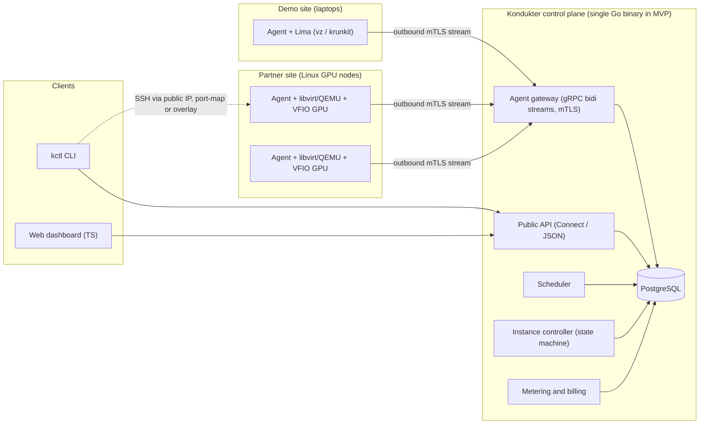
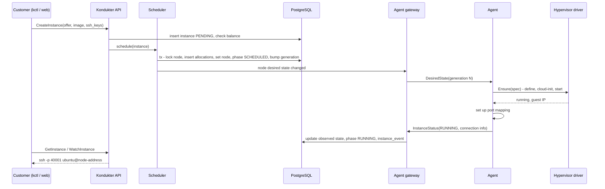
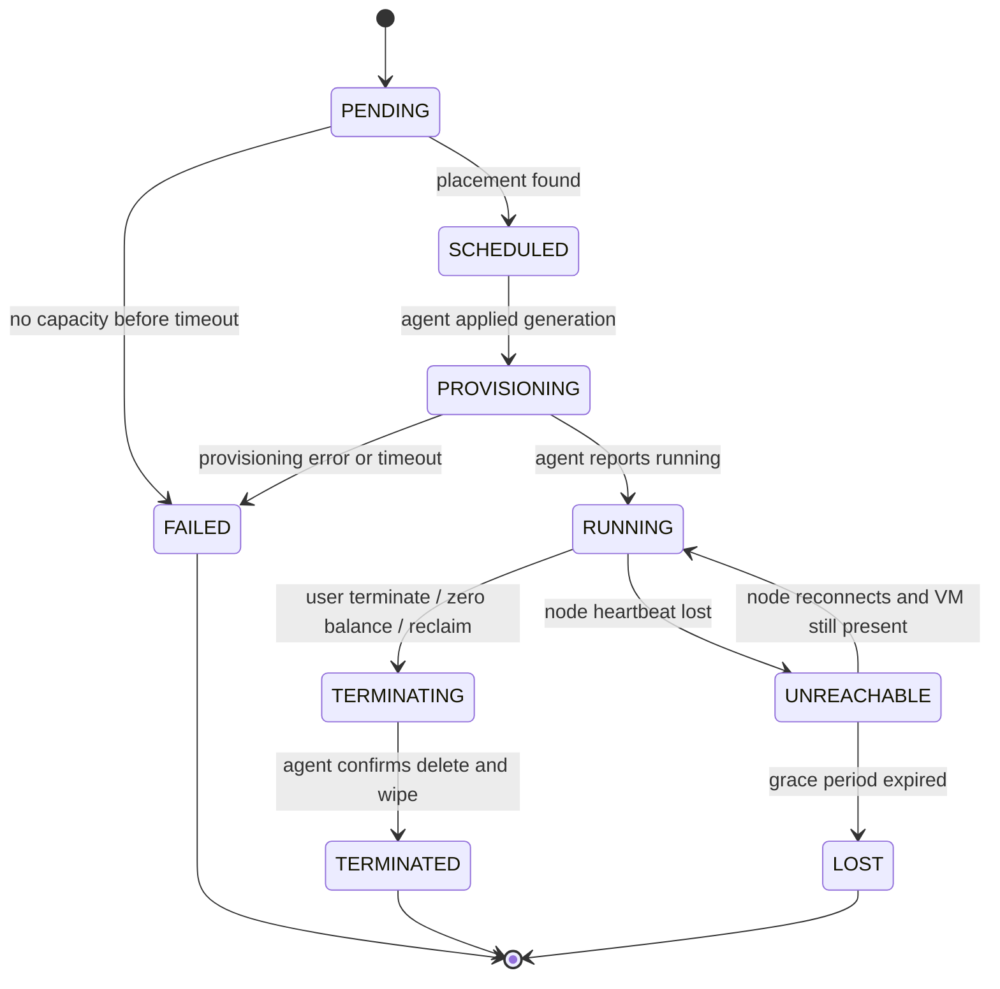

# Kondukter — System Specification & Architecture Brief

> **Status:** Draft v0.1 · 2026-11-08
> **Source:** initial design discussion (product idea, architecture, VMM choice, languages, macOS demo nodes).
> **Audience:** the first architecture-planning session (human + AI).
> **Expected output of that session:** `ROADMAP.md` (step-by-step implementation plan) and one ADR per decision taken.
> **Planning session held 2026-11-08.** Outputs: [ROADMAP.md](ROADMAP.md) (demo scope), [adr/](adr/README.md) (ADR-0001…0025), [spikes/](spikes/README.md), [WEB_PAGES.md](WEB_PAGES.md). The decision log in ROADMAP §2 supersedes the "Proposal"/"Open" labels below where they conflict.

---

## 0. How to use this document

This document captures everything discussed so far about Kondukter, the reasoning behind each direction, and everything that is still undecided. It is the input for the architecture-planning session.

The planning session MUST:

1. Read the whole document before proposing anything.
2. Go through **§17 Open decisions**, collect every item marked as blocking an early phase, and ask the project owner about **all of them in one batch before forming a plan**. Do not silently assume answers. Do not assume hardware that is not listed.
3. Record each resolved decision as an ADR in `docs/adr/NNNN-short-title.md` (context → decision → consequences). §16 lists the ADR seeds.
4. Generate `ROADMAP.md` following the rules in **§21**.
5. Keep the MVP scope (§3) unless the owner explicitly changes it.

Status labels used throughout:

| Label | Meaning |
|---|---|
| **Direction** | Recommended during the initial discussion and not contested. Confirm quickly and write as an ADR; the owner may still overturn it. |
| **Proposal** | Introduced by this spec, not yet discussed. Needs a yes/no. |
| **Open** | Needs a decision; options listed in §17. |

Keywords MUST / SHOULD / MAY follow RFC 2119.

---

## 1. Product summary

### 1.1 Problem

Private datacenters and on-prem infrastructures (companies, institutions, universities) often own capacity — including GPUs — that sits idle for long periods. The hardware is a sunk cost; idle hours earn nothing. Meanwhile ML practitioners need GPUs for training and inference, and hyperscaler GPU pricing is high.

### 1.2 Business model

- Kondukter signs agreements with **partners** (datacenter operators). Each partner dedicates a **fixed share** of its capacity to Kondukter.
- Kondukter resells that capacity to **customers** as on-demand virtual machines — initially GPU VMs for training and inference.
- The partner earns money on otherwise idle hardware (reducing the loss on its investment), the customer pays less than at large providers, Kondukter keeps a margin.

### 1.3 How it works, in one paragraph

A central control plane, **Kondukter**, knows every partner site, every node, every resource (CPU, RAM, disk, GPUs) and what is free or allocated. Every node runs a small **agent** that keeps an outbound connection to Kondukter. When a customer requests a VM with a given configuration (and optionally a GPU), Kondukter picks a node and tells that node's agent what should run there. The agent creates the VM through the local hypervisor, sets up access, and reports the connection details, which Kondukter returns to the customer.

### 1.4 Market context (late 2026; verify before using in a pitch)

- **The model is proven, not novel.** Vast.ai runs a marketplace where hosts — from hobbyists to tier-4 datacenters — install Vast's client software and list their GPUs; renters get Docker containers with per-second billing [1][2][3].
- Third-party reviews report H100 SXM marketplace prices on Vast of roughly **$0.90–$1.87/h**, versus about **$12.29/h** for an AWS P5 equivalent [1]. The competition is therefore other marketplaces, not hyperscalers.
- Two-tier positioning is common: RunPod has a Community Cloud (third-party hardware) and a Secure Cloud (vetted datacenters); Vast offers a "Secure Cloud" filter limited to certified datacenter hosts [2][11].
- Fly.io's GPU retrospective is a cautionary tale for the virtualization layer (§7.5) [4][5].
- **Implication:** technology is not the moat. The moat is supply agreements, reliability, and a differentiator marketplaces lack — candidates: EU/local data residency, local invoicing, support, latency. Choosing it is open (**D-05**).

---

## 2. Actors and glossary

**Actors**

- **Customer** — rents instances.
- **Partner** — datacenter operator that provides capacity.
- **Operator** — Kondukter staff (admin, support, abuse handling).

**Glossary**

| Term | Meaning |
|---|---|
| Kondukter | Central control plane: API, scheduler, state, billing. Also the product name. |
| Agent | Per-node daemon (`kondukter-agent`) that manages VMs on one host. |
| Site | A partner location/datacenter. Groups nodes; owns network configuration. |
| Node | One physical host running an agent. |
| Driver | Agent plugin for a concrete hypervisor (`libvirt`, `lima`, `mock`, …). |
| Accelerator | A GPU or similar device. Kinds: `nvidia`, `apple-metal`, `mock`. |
| Shape | Catalog entry: vCPU / RAM / disk / accelerators. |
| Offer | Shape + region/site + capacity class + price. |
| Instance | A customer VM. |
| Allocation | Reservation of concrete node resources for one instance. |
| Desired state | What Kondukter says should exist on a node (full snapshot). |
| Observed state | What the agent reports actually exists. |
| Generation | Monotonic version number of a node's desired state. |
| Capacity class | `dedicated` (cannot be reclaimed) or `preemptible` (partner may reclaim). |

---

## 3. Scope

### 3.1 MVP (Proposal — confirm in planning)

- Single-node, **whole-GPU** VMs. No GPU slicing.
- Customer gets an **SSH-accessible Linux VM** from a curated image.
- Linux nodes: QEMU/KVM via libvirt with VFIO passthrough.
- macOS nodes: demo only, via Lima.
- CLI first; minimal web UI later in the MVP.
- Prepaid credits, per-minute metering.
- One Kondukter instance (no HA) + PostgreSQL.
- Mock accelerators for tests and demos.

### 3.2 Demo milestone (first external showcase)

- 2–3 laptops act as nodes (exact hardware unknown — **D-29**), connected over a mesh VPN (e.g., Tailscale).
- Happy path: create instance → scheduled onto a laptop → VM boots → SSH works → usage accrues → terminate → resources released.
- Failure path: kill one agent → its instances go `UNREACHABLE` → agent restarts → state reconciles without data loss.
- GPU story per **D-30**; macOS node mode per **D-31**.

### 3.3 Non-goals for the MVP

- GPU slicing (MIG/vGPU), multi-node training, NVLink/NVSwitch (HGX/SXM) passthrough.
- Live migration, snapshots, persistent network volumes.
- Kubernetes anywhere in the stack (§7.6).
- Confidential computing.
- Containers-as-a-service or customer-facing Kubernetes.
- HA control plane.

---

## 4. Functional requirements

### 4.1 Customer

| ID | Requirement |
|---|---|
| C-1 | Sign up, log in, manage scoped API keys, manage SSH public keys. |
| C-2 | Browse offers; filter by accelerator kind/model/count, vCPU, RAM, region, capacity class, price. |
| C-3 | Create an instance: offer + image + SSH key(s) + optional exposed ports + optional cloud-init user data (**D-21**). |
| C-4 | Receive connection info: SSH command, port mappings. |
| C-5 | List, inspect, watch (status stream), terminate instances. |
| C-6 | See balance, per-instance usage, invoices; top up credits. |
| C-7 | Notifications: low balance, termination due to zero balance, instance lost. |
| C-8 | *(Later)* Inference endpoints (OpenAI-compatible API) — **D-06**. |

### 4.2 Partner

| ID | Requirement |
|---|---|
| P-1 | Partner account with one or more sites. |
| P-2 | Generate one-time enrollment tokens; enroll nodes. |
| P-3 | See per-node inventory, health, utilization, count of active instances — never customer data. |
| P-4 | Drain a node (no new placements, existing instances continue) and put it into maintenance. |
| P-5 | Usage and revenue reports per period (depends on **D-03**). |
| P-6 | *(If preemptible capacity exists, **D-04**)* Reclaim capacity with notice. |

### 4.3 Operator

| ID | Requirement |
|---|---|
| O-1 | Global view: sites, nodes, instances, states. |
| O-2 | Manage catalog: shapes, offers, prices, images. |
| O-3 | Quarantine node or accelerator; force-terminate instance; adjust balances; refunds. |
| O-4 | Abuse workflow; KYC review (**D-10**). |
| O-5 | Audit log of all privileged actions. |
| O-6 | Agent rollout management (**D-24**). |

---

## 5. Architecture overview

### 5.1 Principles (Direction)

1. **Agents dial out.** Partner networks will not open inbound ports to their hosts. The agent opens and keeps an outbound mTLS connection (gRPC bidirectional stream); Kondukter sends commands through it. NAT and firewalls stop being a problem. Kondukter never connects into a partner network.
2. **Desired state + reconciliation, not imperative RPC.** Kondukter stores "instance X must exist on node Y with spec Z". The agent continuously compares that with reality and converges. This survives agent restarts, network partitions, and duplicate messages (the Kubernetes/Nomad pattern, without the dependency).
3. **Fail-static agents.** Without a fresh desired state, an agent keeps everything running as-is and deletes nothing.
4. **The control plane is never in the data path.** Customers connect to nodes directly. If Kondukter is down, running VMs keep running and agents buffer metering.
5. **PostgreSQL is the single source of truth** for the control plane. Free capacity is computed transactionally from allocations — no drifting counters.
6. **One protobuf contract** for all inter-component APIs (agent ↔ Kondukter, web/CLI ↔ Kondukter).
7. **Generic resource model.** A GPU is one resource dimension among others; the system supports CPU-only VMs at no extra cost.
8. **The agent owns only what it created.** It never touches VMs, disks, networks or devices it did not create — critical on partner hosts.
9. **Everything is idempotent.** Any message may be duplicated, reordered, or lost.

### 5.2 Component diagram



### 5.3 Create-instance sequence



---

## 6. Kondukter (control plane)

### 6.1 Modules

Runs as **one binary** (modular monolith) in the MVP.

| Module | Responsibility |
|---|---|
| `api` | Public Connect services (gRPC + JSON over HTTP), authn/authz. |
| `gateway` | Terminates agent streams, authenticates nodes by client certificate, pushes desired state, ingests status/inventory/usage, sends acks. |
| `scheduler` | Placement (§6.5). |
| `controller` | Instance and node state machines, timeouts, retries, generation bumps. |
| `billing` | Usage ingestion, ledger, balance enforcement, partner reports. |
| `catalog` | Shapes, offers, images, regions. |
| `partner` | Sites, enrollment tokens, partner views. |
| `audit` | Append-only audit log. |

### 6.2 Data model (sketch)

Money is stored in integer minor units. Timestamps are UTC.

```text
partners          (id, name, legal_name, contact_email, commercial_model, created_at)
sites             (id, partner_id, name, region, country_code, network_mode, public_ip_pool, created_at)
nodes             (id, site_id, hostname, arch, os, driver, agent_version, status, capacity_class,
                   cert_fingerprint, labels jsonb, desired_generation, observed_generation,
                   last_seen_at, created_at)
node_capacity     (node_id, vcpu_total, vcpu_reserved, ram_mib_total, ram_mib_reserved,
                   disk_gib_total, disk_gib_reserved, updated_at)
accelerators      (id, node_id, kind, model, mem_mib, pci_address, numa_node, health, updated_at)
images            (id, name, version, arch, os, accel_stack, digest, size_bytes, status)
shapes            (id, name, vcpu, ram_mib, disk_gib, accel_kind, accel_model, accel_count)
offers            (id, shape_id, region, capacity_class, price_per_hour_minor, currency, active)
orgs, users, memberships, api_keys, ssh_keys
instances         (id, org_id, offer_id, image_id, node_id, desired, phase, phase_reason,
                   spec jsonb, connection jsonb, created_at, running_at, terminated_at)
allocations       (id, instance_id, node_id, vcpu, ram_mib, disk_gib, accelerator_id,
                   created_at, released_at)
instance_events   (id, instance_id, from_phase, to_phase, reason, at)            -- append-only
usage_records     (instance_id, period_start, period_end, running_seconds, node_id)
                   PRIMARY KEY (instance_id, period_start)                       -- idempotent ingest
ledger_entries    (id, org_id, kind, amount_minor, currency, ref_type, ref_id, created_at) -- append-only
enrollment_tokens (id, site_id, token_hash, expires_at, used_at)
audit_log         (id, actor_type, actor_id, action, target, payload jsonb, at)
```

Allocation safety net (one active lease per accelerator):

```sql
CREATE UNIQUE INDEX one_active_lease_per_accelerator
  ON allocations (accelerator_id)
  WHERE released_at IS NULL AND accelerator_id IS NOT NULL;
```

### 6.3 Instance lifecycle



Proposed timeouts (tune during the demo):

| Timer | Proposal | Notes |
|---|---|---|
| Scheduling | 60 s | Then `FAILED` with reason `no_capacity`. |
| Provisioning | 10 min | GPU images are large; image caching shortens this. |
| Heartbeat interval | 10 s | |
| Node `UNREACHABLE` | 3 missed heartbeats (~30–45 s) | |
| Instance `LOST` | 15 min of `UNREACHABLE` | Billing/refund policy: **D-23**. |

Stop/start (keeping the disk while releasing the GPU) is **not** in the MVP — **D-11**.

### 6.4 Node lifecycle

| State | Meaning | Schedulable |
|---|---|---|
| `ENROLLING` | Token used, waiting for first Hello + inventory. | No |
| `READY` | Connected, healthy. | Yes |
| `DRAINING` | No new placements; existing instances continue. | No |
| `MAINTENANCE` | Drained and empty; partner may work on it. | No |
| `UNREACHABLE` | Heartbeats missing. | No |
| `QUARANTINED` | Operator action or failed health gate; certificate may be revoked. | No |
| `RETIRED` | Removed permanently; certificate revoked. | No |

### 6.5 Scheduling

**Filter** — a node is a candidate only if:

- status is `READY`, capacity class and region match the offer;
- node arch matches the image arch (`amd64` / `arm64`);
- the driver supports the requested accelerator kind;
- free vCPU / RAM / disk ≥ shape (free = total − reserved − Σ active allocations);
- it has ≥ N healthy, unallocated accelerators of the requested model. For N > 1 in the MVP: any N on the same node; topology-aware placement (same NUMA node / PCIe switch) is *Later*.

**Score** — prefer, in order:

1. Best fit: nodes with the fewest remaining free accelerators that still fit, so large hosts stay free for large requests (avoid fragmentation).
2. Accelerators on a NUMA node that still has enough free CPU/RAM.
3. Image already cached on the node (faster boot).
4. Partner fairness (round-robin across partners) — depends on **D-03**.

**Commit** — in one transaction:

1. `SELECT … FOR UPDATE` the candidate node row (serializes placements per node).
2. Recompute free capacity from `allocations`.
3. Insert allocations with the **concrete** accelerator IDs chosen.
4. Set `instances.node_id`, phase `SCHEDULED`; bump `nodes.desired_generation`.
5. Commit, then notify the gateway (in-process channel in the MVP; `LISTEN/NOTIFY` when there are several replicas — **D-14**).

If the transaction fails (race, unique-index violation), retry with the next candidate.

### 6.6 Desired-state generation

Any change affecting node N (placement, termination, spec change) bumps `nodes.desired_generation`. The gateway sends a **full snapshot**: all non-terminal instances assigned to N with their full specs. Full snapshots keep agent logic trivial and are small (a node runs few instances). The agent echoes the generation it applied; `observed_generation < desired_generation` for too long is an alert (§14).

### 6.7 Public API (Connect services, sketch)

| Service | RPCs |
|---|---|
| `AccountService` | `GetMe`, `CreateAPIKey`, `RevokeAPIKey`, `AddSSHKey`, `ListSSHKeys`, `DeleteSSHKey` |
| `CatalogService` | `ListOffers(filters)`, `ListImages`, `ListRegions` |
| `InstanceService` | `CreateInstance`, `GetInstance`, `ListInstances`, `TerminateInstance`, `WatchInstance` (server stream) |
| `BillingService` | `GetBalance`, `ListUsage`, `ListInvoices`, `CreateTopUp` |
| `PartnerService` | `ListSites`, `ListNodes`, `CreateEnrollmentToken`, `DrainNode`, `GetUtilization`, `GetReport` |
| `AdminService` | `QuarantineNode`, `ForceTerminate`, `AdjustBalance`, `ListAuditLog`, catalog CRUD |
| `AgentGateway` (internal) | `Connect` (bidi stream) — §8 |

All mutating RPCs accept an idempotency key.

### 6.8 Authentication and authorization

| Principal | Mechanism |
|---|---|
| Customer | Session (web) or scoped API key (CLI/API). Provider: **D-16**. |
| Partner user | Same as customer, scoped to the partner's sites only. |
| Operator | Same + MFA mandatory; every action audited. |
| Agent | mTLS client certificate issued at enrollment (§7.7). Node identity comes **only** from the certificate, never from message bodies. |

---

## 7. Agent (`kondukter-agent`)

### 7.1 Responsibilities

1. Maintain the outbound stream to Kondukter (reconnect with exponential backoff + jitter, cap 60 s).
2. Report inventory: at Hello, periodically (every 5 min), and on change.
3. Reconcile desired vs observed instances through the driver.
4. Manage access for instances (port mappings / proxies, §10).
5. Meter usage and buffer it locally until Kondukter acknowledges it.
6. Run health checks (host, accelerators) and the release-time wipe/health gate (§9.7).
7. Self-update (**D-24**).
8. Expose local metrics and push them outbound (**D-25**).

It runs as a systemd service (launchd on macOS). It MAY be pinned to a reserved host core (`CPUAffinity=`), with guest vCPUs kept off host-reserved cores (§9.4).

### 7.2 Internal structure

| Goroutine | Job |
|---|---|
| `stream` | Owns the gRPC stream; sends the outbox, receives control messages. |
| `reconciler` | Runs on a new snapshot, every 30 s, and on driver events. |
| `inventory` | Discovers resources; diffs and reports changes. |
| `metering` | Every 60 s writes usage records into the local outbox. |
| `access` | Allocates host ports, programs nftables (Linux) or runs a userspace proxy (macOS/demo). |
| `health` | Host and accelerator checks; drives the wipe/health gate. |
| `updater` | Checks for, verifies, and stages signed agent releases. |

### 7.3 Driver interface (Go, sketch)

```go
package driver

import (
	"context"
	"time"
)

type Driver interface {
	// Name is a stable identifier: "libvirt", "lima", "mock", ...
	Name() string
	// Capabilities describes what this driver can do on this host.
	Capabilities(ctx context.Context) (Capabilities, error)
	// Inventory discovers host resources: CPU, RAM, disk, accelerators, arch.
	Inventory(ctx context.Context) (Inventory, error)
	// Ensure converges the instance to spec. Idempotent: calling it again
	// with the same spec is a no-op once the instance is running.
	Ensure(ctx context.Context, spec InstanceSpec) (Observed, error)
	// Delete removes the instance and its disks. Idempotent: deleting a
	// missing instance succeeds.
	Delete(ctx context.Context, instanceID string) error
	// List returns only instances created by Kondukter on this host.
	List(ctx context.Context) ([]Observed, error)
}

type Capabilities struct {
	Arch             string   // "amd64" | "arm64"
	AcceleratorKinds []string // "nvidia", "apple-metal", "mock"
	GPUPassthrough   bool
	MaxInstances     int // 0 = unlimited
}

type InstanceSpec struct {
	ID             string
	Generation     uint64
	VCPU           int
	RAMMiB         int64
	DiskGiB        int64
	AcceleratorIDs []string // concrete devices chosen by the scheduler (e.g. PCI addresses)
	Image          ImageRef // name, version, digest, arch
	SSHKeys        []string
	UserData       []byte     // optional cloud-init (D-21)
	Ports          []PortSpec // guest ports to expose
}

type Observed struct {
	ID        string
	Phase     string // "provisioning" | "running" | "failed" | "deleting"
	Reason    string
	GuestIPs  []string
	StartedAt time.Time
}
```

The scheduler, not the agent, picks concrete accelerator IDs, so every allocation is explicit and verifiable.

### 7.4 Drivers

| Driver | Platform | Status | Notes |
|---|---|---|---|
| `mock` | any | MVP | Simulated lifecycle with configurable delays/failures; reports mock accelerators from config. Used for tests, the fleet simulator (§20), and possibly the demo GPU story (**D-30**). |
| `libvirt` | Linux | MVP (production path) | QEMU/KVM through libvirt. Domain XML from templates, qcow2 overlays or LVM-thin, cloud-init NoCloud ISO, VFIO `hostdev` for GPUs (§9). Binding library: **D-20**. |
| `lima` | macOS (Apple Silicon) | MVP (demo only) | Shells out to `limactl` (`create`, `start`, `delete`, `list --json`). `vmType: vz` for CPU VMs, `vmType: krunkit` for GPU via Vulkan (§11). Instance names prefixed `kdk-`. |
| `cloud-hypervisor` | Linux | Later | Only if whole-GPU-only forever and a smaller attack surface is wanted (§7.5). |
| `firecracker` | Linux | Later | Only for a CPU-only ephemeral segment (CI runners, preemptible batch). |
| `kubevirt` / `k8s-pod` | partner K8s | Later | Adapter for partners already running Kubernetes + NVIDIA GPU Operator (§7.6). |
| `openstack` / `proxmox` / `opennebula` | partner cloud | Later | Adapters if partners give quota inside their existing virtualization instead of bare-metal hosts (**D-02**). |

### 7.5 VMM choice (Direction)

**QEMU/KVM via libvirt for GPU nodes. Not Firecracker.**

| | QEMU + libvirt | Cloud Hypervisor | Firecracker |
|---|---|---|---|
| Whole-GPU VFIO passthrough | Yes, most mature | Yes | No (roadmap only) |
| MIG / vGPU later | Yes — NVIDIA-supported path | Practically no | No |
| Implementation | C, large device model | Rust (rust-vmm) | Rust (rust-vmm) |
| Control API | libvirt (Go bindings) | REST over unix socket | REST over unix socket |
| GPU edge-case documentation | Huge | Small | — |

Evidence:

- Fly.io's docs state that Firecracker does not support GPUs, so their GPU machines ran on Cloud Hypervisor instead [5].
- Fly then spent months failing to make NVIDIA's virtualized-GPU host drivers work with Cloud Hypervisor; NVIDIA's supported paths were conventional hypervisors or Kubernetes, not micro-VMs [4].
- Firecracker's public PCIe roadmap targets basic VFIO passthrough of a single GPU, but explicitly scopes out SR-IOV/vGPU passthrough, PCIe peer-to-peer, GPUDirect Storage, and in-VM DCGM [6].
- Firecracker's millisecond boot does not matter here: GPU sessions last hours and startup is dominated by image size and driver init (Fly reported tens of seconds for GPU machines).

Consequence: if GPU slicing (MIG/vGPU) is ever wanted, QEMU is the only realistic option. Thanks to the `Driver` interface, this choice is not a lock-in.

### 7.6 Why no Kubernetes in the MVP (Direction)

- **K8s does not federate across WAN.** etcd and kubelet heartbeats expect LAN latency. A node that loses connectivity goes `NotReady` and, after ~5 min, taint-based eviction kills its pods — fatal for a customer VM mid-training. In practice it would mean **one cluster per site**, and Kondukter would still be needed above them. K8s would add a layer, not replace one.
- **The product is a VM, not a pod.** VMs on K8s mean KubeVirt + NVIDIA GPU Operator in vfio mode: workable, but a heavy ops burden (cluster upgrades, CNI, storage, three layers to debug) for a one-to-two-person team.
- **It does not run on the macOS demo nodes** (KubeVirt needs KVM).
- **The control plane does not need it.** A Go binary + Postgres on a VPS (or docker compose) is enough for a long time.

Borrow the ideas instead: desired state + reconcile, leases, labels/taints for scheduling (`gpu.model=…`, `arch=arm64`, `accel.kind=apple-metal`).

**When to revisit:** (1) a partner already runs K8s/OpenShift with GPU Operator → write a `kubevirt`/`k8s-pod` driver against their API; (2) the product shifts to containers/jobs (batch training, serverless inference) → K8s per site + GPU Operator + Kueue becomes worth it; (3) node counts per site grow until the agent starts reimplementing kubelet.

### 7.7 Enrollment and identity

1. A partner user or operator creates an enrollment token for a site (one-time, TTL ~1 h, stored hashed).
2. On the node: `kondukter-agent enroll --server <url> --token <token>`. The agent generates a key pair and a CSR.
3. Kondukter validates the token, creates the node record (`ENROLLING`), and signs a short-lived certificate (e.g., 30 days) from an internal CA with the node ID in the SAN (e.g., URI `kondukter://node/<id>`).
4. The agent rotates its certificate before expiry over the authenticated stream.
5. The gateway authorizes every message by the node ID in the certificate.
6. `QUARANTINED`/`RETIRED` nodes have their certificate fingerprint deny-listed.

### 7.8 Reconciliation rules

- Triggers: a new snapshot, every 30 s, and driver events.
- Ignore any snapshot whose generation is lower than the last applied one.
- For each desired instance: `Ensure(spec)`, then report observed status.
- For each **owned** instance absent from a fresh snapshot: `Delete` → wipe/health gate (§9.7) → report.
- Ownership = `kdk-` name prefix **and** ownership metadata in the domain/VM definition. Never touch anything else on the host.
- **Fail-static:** with no stream (or a stale snapshot), keep running everything and delete nothing.

### 7.9 Local state and crash safety

- Local store at `/var/lib/kondukter-agent/` (engine: **D-19**) holding: last applied generation + snapshot, usage outbox with persisted sequence numbers, port allocations, certificate and key.
- On restart: rebuild observed state from `driver.List()` + the local store, send Hello with `last_applied_generation` and observed instances, resend un-acked outbox entries.
- Must survive `kill -9` at any point without leaking or double-creating VMs.

### 7.10 Self-update

Signed releases (cosign or minisign — **D-24**). The agent downloads the binary, verifies the signature against a **pinned** public key, swaps the binary, and restarts via systemd, with rollback if the new version fails its health check. The signing key lives offline, not on the control-plane host, so a compromised Kondukter cannot push arbitrary binaries. Whether partners must approve upgrades is **D-24**.

---

## 8. Agent ↔ Kondukter protocol

### 8.1 Semantics

- **Transport:** gRPC bidirectional stream over HTTP/2 + mTLS, opened by the agent. gRPC keepalive pings every 20 s.
- **Hello / resync:** the first agent message is `Hello` (protocol version, agent version, driver, capabilities, `last_applied_generation`, observed instances). The gateway answers with the current `DesiredState`.
- **Snapshots:** `DesiredState` is always a full snapshot for that node, with a monotonic generation.
- **Sequencing and acks:** every `AgentMessage` has a `seq`, persisted across restarts. The gateway sends cumulative `Ack(seq)` once the messages are durably stored; the agent then prunes its outbox.
- **Idempotent ingest:** usage is keyed by `(instance_id, period_start)`; status updates are last-writer-wins by timestamp and generation.
- **Heartbeat:** every 10 s, with applied generation and a resource summary.
- **Versioning:** the proto package is versioned (`kondukter.agent.v1`). The gateway rejects incompatible `protocol_version` with a clear error.
- **Limits:** max message 4 MiB.

### 8.2 Proto sketch

```proto
syntax = "proto3";

package kondukter.agent.v1;

import "google/protobuf/timestamp.proto";

service AgentGateway {
  // Opened by the agent (outbound) and kept open for the agent's lifetime.
  rpc Connect(stream AgentMessage) returns (stream ControlMessage);
}

message AgentMessage {
  uint64 seq = 1; // persisted, monotonic per node
  oneof body {
    Hello hello = 10;
    Inventory inventory = 11;
    Heartbeat heartbeat = 12;
    InstanceStatus instance_status = 13;
    UsageBatch usage = 14;
  }
}

message ControlMessage {
  oneof body {
    DesiredState desired_state = 10;
    Ack ack = 11;               // cumulative: every AgentMessage.seq <= ack.seq is durable
    DrainRequest drain = 12;
    UpgradeRequest upgrade = 13;
  }
}

message Hello {
  string protocol_version = 1;
  string agent_version = 2;
  string driver = 3;
  uint64 last_applied_generation = 4;
  repeated InstanceStatus observed = 5;
}

message DesiredState {
  uint64 generation = 1;
  repeated InstanceSpec instances = 2; // full snapshot for this node
}

message InstanceSpec {
  string id = 1;
  uint32 vcpu = 2;
  uint64 ram_mib = 3;
  uint64 disk_gib = 4;
  repeated string accelerator_ids = 5;
  ImageRef image = 6;
  repeated string ssh_public_keys = 7;
  bytes user_data = 8;
  repeated PortSpec ports = 9;
}

message InstanceStatus {
  string id = 1;
  Phase phase = 2;
  string reason = 3;
  repeated string guest_ips = 4;
  repeated PortMapping port_mappings = 5;
  uint64 applied_generation = 6;
  google.protobuf.Timestamp at = 7;
}

message UsageBatch {
  repeated UsageRecord records = 1;
}

message UsageRecord {
  string instance_id = 1;
  google.protobuf.Timestamp period_start = 2;
  google.protobuf.Timestamp period_end = 3;
  uint32 running_seconds = 4;
}

// Inventory, Heartbeat, ImageRef, PortSpec, PortMapping, Phase, Ack,
// DrainRequest and UpgradeRequest are omitted for brevity.
```

---

## 9. Linux GPU node stack

### 9.1 Host OS

Ubuntu 24.04 LTS or a RHEL-family 9.x (Rocky/Alma) — **D-34**. The host runs **no NVIDIA driver** for passthrough GPUs: they belong to `vfio-pci`.

### 9.2 Firmware and kernel checklist

- BIOS/UEFI: VT-x/AMD-V, VT-d/AMD-Vi (IOMMU), **Above 4G decoding**, ACS enabled on root ports where available.
- Kernel parameters: `intel_iommu=on iommu=pt` (Intel) or `amd_iommu=on iommu=pt` (AMD); hugepages (proposal: 1 GiB pages reserved at boot, sized per node).
- Bind GPUs (and their audio functions) to `vfio-pci` at boot (`vfio-pci.ids=` or `driverctl`); blacklist `nouveau` and `nvidia` on the host.
- Verify **clean IOMMU groups**: each GPU (+ its audio function) alone in its group, so different tenants' GPUs never share a group.
- Large-BAR GPUs (A100/H100 class) may need a larger 64-bit MMIO window in OVMF. Verify during spike S2.

### 9.3 libvirt domain essentials

- `q35` machine, OVMF (UEFI) firmware, `<cpu mode='host-passthrough'>`.
- `<vcpupin>` + `<numatune>` so vCPUs and memory sit on the **same NUMA node as the GPU**; `<memoryBacking><hugepages/></memoryBacking>`. Without this, training throughput drops noticeably.
- virtio-net on the isolated bridge (§10); virtio-scsi/virtio-blk with `discard='unmap'`.
- cloud-init NoCloud ISO attached as a CD-ROM — no metadata server needed.
- No graphics/USB/sound devices; serial console only.
- GPU passthrough:

```xml
<hostdev mode='subsystem' type='pci' managed='yes'>
  <source>
    <address domain='0x0000' bus='0x41' slot='0x00' function='0x0'/>
  </source>
</hostdev>
```

### 9.4 Host resource reservation

- Reserve a few cores (+ SMT siblings) and some RAM for the host + agent (`vcpu_reserved`, `ram_mib_reserved`).
- Confine guests to the remaining cores via the libvirt `machine.slice` (`AllowedCPUs=`); pin the agent with `CPUAffinity=`.

### 9.5 Guest images

| Image | Arch | Contents | Used by |
|---|---|---|---|
| `ubuntu-gpu` | amd64 | Ubuntu LTS, NVIDIA driver (open kernel modules), CUDA toolkit, Docker + NVIDIA Container Toolkit, cloud-init | Linux GPU nodes |
| `ubuntu-cpu` | amd64 / arm64 | Ubuntu LTS, Docker, cloud-init | CPU-only VMs, Lima `vz` |
| `fedora-venus` | arm64 | Fedora + patched Mesa (Venus) + llama.cpp with Vulkan | Lima `krunkit` (§11) |

- Built with Packer or mkosi (**D-21**), versioned, pinned by digest, served over HTTPS from object storage, cached on nodes (popular images pre-pulled).
- An NVIDIA driver ↔ GPU generation compatibility matrix lives next to the image definitions.

### 9.6 Storage

- Base images in a node-local cache; per-instance qcow2 overlay (or LVM-thin snapshot) on local NVMe.
- Ephemeral by default; persistent volumes are **D-12**.
- Disk quotas enforced by the overlay size.

### 9.7 Release: wipe and health gate

After an instance is deleted, its resources return to the pool only after:

1. Disks are removed and discarded (`blkdiscard` for LVM-thin; delete + discard for qcow2).
2. The GPU is reset (function-level reset on VFIO release).
3. A GPU health check passes. **Caveat:** the host has no NVIDIA driver (the GPU is bound to `vfio-pci`), so NVML/DCGM do not work on the host. Options: a short-lived **validator VM** that runs DCGM diagnostics, or temporarily rebinding the GPU to the host driver — **D-26**.
4. On failure, the accelerator becomes `QUARANTINED` and an operator is alerted.

Inventory on passthrough hosts therefore comes from **sysfs/PCI IDs** (vendor/device ID → model table, NUMA node, IOMMU group), not NVML.

### 9.8 Hardening

- sVirt confinement (SELinux/AppArmor via libvirt); QEMU seccomp sandbox enabled; QEMU runs as an unprivileged user.
- Minimal device model (above). Keep kernel, QEMU and libvirt patched on a fixed cadence.
- ACS/IOMMU isolation between tenants' GPUs; no GPU peer-to-peer across tenants.
- GPU firmware/state tampering by a tenant is a residual risk (§13).

---

## 10. Networking

### 10.1 Isolation (MUST)

- Guests attach only to a dedicated bridge (e.g., `kdk-br0`), never to the partner's LAN or management bridge.
- nftables on the host: drop guest → RFC 1918 ranges, link-local (`169.254.0.0/16`, including cloud metadata addresses), partner management ranges, and host IPs; allow established traffic; allow guest → internet per policy.
- Per-tap anti-spoofing (MAC/IP binding).
- Guest ↔ guest traffic on the same node: dropped by default (different tenants).
- This is the first thing a partner will ask about; it must be testable (§21, Phase 7 exit criterion).

### 10.2 Customer access modes (per site)

| Mode | How | Pros | Cons |
|---|---|---|---|
| `public-ip` | Partner routes an IP block to the node; 1:1 NAT or routed. | Best UX, standard ports. | Needs an IP block from the partner. |
| `port-map` | Host IP + port range (e.g., 40000–49999) DNAT → guest `:22` and declared ports. | Works anywhere. | Non-standard ports. |
| `overlay` | WireGuard/Tailscale (or Headscale) into the guest. | Works behind NAT; great for the demo. | Extra dependency; traffic path through the overlay. |

- MVP default: `port-map` — nftables DNAT on Linux; a userspace TCP proxy on macOS/demo nodes.
- Demo option: cloud-init installs Tailscale in the guest with an **ephemeral** auth key, so the VM gets its own tailnet IP and disappears from the tailnet after deletion.

### 10.3 Egress controls

- Block outbound TCP/25; rate-limit per instance (`tc`); conntrack limits.
- Monitor flow counts; automatically suspend on abuse signals; abuse workflow (O-4).
- Otherwise the partner's IPs end up on blacklists.

### 10.4 Data path

Customer datasets flow directly between the guest and the internet/customer. **Never** route customer data through Kondukter (bandwidth cost, latency, liability).

---

## 11. macOS nodes (demo only)

### 11.1 Constraints

- Virtualization goes through Apple's Virtualization.framework, not KVM. libvirt/VFIO do not exist on macOS.
- Guests are **arm64**: the image catalog carries `arch` and the scheduler filters on it.
- **No CUDA, no PCI passthrough.** A plain Linux guest has no GPU compute.
- macOS guests are limited to 2 per host (license + framework); Linux guests are not. Use Linux guests only.
- NAT networking by default; bridged mode requires a restricted Apple entitlement. The agent exposes guest ports itself (§10.2).
- Laptops sleep with the lid closed. During the demo: `sudo pmset -a disablesleep 1` (restore to `0` afterwards), keep chargers connected.

### 11.2 Unified memory is not compute

LLMs run fast on Apple Silicon because the **GPU (Metal)** reads unified memory at high bandwidth. Giving a VM "RAM capability" without GPU access means **CPU inference**: it works, but prefill (prompt processing, compute-bound) is much slower; decode (memory-bound) is more tolerable.

### 11.3 Mac node modes (**D-31**)

| Mode | How | Speed | Isolation | Notes |
|---|---|---|---|---|
| CPU VM | Lima `vz`, llama.cpp arm64 on CPU | Slow | VM | Simplest. |
| GPU VM via Vulkan | Lima `krunkit` [7]: libkrun with a virtio-gpu device; Venus serializes Vulkan commands from the guest and MoltenVK translates them to Metal on the host [8]; llama.cpp built with `-DGGML_VULKAN=ON`, run with `-ngl 99` | Below native Metal, well above CPU | VM | **Experimental**: Lima ≥ 2.0, macOS ≥ 14, Apple Silicon. Same Lima driver, different `vmType`. Best demo fit. |
| Native inference endpoint | Agent runs `llama-server` or MLX on the host with Metal; Kondukter routes OpenAI-compatible requests | Full | Process (customer runs no code) | A different product (inference-as-a-service, C-8). Probably the most natural use of Mac capacity. |

### 11.4 Resource accounting on Mac nodes

- RAM is **one pool**: VM RAM and the GPU working set share the same physical memory. Never sell them as separate resources. Inventory: `unified_mem_total`, `host_reserve`, `allocatable`.
- Native mode: Metal can wire only part of RAM by default (roughly 2/3–3/4). Raise it with `sudo sysctl iogpu.wired_limit_mb=<N>`.
- Fit rule: weights + KV cache + overhead ≤ allocatable.
- Throughput estimate: decode tokens/s ≲ memory bandwidth ÷ model size in bytes. Example: M1 (~68 GB/s) with an 8B Q4 model (~4.7 GB) → ceiling ~14 tokens/s per stream; less in practice, and less again through Venus.
- Inventory kind: `accelerator: {kind: apple-metal, path: venus | native}` vs `{kind: nvidia, cuda: true}`. Jobs requiring CUDA or training never land on Mac nodes.

### 11.5 Alternatives considered for the macOS driver (**D-33**)

| Tool | Notes |
|---|---|
| **Lima** | Apache-2.0, built-in provisioning (cloud-init), port forwarding to host loopback, `vz` and experimental `krunkit` VM types [7]. **Proposal.** |
| Tart | OCI-distributed VM images. License has changed over time: the repo states FSL-1.1-ALv2 (copyright OpenAI), while the old site still describes Fair Source with a 100-core free tier [10]. Fine for a demo; check before production. |
| apple/container | Linux containers, each in its own lightweight VM; 1.0 released June 2026; requires Apple Silicon and macOS 26 [9]. Fits a "container UX + VM isolation" product. |
| Direct Virtualization.framework bindings (`Code-Hex/vz`) | Most control; the binary must be signed with the `com.apple.security.virtualization` entitlement. |

---

## 12. Metering, billing, payouts

- **Billing authority (Proposal, D-22):** billable time runs from the `RUNNING` transition to `TERMINATED`, taken from `instance_events` on Kondukter. Agent usage records cross-check it and resolve `UNREACHABLE` periods (if the agent later proves the VM kept running, the period is billable).
- **Granularity (D-08):** proposal — per minute, rounded up, with a minimum charge.
- **Ledger:** append-only `ledger_entries` (top-ups, usage, refunds, adjustments). Balance = sum of entries. A cached balance column MAY exist if it is updated in the same transaction and periodically reconciled.
- **Pre-authorization:** creating an instance requires a balance ≥ price × minimum period (proposal: 1 h).
- **Enforcement loop (every minute):** accrue usage; warn at < 15 min of burn remaining; at ≤ 0 → `TERMINATING` after a short grace period (proposal: 5 min).
- **Partner payouts:** fixed lease fee, revenue share, or hybrid — **D-03**. Reports per site/period from `usage_records` + `allocations`.
- **Payment provider, invoicing, VAT:** **D-09** (needs research with an accountant; company and customer jurisdictions matter).

---

## 13. Security and trust model

| Threat | Impact | Mitigation |
|---|---|---|
| Malicious tenant escapes the VM | Host and other tenants compromised | sVirt, seccomp, minimal QEMU device model, patch cadence, one tenant per GPU, IOMMU/ACS isolation. |
| Tenant attacks the partner network | Partner breach; deal lost | Dedicated bridge, nftables deny to private and management ranges, anti-spoofing; tested in Phase 7. |
| Tenant abuses the internet (spam, scanning, illegal content) | Partner IPs blacklisted; legal exposure | Egress controls, KYC, AUP, abuse workflow, auto-suspend. |
| Tenant tampers with GPU state/firmware | Next tenant affected | FLR reset, health gate (§9.7), quarantine; residual risk documented. |
| Host operator (partner) reads tenant memory/disk | Customer data exposure | **Cannot be prevented** without confidential computing (H100 CC + SEV-SNP/TDX — Later). Disclose in the ToS; offer a "verified partner" tier. |
| Compromised agent | Lies about inventory/usage; attacks the gateway | Per-node mTLS identity from the certificate only; Kondukter never trusts agent claims for authorization; usage sanity checks; rate limits. |
| Compromised Kondukter | Full control of the fleet | Minimal exposed surface, operator MFA, audit log, secrets management, **offline release-signing key** (agents reject unsigned binaries). |
| Customer account takeover | Resource theft, data exposure | MFA, scoped API keys, anomaly alerts. |

Legal and compliance items (ToS, AUP, partner agreement, GDPR roles — Kondukter as controller for account data and processor for workload data, partners as sub-processors) are tracked in **D-10**. This spec is not legal advice.

---

## 14. Observability and operations

- **Outbound-only rule applies to telemetry too:** Prometheus cannot scrape partner nodes from outside. Nodes run a local collector (Prometheus agent mode or Grafana Alloy) that `remote_write`s outbound, or the agent forwards summaries over its stream — **D-25**.
- **Control-plane metrics:** active streams; nodes by status; instances by phase; scheduling latency; provisioning duration; reconcile lag (`desired_generation − observed_generation` and its age); billing loop lag; ledger reconciliation diffs.
- **Node metrics:** node_exporter, libvirt metrics; DCGM exporter only where a driver is loaded (not on passthrough hosts, §9.7).
- **Logs:** structured JSON (`log/slog`) everywhere; optional Loki. OpenTelemetry tracing is optional.
- **Alerts:** node unreachable; provisioning failure rate; reconcile lag > threshold; wipe/health gate failures; enforcement loop stalled; certificates near expiry; Postgres replication/backup failures.
- **Backups:** Postgres base backups + WAL archiving (PITR), with a regularly tested restore.
- **Runbooks:** node lost, stuck provisioning, partner reclaim, abuse report, certificate revocation, emergency drain.

---

## 15. Technology stack

| Area | Choice | Why | Status |
|---|---|---|---|
| Control plane | **Go** | Same language and types as the agent; goroutines handle thousands of long-lived streams; strong infra ecosystem. | Direction |
| Agent | **Go**, static binary | No dependencies on partner hosts; easy cross-compile (`linux/amd64`, `linux/arm64`, `darwin/arm64`). Fully static only if the libvirt binding is pure Go (D-20). | Direction |
| CLI (`kctl`) | Go + cobra | One binary; shares the generated client with everything else. | Proposal |
| Contract | **Protobuf**, managed with `buf` (lint, breaking-change checks, codegen) | One `.proto` → Go server, Go agent client, TS browser client. | Direction |
| RPC framework | Connect (`connect-go`, `connect-es`) for public APIs; gRPC bidi stream for agents | Connect speaks gRPC, gRPC-Web and JSON from the same handlers; browsers need no proxy. | Direction |
| Database | **PostgreSQL** (16+) | Transactions for allocation correctness; JSONB for specs; `LISTEN/NOTIFY`. | Direction |
| DB access | `pgx` v5 + `sqlc` | Type-safe SQL without an ORM. | Direction |
| Migrations | goose / atlas / golang-migrate | | Open (D-18) |
| Agent local store | SQLite (pure-Go driver) or bbolt | Crash-safe outbox and snapshot. | Open (D-19) |
| libvirt binding | `digitalocean/go-libvirt` (pure Go, RPC over the libvirt socket) vs `libvirt.org/go/libvirt` (official, cgo) | Pure Go keeps `CGO_ENABLED=0` static binaries. | Open (D-20) |
| VMM (Linux) | **QEMU/KVM via libvirt** | §7.5. | Direction |
| VMM (macOS demo) | **Lima** (`vz`, `krunkit`) | §11. | Direction |
| Guest provisioning | cloud-init (NoCloud ISO) | No metadata server; standard images. | Direction |
| Image builds | Packer or mkosi | | Open (D-21) |
| Node bootstrap | Ansible | IOMMU kernel params, vfio binding, libvirt, nftables, agent install. Same pattern as OpenNebula's OneDeploy. | Proposal |
| Frontend | TypeScript; React + Vite, Next.js, or SvelteKit | Client generated from proto. | Open (D-17) |
| Auth | Self-built vs Ory Kratos / Keycloak / Zitadel vs a hosted provider | | Open (D-16) |
| Observability | Prometheus, Grafana, node_exporter, DCGM exporter, Alloy/Prometheus agent (`remote_write`), optional Loki | | Proposal |
| Demo networking | Tailscale | Mesh across laptops on different networks. | Proposal |
| Local dev | docker compose (Postgres, Kondukter, Grafana) | | Proposal |
| CI | GitHub Actions; a self-hosted runner with KVM for libvirt integration tests | Hosted runners have limited nested virtualization. | Proposal |
| Release signing | cosign or minisign | | Open (D-24) |

**Why not other languages**

- **Rust:** its advantages (no GC, memory control) do not pay off for an orchestration daemon that talks to libvirt and spawns processes. The hard parts here are distributed-state correctness and operations, where Go iterates faster and the infra ecosystem (containerd, Kubernetes, Nomad, Tailscale, Lima) is denser. Rust makes sense only when working inside the VMM layer (embedding libkrun, modifying Cloud Hypervisor) — not needed for this product. If the owner is much faster in Rust, the agent decision can be revisited; the control plane stays Go.
- **Python:** fine for scripts and ML images, bad for the agent — dependency hell on partner hosts instead of a single binary.
- **TypeScript/Node for the control plane:** workable, but it adds a second backend language and loses shared types with the agent.
- **Elixir/Erlang:** excellent for many long-lived supervised connections, but niche; fewer libraries for libvirt/NVML and harder hiring.

---

## 16. Directions already taken (ADR seeds)

The planning session should write these as ADRs (status *Accepted* once the owner confirms).

| ADR | Direction |
|---|---|
| ADR-0001 | Agents connect outbound; the control plane never connects into partner networks. |
| ADR-0002 | Desired-state full snapshots with generations + agent reconciliation; agents are fail-static. |
| ADR-0003 | QEMU/KVM via libvirt is the Linux VMM; Firecracker is not used for GPU workloads; Cloud Hypervisor is an optional later driver. |
| ADR-0004 | No Kubernetes in the MVP; K8s appears later only as a driver/adapter. |
| ADR-0005 | Go for control plane, agent and CLI; TypeScript for the web app. |
| ADR-0006 | Protobuf (buf) is the single contract; Connect for public APIs, gRPC bidi for agents. |
| ADR-0007 | Generic resource model: accelerators are a list; every offer has a capacity class. |
| ADR-0008 | Whole-GPU passthrough only in the MVP (no MIG/vGPU). |
| ADR-0009 | PostgreSQL is the single source of truth; free capacity is computed transactionally from allocations. |
| ADR-0010 | The control plane is never in the data path; customer traffic never flows through Kondukter. |
| ADR-0011 | macOS nodes are demo-only via Lima; no CUDA on macOS; Mac RAM is one unified pool. |

---

## 17. Open decisions

"Blocks" names the earliest roadmap phase (§21) that cannot be finalized without the decision. Anything blocking Phase 0–4 MUST be asked in the first planning session.

### 17.1 Product and business

| ID | Question | Options | Proposal | Blocks |
|---|---|---|---|---|
| D-01 | Product scope | GPU-only · general VMs · GPU-first with CPU VMs as an add-on · preemptible CPU for batch/CI | Generic model in code regardless (ADR-0007); positioning decided by the owner. CPU VMs as a main product compete with very cheap commodity VPS providers. | P6 (catalog/UI) |
| D-02 | Supply model | Partner hands over bare-metal hosts (we install the OS) · quota inside the partner's existing virtualization (OpenStack/Proxmox/OpenNebula/VMware/K8s) | MVP assumes bare metal; adapters later. | P7 |
| D-03 | Partner commercial model | Fixed lease fee for the fixed share · revenue share · hybrid | — | P5 |
| D-04 | Capacity classes | Dedicated only · dedicated + preemptible | Dedicated only in the MVP; keep the field. | P3 (scheduler semantics) |
| D-05 | Target market and differentiator | Serbia/region (data residency, local invoicing) · EU · global | — | P9 |
| D-06 | Customer product form | SSH VM · containers/jobs · inference endpoints | SSH VM for the MVP; endpoints Later. | **P2** |
| D-07 | GPU classes | Consumer (e.g., RTX 4090/5090) · datacenter PCIe (L40S, H100 PCIe) · SXM/HGX with NVLink | PCIe only in the MVP. | P7 |
| D-08 | Pricing granularity | Per second · per minute; minimum charge; prepaid vs postpaid | Per minute, rounded up, prepaid. | P5 |
| D-09 | Payments, invoicing, VAT | Card processor availability for the company's jurisdiction · merchant-of-record · bank transfer/invoices for B2B | Research with an accountant. | P5 |
| D-10 | Legal | ToS, AUP, partner agreement (dedicated share, SLA, liability, IP ownership, abuse escalation), GDPR roles, KYC level | — | P9 |

### 17.2 Technical

| ID | Question | Options | Proposal | Blocks |
|---|---|---|---|---|
| D-11 | Stop/start instances | Not supported · stop keeps disk and releases GPU (no restart guarantee) | Not in MVP. | P3 |
| D-12 | Persistent storage | None · node-local persistent disks · network volumes | None in MVP. | Later |
| D-13 | Default access mode | `public-ip` · `port-map` · `overlay` (per site) | `port-map` default; `overlay` for the demo. | **P2** |
| D-14 | Gateway fan-out with several replicas | In-process (single replica) → Postgres `LISTEN/NOTIFY` · NATS | Single replica + in-process in MVP; `LISTEN/NOTIFY` next. | **P3** |
| D-15 | Control-plane HA | Single instance · active/passive · active/active | Single in MVP (data plane unaffected by outages). | Later |
| D-16 | Auth implementation | Self-built (sessions + API keys) · Ory Kratos · Keycloak · Zitadel · hosted provider | API keys only for the CLI in P3; decide before P6. | P6 |
| D-17 | Frontend framework | React + Vite · Next.js · SvelteKit | — | P6 |
| D-18 | Migration tool | goose · atlas · golang-migrate | — | **P3** |
| D-19 | Agent local store | SQLite (pure Go) · bbolt | — | **P2** |
| D-20 | libvirt Go binding | `digitalocean/go-libvirt` (pure Go) · `libvirt.org/go/libvirt` (cgo) | Pure Go, to keep static binaries; validate in spike S1. | **P1** |
| D-21 | Images | Curated only · customer-supplied images; customer cloud-init allowed?; Packer vs mkosi; distribution (HTTPS object storage vs OCI registry) | Curated only + limited user-data in MVP. | **P2** |
| D-22 | Billing authority | Kondukter state transitions · agent usage records | Kondukter transitions, agent records for cross-check and `UNREACHABLE` periods. | P5 |
| D-23 | Lost/unreachable policy | Billing during `UNREACHABLE`; when to declare `LOST`; refunds | Bill only proven running time; refund `LOST` from the last proof. | P3 (state machine), P5 (money) |
| D-24 | Agent upgrades on partner hosts | Automatic · partner-approved · maintenance windows; cosign vs minisign | — | P8 |
| D-25 | Telemetry from partner sites | Local collector with `remote_write` · forwarded over the agent stream | Local collector. | P8 |
| D-26 | Wipe and GPU health gate | Validator VM with DCGM · temporary host rebind · minimal checks; time budget per release | — | P7 |
| D-27 | Multi-tenancy per node | Several customers per host (different GPUs) · one customer per host | Several per host, with NUMA-aware placement and ACS isolation. | P3 |
| D-28 | Confidential computing | Never · Later (H100 CC + SEV-SNP/TDX) | Later. | Later |
| D-34 | Linux host OS | Ubuntu 24.04 LTS · Rocky/Alma 9.x | — | P1 (spike S2) |

### 17.3 Demo

| ID | Question | Options | Proposal | Blocks |
|---|---|---|---|---|
| D-29 | Demo hardware | Which laptops: Apple Silicon (which chip, how much RAM) / Intel / Windows; can x86 laptops run Linux for the real `libvirt` driver? | — | **P1** |
| D-30 | Demo GPU story | Mock accelerators (say so openly) · one real Linux node with an NVIDIA GPU · Metal via `krunkit` | — | **P1** |
| D-31 | Mac node mode | CPU VM · `krunkit` GPU VM · native inference endpoint | `krunkit` for the demo. | **P1** |
| D-32 | Where Kondukter runs for the demo | VPS · one of the laptops | VPS, reachable over the tailnet. | **P4** |
| D-33 | macOS driver tool | Lima · Tart · apple/container · direct Virtualization.framework | Lima. | **P2** |
| D-35 | Linux GPU test hardware for spike S2 | Is a Linux machine with an NVIDIA GPU available? If its only GPU also drives its display, the host must run headless while the GPU is passed through. | — | **P1** |

---

## 18. Risks

| Risk | Impact | Mitigation |
|---|---|---|
| Little idle GPU supply among regional partners | No product | Validate supply before heavy build-out; generic model allows CPU/preemptible pivots (D-01). |
| Price competition from established marketplaces | Thin margins | Pick a differentiator early (D-05). |
| Partner reclaims "idle" capacity during peaks | Interrupted customer jobs | Contractually dedicated share; preemptible class only with explicit pricing (D-04). |
| Reliability of heterogeneous partner hardware | Churn | Health gates, quarantine, partner tiers, SLAs in agreements. |
| Security incident on partner premises | Partner trust lost | §10 isolation, §13 mitigations, tested before the pilot. |
| NVIDIA licensing for GPU slicing | Cannot sell fractional GPUs cheaply | Whole GPUs only; QEMU keeps the vGPU path open. |
| Operational load for a tiny team | Burnout, outages | No K8s, modular monolith, strong automation, runbooks. |
| Hardware quirks (IOMMU groups, large BARs, GPU reset bugs) | Nodes unusable | Spike S2 first; per-model compatibility matrix. |

---

## 19. Repository layout (Proposal)

```text
kondukter/
├── proto/                     # single source of truth (buf.yaml, buf.gen.yaml)
│   └── kondukter/
│       ├── agent/v1/          # AgentGateway
│       └── api/v1/            # public services
├── gen/                       # generated Go and TS code (or per-language output dirs)
├── cmd/
│   ├── kondukter/             # control-plane binary
│   ├── kondukter-agent/       # node agent
│   └── kctl/                  # customer/partner CLI
├── internal/
│   ├── controlplane/
│   │   ├── api/
│   │   ├── gateway/
│   │   ├── scheduler/
│   │   ├── controller/
│   │   ├── billing/
│   │   ├── catalog/
│   │   └── auth/
│   ├── agent/
│   │   ├── stream/
│   │   ├── reconcile/
│   │   ├── inventory/
│   │   ├── metering/
│   │   ├── access/            # port-map / proxy / nftables
│   │   ├── health/
│   │   └── driver/
│   │       ├── libvirt/
│   │       ├── lima/
│   │       └── mock/
│   ├── store/                 # sqlc queries + migrations
│   └── simulator/             # fake agent fleet for tests
├── web/                       # TypeScript frontend
├── deploy/
│   ├── ansible/               # node bootstrap
│   ├── compose/               # local dev stack
│   └── images/                # Packer/mkosi guest image definitions
└── docs/
    ├── SPEC.md                # this document
    ├── ROADMAP.md             # generated from this document
    └── adr/                   # one file per decision
```

---

## 20. Testing strategy

| Layer | What | How |
|---|---|---|
| Unit | Scheduler filters/scores, state machines, ledger math, reconcile decisions | Table-driven Go tests. |
| Concurrency | N parallel `CreateInstance` calls against limited capacity never over-allocate | Real Postgres (compose/testcontainers), `-race`, repeated runs. |
| Fleet simulator | 100–1000 in-process fake agents (mock driver) | Gateway load, reconnect storms, generation handling, scheduler at scale. |
| Fault injection | Drop/duplicate/reorder messages; kill the agent mid-provision; kill Kondukter; network partition | Simulator hooks + chaos tests; assert convergence and no leaks. |
| Driver integration | `libvirt` on a self-hosted KVM runner; `lima` on a Mac (manual or self-hosted runner) | Create/ensure/delete idempotency; crash-restart behavior. |
| End-to-end | The scripted demo flow (§3.2) | Runs against the demo environment before every showcase. |

---

## 21. Rules for generating `ROADMAP.md`

### 21.1 Process

1. Ask the owner every open decision that blocks Phases 0–4 (§17, entries with bold "Blocks") in **one batch** before writing the roadmap.
2. Write ADR-0001…0011 (§16) plus ADRs for newly resolved decisions.
3. Produce `ROADMAP.md` with the item format below. Phases may be restructured, but every phase needs a verifiable exit criterion.

### 21.2 Item format

```markdown
### P2.3 — Reconcile loop (mock driver)
- **Goal:** one sentence.
- **Deliverables:** code/docs produced.
- **Acceptance criteria:** testable statements (commands to run, expected results).
- **Depends on:** item IDs.
- **Decisions required:** D-xx (must be resolved before starting).
- **Size:** S (≤ half a session) · M (one session). L is not allowed — split it.
```

Additional rules:

- Every item fits **one implementation session** and leaves the repo green (build + tests).
- Decision gates appear as explicit items (e.g., "P1.5 — Decision gate: D-29, D-30, D-31").
- Highest-risk unknowns go first, as time-boxed spikes with written findings.
- A "Later" bucket collects out-of-scope ideas; it is not scheduled.
- Each phase ends with something demoable or measurable.

### 21.3 Suggested phase outline

| Phase | Content | Exit criterion |
|---|---|---|
| **P0 — Foundations** | Monorepo, `buf` + codegen (Go/TS), CI (lint, test, `-race`), compose stack (Postgres), Makefile, ADR folder with ADR-0001…0011. | `make gen test` green in CI; ADRs merged. |
| **P1 — Spikes** (time-boxed) | **S1** libvirt VM create/delete from Go with cloud-init (no GPU) — validates D-20. **S2** VFIO GPU passthrough on a real Linux + NVIDIA host, manual first, then libvirt XML; record IOMMU groups, large-BAR/MMIO findings, NUMA layout. **S3** Lima `vz` + `krunkit` on a Mac; llama.cpp Vulkan inside the guest; measure tokens/s vs native. **S4** Outbound gRPC bidi stream through NAT/Tailscale with reconnect. | Written findings per spike; go/no-go on assumptions; D-20, D-29–D-31, D-34, D-35 resolved. |
| **P2 — Agent v0** | Enrollment + mTLS identity; stream client + Hello/resync; inventory; local store + outbox; mock driver; reconcile loop; `libvirt` driver; `lima` driver; access (port-map/proxy). | Agent converges to a hand-written desired state served by a stub; survives `kill -9` and stream drops without leaks. |
| **P3 — Kondukter v0** | Schema + migrations; gateway; node registry + lifecycle; catalog; scheduler; instance controller/state machine; public API (Connect); API-key auth; `kctl` CLI; fleet simulator. | Create/terminate via `kctl` against a simulated fleet; concurrency test proves no over-allocation; `UNREACHABLE` → `RUNNING` recovery works. |
| **P4 — Laptop demo** | Tailscale networking; real drivers on laptops; SSH key injection; connection info; failure scenario; demo script + rehearsal checklist. | The scripted demo (§3.2) passes end-to-end on 2–3 laptops. |
| **P5 — Metering and billing** | `instance_events`, usage ingestion, ledger, prepaid credits, enforcement loop, payment integration (D-09), partner reports. | Billing matches state transitions to the minute in tests; zero-balance termination works. |
| **P6 — Web app** | Auth (D-16), offers, instances, usage/billing, partner dashboard. | All C-1…C-7 and P-1…P-5 doable from the web. |
| **P7 — Linux GPU node productionization** | Ansible bootstrap; image pipeline; NUMA pinning + hugepages; network isolation (nftables) + egress controls; wipe/health gate; hardening. | Security checklist passes on a real GPU node; automated test proves a guest cannot reach partner/private ranges. |
| **P8 — Operations** | Telemetry push pipeline; alerts; signed agent self-update; drain/quarantine flows; Postgres PITR; runbooks. | Game-day exercises (node loss, Kondukter restart, bad agent release rollback) pass. |
| **P9 — Partner pilot** | First partner site; legal documents (D-10); KYC/AUP; live pricing; limited beta customers. | A paying customer runs on partner hardware. |
| **Later** | Inference endpoints; preemptible class; topology-aware multi-GPU; NVLink/HGX; MIG/vGPU (QEMU); Cloud Hypervisor driver; OpenStack/Proxmox/OpenNebula/KubeVirt adapters; persistent volumes; HA control plane; confidential computing; multi-currency/regions. | — |

The demo (P4) deliberately comes before billing (P5): it validates the core loop — schedule, provision, access, reconcile — on real hardware as early as possible.

---

## 22. References

1. Fast.io — *Vast.ai Review 2026: Pricing, Reliability, and When to Use It* — https://fast.io/resources/vast-ai-review-2026/
2. GPUnex — *Vast.ai review 2026* — https://www.gpunex.com/blog/vast-ai-review-2026
3. Vast.ai docs — *Introduction* — https://vast.ai/docs/overview/introduction · *Hosting* — https://vast.ai/hosting
4. Fly.io — *We Were Wrong About GPUs* — https://fly.io/blog/wrong-about-gpu.md · summary: https://sysdesign-wiki.pages.dev/sources/2025-02-14-flyio-we-were-wrong-about-gpus/
5. Fly.io docs — *Getting Started with Fly GPUs* — https://fly.io/docs/gpus/getting-started-gpus/
6. Firecracker — *PCIe Support in Firecracker Community Roadmap* (PR #4894) — https://github.com/firecracker-microvm/firecracker/pull/4894
7. Lima — *krunkit VM type* — https://lima-vm.io/docs/config/vmtype/krunkit/
8. S. Lopez — *Enabling containers to access the GPU on macOS* — https://sinrega.org/2024-03-06-enabling-containers-gpu-macos/
9. apple/container — https://github.com/apple/container · 1.0 overview: https://pasqualepillitteri.it/en/news/6007/apple-container-linux-containers-mac-no-docker-desktop
10. Tart license — https://www.github.com/cirruslabs/tart/blob/main/LICENSE · licensing note: https://computingforgeeks.com/?p=179858
11. Cantech — *Top GPU Marketplace and AI Platforms 2026* (RunPod Secure/Community tiers) — https://www.cantech.in/blog/gpu-marketplace-and-ai-platforms/
