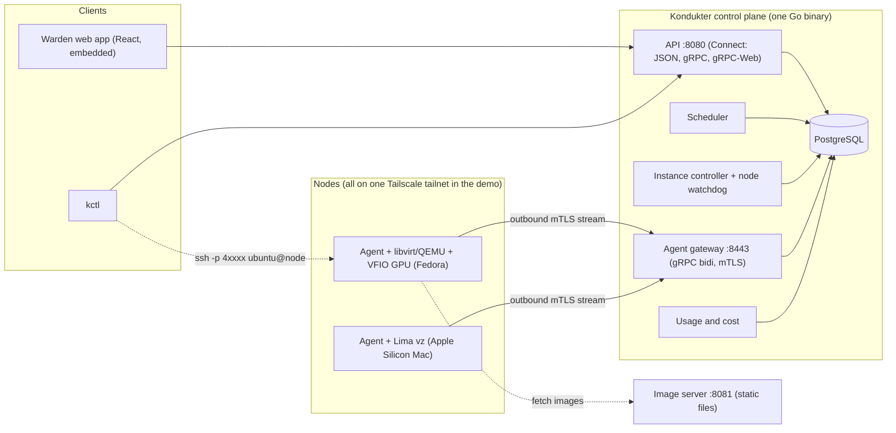
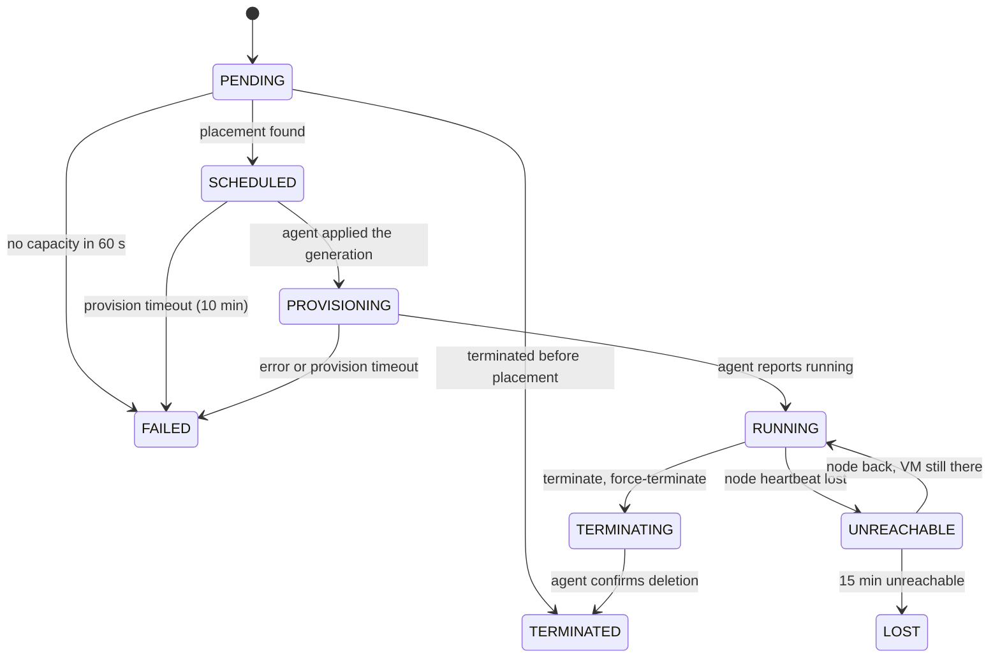

# Warden / Kondukter — System documentation

> **Status:** as built on 2026-11-08, branch `web-warden-design`. This is the one-document tour of the whole system: what it is, how the parts fit, how it behaves, how to run it, and what is not done. It summarises and links to the detailed documents rather than replacing them: [SPEC](SPEC.md) (the original brief), [ROADMAP](ROADMAP.md) (items, "as built" notes and the decision log), [ADRs](adr/README.md) (one per decision), [WEB_PAGES](WEB_PAGES.md) (route map), [DEMO](DEMO.md) (run sheet and drills).
>
> **Naming.** **Warden** is the brand users see. **Kondukter** is the control-plane component and keeps its name in code: the `kondukter` and `kondukter-agent` binaries, the protobuf packages, `kctl`, the `kondukter seed` and `kondukter token` commands, and every command the server prints.

---

## 1. What it is

Partners (datacenter operators) dedicate a share of their machines, GPUs included, that would otherwise sit idle. Warden resells that capacity to customers as **on-demand virtual machines reachable over SSH**. A central **control plane** (Kondukter) knows every node and every resource and schedules requests onto the best-fit machine. A small **agent** on each node keeps one outbound connection to the control plane and makes the local hypervisor match what the control plane says should run.

This repository is a **demo-scoped** build for a first external showcase, not a commercial system: no real money, no sign-up, no production hardening (see [§13](#13-status-and-known-gaps)).

| Actor | Does | Sees |
|---|---|---|
| **Customer** | Browses offers, creates and terminates instances, manages SSH and API keys | Own org's instances, usage, cost |
| **Partner** | Enrolls nodes, drains and undrains them, reads utilization | Own sites and nodes. Never customer identities or instance specs |
| **Operator** | Watches the whole fleet, quarantines nodes, force-terminates instances, reads the audit log | Everything |

### Glossary

| Term | Meaning |
|---|---|
| Site / Node | A partner location, and one physical host in it running an agent |
| Driver | The agent plugin for one hypervisor: `mock`, `libvirt`, `lima` |
| Shape | vCPU, RAM, disk and accelerators (count may be 0) |
| Offer | A shape in a region with a capacity class and a price per hour |
| Instance | A customer VM |
| Allocation | A reservation of concrete node resources, including concrete GPU ids, for one instance |
| Desired state / generation | What the control plane says a node should run (a full snapshot), numbered by a per-node counter that only grows |
| Accelerator | A GPU or similar device (`nvidia`, `apple-metal`, `mock`) |
| Capacity class | `dedicated` (only one offered) or `preemptible` (field exists, unused) |

---

## 2. Architecture



### Principles that shape everything ([ADR-0001](adr/0001-agents-dial-out.md) to [0011](adr/0011-macos-nodes-demo-only-lima.md))

1. **Agents dial out.** Partner networks open no inbound ports. Kondukter never connects into a partner network.
2. **Desired state, reconciled.** The control plane stores what should exist and bumps a generation; the agent converges. Duplicated, reordered or lost messages are harmless.
3. **Fail-static agents.** Without a fresh snapshot an agent keeps everything running and deletes nothing.
4. **The control plane is never in the data path.** Customers SSH straight to nodes. If Kondukter is down, VMs keep running and agents buffer usage.
5. **PostgreSQL is the single source of truth.** Free capacity is recomputed inside the placement transaction, never kept as a counter.
6. **One protobuf contract** for the agent protocol and every public API.
7. **Generic resource model.** A GPU is one resource among others, so CPU-only nodes (the Macs) need no special case.
8. **The agent owns only what it created.** Ownership is a name prefix *and* metadata in the VM definition.
9. **Everything is idempotent.**

### Technology

| Area | Choice |
|---|---|
| Control plane, agent, CLI | Go 1.27, one module `github.com/St1viG/cj`, modular monolith ([ADR-0005](adr/0005-go-and-typescript.md)) |
| Contract | Protobuf managed with `buf`; Connect for the public APIs, gRPC bidirectional stream for agents ([ADR-0006](adr/0006-protobuf-connect-grpc.md)) |
| Database | PostgreSQL 17 through `pgx` v5 and `sqlc`; goose migrations ([ADR-0018](adr/0018-goose-sqlc-pgx-bbolt.md)) |
| Agent store | bbolt (pure Go, crash-safe) |
| Linux VMM | QEMU/KVM via libvirt, pure-Go binding `digitalocean/go-libvirt` ([ADR-0003](adr/0003-qemu-kvm-libvirt-vmm.md), [0019](adr/0019-pure-go-libvirt-binding.md), still *Proposed* until spike S1 passes) |
| macOS VMM | Lima `vmType: vz` ([ADR-0020](adr/0020-lima-macos-driver.md)) |
| Web app | React 19, Vite 8, TypeScript 7, React Router 8, TanStack Query 5, connect-es 2; embedded in the Go binary ([ADR-0022](adr/0022-react-vite-typescript-connect-es.md)) |
| Networking | Tailscale for the demo fleet; port-map access ([ADR-0016](adr/0016-port-map-access-mode.md)) |
| Deploy | docker compose on the presenter Mac ([ADR-0014](adr/0014-control-plane-compose-on-presenter-mac.md)) |

Deliberately absent: Kubernetes ([ADR-0004](adr/0004-no-kubernetes-in-mvp.md)), Firecracker for GPUs, MIG/vGPU ([ADR-0008](adr/0008-whole-gpu-passthrough-only.md)), a message bus, HA ([ADR-0017](adr/0017-single-replica-in-process-fanout.md)).

---

## 3. Repository layout

| Path | What |
|---|---|
| `proto/kondukter/agent/v1/` | The agent protocol (`agent.proto`) |
| `proto/kondukter/api/v1/` | Public services: `auth`, `account`, `catalog`, `instance`, `usage`, `partner`, `admin`, `enrollment`, shared `types` |
| `gen/go`, `gen/ts` | Generated code (committed; CI checks it is current) |
| `cmd/kondukter` | Control plane: `serve`, `migrate`, `seed catalog`, `seed accounts`, `token create`, `healthcheck` |
| `cmd/kondukter-agent` | Node agent: `run`, `enroll`, `inventory`, `version` |
| `cmd/kctl` | Customer, partner and operator CLI |
| `cmd/kdk-sim` | Fleet simulator (fake agents against a live control plane) |
| `cmd/kdk-stubgw` | Stub gateway that serves hand-written desired state to an agent |
| `internal/controlplane/*` | `api`, `gateway`, `scheduler`, `controller`, `catalog`, `accounts`, `enrollment`, `pki`, `usage`, `events`, `server` |
| `internal/agent/*` | `stream`, `reconcile`, `driver/{mock,libvirt,lima}`, `inventory`, `metering`, `access`, `store`, `config`, `enroll` |
| `internal/agentproto` | Constants both ends share (protocol version, keepalive, SAN prefix) |
| `internal/store` | Migrations, sqlc queries and generated code, `WithTx`, test helpers |
| `internal/simulator` | In-process fleet, fault injection, invariant checks |
| `internal/kctl` | The CLI implementation |
| `web/` | The Warden web app (see [§9](#9-the-web-app)) |
| `deploy/compose` | Postgres, Kondukter and image-server stack |
| `deploy/nodes` | `install-agent.sh`, systemd unit (Fedora), LaunchDaemon plist (macOS) |
| `deploy/images` | Guest image definitions (served by the image server) |
| `hack/` | Demo and smoke scripts, spike code (`hack/s<n>/` have their own `go.mod`) |
| `docs/` | This file, SPEC, ROADMAP, WEB_PAGES, DEMO, ADRs, spike findings |

---

## 4. The control plane (Kondukter)

One binary, `kondukter serve`, runs everything in one process and migrates the database at start-up. It is configured by `KONDUKTER_*` environment variables, which flags override.

### 4.1 Endpoints

| Port | Protocol | What |
|---|---|---|
| `:8080` | HTTP/1.1 and h2c, plain | The API (Connect JSON, gRPC, gRPC-Web on one port), `/healthz`, `EnrollmentService`, the embedded web app at `/`. The web app reaches the same services under `/api` |
| `:8443` | gRPC over HTTP/2, **mTLS** | The agent gateway. Client certificates are required and verified against the internal CA |
| `:8081` | HTTP | A static file server (`caddy`) for guest images in `deploy/images/dist` |
| `:55432` | Postgres | Compose's Postgres, published on loopback so it never collides with a host Postgres |

### 4.2 Data model

PostgreSQL holds all state ([ADR-0009](adr/0009-postgres-source-of-truth.md)). Six goose migrations (`internal/store/migrations`) build it.

| Group | Tables |
|---|---|
| Topology | `partners`, `sites`, `regions`, `nodes`, `node_capacity`, `accelerators` |
| Catalog | `images`, `shapes`, `offers` |
| Identity | `orgs`, `users`, `memberships`, `api_keys`, `ssh_keys`, `sessions`, `enrollment_tokens`, `pki_ca` |
| Workload | `instances`, `allocations`, `instance_events`, `usage_records` |
| Control | `audit_log`, `idempotency_keys` |

Rules worth knowing:

- `instances.phase` and `nodes.status` are Postgres enums with lowercase values.
- **Allocations.** Per instance, one row holds vCPU, RAM and disk with `accelerator_id` NULL, and each accelerator gets its own zero-resource row. The partial unique index `one_active_lease_per_accelerator` (`accelerator_id` where not released) makes a double-booked GPU impossible even if the scheduler had a bug.
- `instance_events` is append-only. `usage_records` has the primary key `(instance_id, period_start)`, so ingest is idempotent.
- `nodes.desired_generation` starts at 1 and only grows. `instances.placement_generation` records the generation at placement, so a status produced before it is ignored.
- There is **no ledger table**: the demo has no money ([ADR-0023](adr/0023-demo-metering-no-money.md)).

### 4.3 Instance lifecycle



The transition table is a pure function `(phase, event) → phase`, tested edge by edge: every legal pair is asserted and every other pair must be rejected. Each transition appends an `instance_events` row in the same transaction. There is no stop/start and no `STOPPED` phase ([ADR-0025](adr/0025-mvp-scheduling-semantics.md)).

| Timer | Value | Owner |
|---|---|---|
| Heartbeat | 10 s | agent |
| Node `UNREACHABLE` | 35 s of silence (3 × 10 s + 5 s), checked by a 10 s sweep, so 45 s at worst | node watchdog |
| Restart grace | 95 s after the control plane starts, so agents still in reconnect backoff are not marked unreachable | watchdog |
| Pending → `FAILED(no_capacity)` | 60 s | scheduler |
| Scheduled/provisioning → `FAILED(provision_timeout)` | 10 min | controller sweep (every 5 s) |
| `UNREACHABLE` → `LOST` | 15 min | controller sweep |

### 4.4 Node lifecycle

`ENROLLING → READY ⇄ DRAINING → MAINTENANCE`, plus `UNREACHABLE`, `QUARANTINED` and `RETIRED`. Only `READY` nodes take placements. A `DRAINING` node with no active allocations moves to `MAINTENANCE` by itself. **Quarantine** stops placements and ignores the node's reports (except the confirmation that an instance told to terminate is gone), but it does not stop running instances and does not revoke the certificate ([ADR-0024](adr/0024-mtls-node-identity-deferred-rotation.md)).

### 4.5 Scheduling ([ADR-0025](adr/0025-mvp-scheduling-semantics.md))

**Filter** (first rejecting reason wins): node `READY`; region and capacity class match; node architecture matches the image; the driver supports the accelerator kind and `max_instances` is not reached; free vCPU, RAM and disk are at least the shape, where *free = total − reserved − Σ active allocations*; enough healthy unallocated accelerators of the model; the image's accelerator stack fits the model.

**Score**, in order: fewest free accelerators on the node (best fit, so big hosts stay free for big requests); image already cached on the node; the partner that least recently received a placement (round robin, computed from `instances.scheduled_at`, so it survives restarts); node id.

**Commit** is one transaction: lock the instance, then the node row (`SELECT … FOR UPDATE`), recompute free capacity, insert the resource row and one row per concrete accelerator, bump `desired_generation`, set `SCHEDULED`, append the event. A capacity race or a unique-index violation moves to the next candidate; a serialization failure or deadlock retries the same one up to three times. After commit it notifies the gateway. NUMA-aware placement is deferred.

The scheduler runs a pass every second and when triggered (a gateway or watchdog hook fires it whenever an instance changes), placing pending instances oldest first. A concurrency test creates 50 GPU instances against three single-GPU nodes, 20 rounds under `-race`, and asserts exactly three are scheduled.

### 4.6 Agent gateway ([ADR-0001](adr/0001-agents-dial-out.md), [0002](adr/0002-desired-state-reconciliation.md), [0017](adr/0017-single-replica-in-process-fanout.md))

- A second stream from the same node closes the first (`Aborted`).
- **Hello** moves an `ENROLLING` or `UNREACHABLE` node to `READY`, records version, driver and capabilities, and always gets the current snapshot back. If the agent's last applied generation is ahead of the server's (a re-enrolled node keeping an old store), the generation jumps past it so snapshots are not ignored.
- **Snapshots** are built in a repeatable-read, read-only transaction so the generation always matches the instance list: all non-terminal instances of the node with spec, image ref (URL and digest), ports and concrete accelerator ids.
- **Ingest** is idempotent. `Inventory` upserts capacity and accelerators (an allocated accelerator is only marked `missing`, never deleted). `Heartbeat` updates `last_seen_at` and `observed_generation`. `InstanceStatus` drives controller transitions only when it is newer than `agent_status_at` and produced under at least the placement generation. `UsageBatch` is `INSERT … ON CONFLICT DO NOTHING` with an ownership check.
- **Acks** are per message, sent after the enclosing transaction commits, so nothing un-stored is acknowledged. An ingest error closes the stream.
- **Repair:** the gateway re-pushes the snapshot when heartbeats show an agent behind for 3 heartbeats; a heartbeat from a node the watchdog marked unreachable while its stream was open ends the stream so the agent re-sends its state.
- Fan-out from scheduler and controller to the gateway is an in-process interface (`NodeChanged(nodeID)`), the single-replica design; Postgres `LISTEN/NOTIFY` would replace it for several replicas.

### 4.7 Node identity ([ADR-0024](adr/0024-mtls-node-identity-deferred-rotation.md))

1. A partner or operator creates a **one-time enrollment token** for a site (`kdk_enr_…`, stored hashed, one hour). Unknown, used and expired tokens all return the same `Unauthenticated`.
2. `kondukter-agent enroll` generates a key and CSR. The server signs a **30-day certificate** from its internal CA (ECDSA P-256, 10 years, key sealed with AES-256-GCM under an HKDF key from `KONDUKTER_MASTER_KEY`, stored in Postgres) with the SAN `kondukter://node/<uuid>`.
3. The gateway takes the node id **only from the certificate**, never from a message body, and also requires the certificate fingerprint to match `nodes.cert_fingerprint` (an old certificate stops working after a re-enroll) and refuses retired nodes.

The gateway's own server certificate is minted in memory at every start for the configured names and IPs, so only the CA is persisted. Rotation, revocation and signed self-update are deferred.

### 4.8 Public API

Connect services, all on `:8080`. Every mutating call takes an `idempotency_key`: the first request's hash and response are stored per org, method and key inside the call's own transaction, a replay returns the stored response, the same key with a different request is `InvalidArgument`, and keys expire after 24 h.

| Service | Calls | Caller |
|---|---|---|
| `AuthService` | `Login`, `Logout`, `GetMe` | anyone (`GetMe` accepts a cookie or an API key) |
| `EnrollmentService` | `Enroll` (token + CSR → certificate) | an agent |
| `CatalogService` | `ListOffers` (filters), `ListImages`, `ListRegions` | customer |
| `InstanceService` | `CreateInstance`, `GetInstance`, `ListInstances`, `TerminateInstance`, `WatchInstance` (server stream) | customer |
| `AccountService` | SSH keys and API keys: add, list, delete, create, revoke | customer |
| `UsageService` | `ListUsage` (per org, optional instance and period) | customer |
| `PartnerService` | `ListSites`, `ListNodes`, `CreateEnrollmentToken`, `DrainNode`, `UndrainNode`, `GetUtilization` | partner (scoped to its sites), operator (all) |
| `AdminService` | `ListNodes`, `ListInstances`, `QuarantineNode`, `UnquarantineNode`, `ForceTerminateInstance`, `ListAuditLog`, `ListCatalog` | operator |

`CreateInstance` checks the offer is active, the image is active and compatible with the shape (an accelerator shape needs an image whose stack lists the model; a CPU shape needs one without a stack), SSH keys (at least one, deduplicated by fingerprint), ports (1 to 65535, no `22/tcp`, no duplicates, at most 16), user-data of at most 16 KiB, and a name of at most 63 characters (which also becomes the hostname when it is a DNS label). `WatchInstance` subscribes to the in-process event bus *before* its first read, re-reads on every signal so it never sends stale state, re-reads every 30 s, and ends at a terminal phase.

### 4.9 Authentication, roles, audit ([ADR-0021](adr/0021-seeded-accounts-sessions-api-keys.md))

| Principal | Mechanism |
|---|---|
| Browser user | Email and password (argon2id) → `kdk_session` cookie: `HttpOnly`, `SameSite=Lax`, `Secure` when the public URL is https. Only the SHA-256 of the 256-bit token is stored; sessions slide by 12 h |
| CLI and API | `Authorization: Bearer kdk_…` (`kdk_` plus 40 base32 characters), stored as a hash |
| Agent | mTLS client certificate |

A role comes from the org kind. The interceptor enforces it: `InstanceService` is customer-only, `PartnerService` partner and operator, `AdminService` operator only. A partner's scope is its org's partner id; another partner's site or node is `NotFound`. Instances, SSH keys and API keys are only read through org-scoped queries, so another org's id is `NotFound`. There is no sign-up, email verification, password reset or MFA.

Every partner and admin mutation, and every customer terminate, writes an `audit_log` row (actor type and id, email, action such as `admin.quarantine_node`, target `node/<id>`, JSON payload) in the same transaction as the change.

### 4.10 Usage and estimated cost ([ADR-0023](adr/0023-demo-metering-no-money.md))

Running time is the sum of intervals from `RUNNING` until the next event leaves it (terminating, unreachable, lost…), clipped to an optional window, with an open interval closed at now. An unreachable gap stops the clock and a recovery restarts it. Minutes are `ceil(seconds / 60)`; estimated cost is `minutes × price per hour / 60` rounded up to a whole cent, so a running instance is never shown as free. Every `Instance` the API returns carries `usage`. The agent's per-minute records are cross-checked against the event figure every 5 minutes, and a difference above 2 minutes is logged. **No money moves.**

---

## 5. The agent (`kondukter-agent`)

A static Go binary (`CGO_ENABLED=0`) that runs under systemd (Fedora, as root) or a LaunchDaemon (macOS, as the dedicated user `_kondukter`, because Lima refuses to run as root).

| Part | Job |
|---|---|
| `stream` | Owns the gateway stream: Hello, heartbeats every 10 s, outbox draining, backoff 1 s → 60 s with full jitter, keepalive 20 s |
| `reconcile` | Runs on a new snapshot, every 30 s and on driver events; calls `Ensure` for desired instances and `Delete` for owned instances missing from a fresh snapshot |
| `inventory` | CPUs, memory, disk and, on Linux, NVIDIA GPUs from sysfs; sent at Hello, after any change found by a 30 s check, and at least every 5 minutes |
| `metering` | Minute-aligned usage records into the outbox |
| `access` | Port allocation and the nftables table (Linux) or port forwards (Lima) |
| `store` | bbolt at `<data>/state.db`: `meta`, `outbox`, `ports`, `identity`, `meter` |

### 5.1 Reconciliation rules ([ADR-0002](adr/0002-desired-state-reconciliation.md))

- A snapshot with a lower generation than the stored or applied one is ignored; an applied duplicate is a no-op.
- "Fresh" means received on the live stream. Only a fresh pass deletes and records the applied generation, and only after every desired instance was attempted. A stored snapshot from before a restart keeps everything running.
- Ownership is the `kdk-` name prefix **and** metadata in the VM definition. The agent never lists, starts, stops or deletes anything else on the host.
- Statuses are reported only when they change. An instance that leaves the snapshot without ever reaching the host is still reported `DELETED`, so the control plane is not left waiting.

### 5.2 Crash safety

The agent must survive `kill -9` at any point without leaking or duplicating a VM. A chaos test runs the real agent as a subprocess, kills it 20 times at random moments and asserts the host ends with exactly the desired VMs and every metered period arrived once. Usage records and their per-instance marks are written in one bbolt transaction: a crash can re-send a period, which the server's key absorbs, but never lose one. A restarted agent backfills minutes a VM kept running while the agent was down (at most 24 h). The outbox caps at 20 000 messages, warns from 80 % and then evicts oldest first.

### 5.3 Drivers

| Driver | Platform | Notes |
|---|---|---|
| `mock` | any | Simulated lifecycle with a configurable provision delay and failure rate and configured mock accelerators; state in `<data>/mock/instances.json`. Used by tests, the simulator, the stage fallback and the demo scripts |
| `libvirt` | Linux | q35 + OVMF with per-VM NVRAM, `host-passthrough`, virtio disk with `discard='unmap'` on a qcow2 overlay, virtio-net on `kdk-net` (open forward mode), a NoCloud seed ISO built in pure Go, serial console only, one `<hostdev>` per GPU plus its audio function. Ownership is `kdk-<id>` plus a `<metadata>` element; `Ensure` and `Delete` are idempotent and background work reports `provisioning` immediately |
| `lima` | macOS (Apple Silicon) | One `vz` VM per instance (`kdk-<id>`) from a rendered template: arm64 Ubuntu by URL and digest, no mounts, SSH on guest port 2222 (Lima keeps 22), forwards on `0.0.0.0`, two catch-all ignore rules so no guest listener leaks to host loopback. Ownership is a template parameter. A killed Lima host agent is a hard power-off, so a stopped VM is started again, or re-created if it never finished its first boot. One `limactl` mutation at a time |

Details and the reasons behind each choice are in [ADR-0003](adr/0003-qemu-kvm-libvirt-vmm.md), [ADR-0020](adr/0020-lima-macos-driver.md) and the roadmap items P2.5 and P2.6.

### 5.4 Customer access: port-map ([ADR-0016](adr/0016-port-map-access-mode.md))

The agent allocates a host port from `40000–49999` for guest `22/tcp` and each declared port, persists it, and reports the mappings. Connection info is `ssh -p <port> ubuntu@<node address>`; in the demo the address is the node's tailnet IP.

On Linux the agent owns one nftables table, `inet kdk`, applied atomically with `nft -f`: DNAT per mapping, a forward chain that accepts only DNAT'd and established traffic toward guests, masquerade for the guest subnet (`10.77.0.0/24` on bridge `kdk-br0`), and drops from guests to RFC 1918, link-local, the tailnet range and IPv6; guests may reach only DHCP and DNS on the gateway. On macOS the mappings become Lima `portForwards`.

### 5.5 Packaging

`make agent-dist` cross-compiles `linux/amd64` and `darwin/arm64`. `deploy/nodes/install-agent.sh` installs the binary and the service, writes a starting config if none exists, and with `--token` stops the service, enrolls as the service user and starts it. The systemd unit uses `Restart=always` with `RestartSec=60`, so a killed agent shows as `UNREACHABLE` before it returns, as the failure drill expects.

---

## 6. The agent protocol

`kondukter.agent.v1.AgentGateway.Connect` is one bidirectional gRPC stream opened by the agent over HTTP/2 + mTLS ([ADR-0006](adr/0006-protobuf-connect-grpc.md)). Protocol version `1.0` (a different major is `FAILED_PRECONDITION` and the agent waits the full 60 s). Maximum message 4 MiB.

| Direction | Message | Notes |
|---|---|---|
| agent → server | `Hello` | Protocol and agent version, driver, capabilities, `last_applied_generation`, observed instances |
| | `Inventory` | Capacity, accelerators (PCI address, model, NUMA node, IOMMU group, health, companion functions), cached images |
| | `Heartbeat` | Applied generation and a resource summary, every 10 s |
| | `InstanceStatus` | Phase, reason, guest IPs, port mappings, applied generation, time. **Sequenced** |
| | `UsageBatch` | `(instance_id, period_start, period_end, running_seconds)` records. **Sequenced** |
| server → agent | `DesiredState` | A full snapshot with a generation: the node's non-terminal instances with full specs |
| | `Ack` | **Per message** (not cumulative), sent after the data is stored |
| | `DrainRequest`, `UpgradeRequest` | Defined; not used in the demo |

Only `InstanceStatus` and `UsageBatch` go through the durable outbox and carry a sequence number; `Hello`, `Heartbeat` and `Inventory` are rebuilt on every connection. The agent re-sends an unacked outbox message after 3 heartbeats on the same connection and re-sends everything unacked on a new connection. The fleet simulator's fault injection (drop, duplicate, reorder, delay) is what found the need for per-message acks, retransmission and snapshot re-push.

---

## 7. Security model

| Threat | Mitigation in this build |
|---|---|
| Compromised agent | It can speak only as its own node (identity from the certificate); the control plane never trusts agent claims for authorization; usage ownership is checked at ingest |
| Tenant attacks the partner LAN | Dedicated bridge and the nftables drop rules above, tested in a network-namespace lab |
| Tenant escapes a VM | One tenant per GPU, whole-GPU passthrough, minimal QEMU device model; sVirt, seccomp and patch cadence are deferred |
| Customer data exposure to the host operator | Cannot be prevented without confidential computing (deferred) |
| Account abuse | API keys are scoped and revocable; no MFA yet |

**Known gaps** ([§13](#13-status-and-known-gaps)): no certificate rotation or revocation, no GPU wipe or health gate between tenants, no egress rate limits or abuse workflow, no Mac-node guest isolation (a guest on a Mac node can reach the host's loopback, LAN and tailnet; spike S3 finding 3 awaits a decision), and the CA key lives in the compose volume.

---

## 8. Command-line tools

**`kctl`** (cobra, generated Connect client; config in `~/.config/kctl/config.yaml`, or `KCTL_SERVER`, `KCTL_API_KEY`, `KCTL_CONFIG`):

| Command | Does |
|---|---|
| `login`, `whoami` | Store and check an API key |
| `offers`, `images` | Browse, with filters (`--accel`, `--arch`, `--region`, `--min-vcpu`, `--min-ram`) |
| `create` | Create an instance (`--offer`, `--image`, `--ssh-key`, `--port`, `--user-data`, `--name`, `--wait`); retries `Unavailable` with the same idempotency key |
| `get`, `list`, `watch`, `terminate` | Inspect and end instances; `watch` exits 2 when an instance ends `FAILED` or `LOST` |
| `ssh` | Print (or with `--exec` run) `ssh -p <port> ubuntu@<host>` |
| `nodes`, `enroll-token`, `drain`, `undrain` | Partner and operator views |
| `usage` | Running time and estimated cost |

`--output json` prints protojson everywhere. **`kdk-sim`** runs a fleet of fake agents (CPU and GPU nodes, optional `--drop`, `--duplicate`, `--reorder` faults) against a live control plane. **`kdk-stubgw`** serves a hand-written desired state to one agent.

---

## 9. The web app

`web/` is the Warden app: a Vite + React + TypeScript single-page app that the `kondukter` binary embeds (`go:embed web/dist`) and serves at `/`. A Go build made without Node answers `503` with a note to run `make web`. The generated client comes from `gen/ts` through the `@gen/*` alias; `@bufbuild/protobuf` is pinned to one version in both packages so they share a single copy.

### 9.1 Routes

| Route | Who | Page |
|---|---|---|
| `/` | everyone | Guest home page: banner and price chips, looping lifecycle preview, a cost calculator over the real prices, what we do, how it works, catalog, audiences. Signed-in users get "Open dashboard" |
| `/products` | everyone | Product catalog in the manner of a GPU price-comparison list: type tabs, filters (GPU model, architecture, availability, max price), price per hour/day/month, sort, table or card view. A visitor sees a built-in catalog; a signed-in customer sees the live `ListOffers` and launches into the create form |
| `/login` | everyone | Email and password |
| `/app/offers`, `/app/instances`, `/app/instances/new`, `/app/instances/:id`, `/app/keys`, `/app/usage`, `/app/billing` | customer | Offers with filters; the live instance list; a create form; one instance with lifecycle pipeline, `ssh` block, mappings, timeline and cost; keys; usage; billing |
| `/partner/sites`, `/partner/nodes`, `/partner/enroll`, `/partner/utilization`, `/partner/earnings` | partner | Sites; nodes with Drain/Undrain and a table or map view; a one-time install command; utilization; earnings |
| `/admin/nodes`, `/admin/instances`, `/admin/catalog`, `/admin/audit` | operator | Fleet with Quarantine, Drain and generation lag; every org's instances with Force terminate; the catalog; the audit log |
| `/stage` | operator | Projector view: nodes grouped by site with live instances and phase ages, refreshed every 2 s; `?demo=1` shortens ids |

The full route-to-RPC table is in [WEB_PAGES.md](WEB_PAGES.md), and `routes.ts` is the same table as data. `routes.test.ts` fails if the two differ or an RPC named there does not exist.

### 9.2 Access rules

One role per area: `/app` customer, `/partner` partner, `/admin` and `/stage` operator. A signed-in user who opens another role's area is redirected to their own home (customer `/app/instances`, partner `/partner/nodes`, operator `/admin/nodes`). Signed out, any guarded route, including an unknown path inside an area, redirects to `/login` and returns afterwards if the role may open it. A deliberate logout starts the next login at home. Any `Unauthenticated` answer from any call signs the user out; a `GetMe` failure that is not a 401 shows the error with Retry instead.

### 9.3 Structure

| Path | What |
|---|---|
| `src/api/` | Transport (`/api`, cookies, JSON), one typed client per service (`useApi()`), query keys, the query client |
| `src/auth/` | `useMe()`, `RoleRoute` guards, role → home rules |
| `src/hooks/` | `useWatchInstance` (the `WatchInstance` stream as a reconnecting hook that feeds the query cache), `useParam`, `useNow` |
| `src/components/` | `DataTable`, `Form`, `Field`, `Confirm`, `State`; the design's `StatusChip`, `Pipeline`, `Terminal`, `Stat`, `ResourceBar`, `FleetMap`, `Logo`, `SiteNav`, `PageTitle`; `charts/TimeChart` |
| `src/pages/` | One folder per area, plus `LandingPage`, `ProductsPage`, `LoginPage`, `AreaLayout`, `stage/` |
| `src/lib/` | Formatting, ids, clipboard, theme, page descriptions, the built-in product list, fake billing and earnings |
| `src/theme.css`, `src/fonts/` | The design system and its bundled fonts |
| `src/test/` | In-memory servers used by the page tests and the dev mock |

Browser constraints are handled in `src/lib`: the demo is served over plain HTTP (an insecure context), so `crypto.randomUUID` and `navigator.clipboard` have fallbacks (`newId`, `copyText`); a browser allows about six HTTP/1.1 connections per host and each `WatchInstance` stream holds one, so the instance list follows at most three in-flight instances; query keys hold plain numbers because TanStack Query hashes keys as JSON.

### 9.4 Design system

The owner's design (`web/design.html.html`) is applied in `theme.css`: dark first with a light variant (`<html data-theme="light">`, remembered in `localStorage`), tokens as CSS custom properties, one baby-blue accent, hairlines instead of shadows, and three type voices (Fraunces for display, Geist for the interface, Geist Mono for data). Status is always a glyph plus a colour plus a word. One navigation bar (`SiteNav`) serves every page except `/stage`; dashboard areas add a numbered tab row beneath it. Charts are single-series with the design's mark specs (2 px line, bars at most 24 px with a rounded cap, hairline grid) and a hover or arrow-key readout. Decorative words (pipeline steps, legends, stat labels) are drawn from `data-*` attributes so page text carries a phase or status only once.

### 9.5 Data that is not real

The backend has no ledger, so these views are generated in the browser and carry no on-screen label saying so:

- `/app/billing` and the balance in the navigation bar (`lib/fakeBilling.ts`): thirty days of top-ups, usage, a welcome bonus, a refund and invoices ending on a sensible balance. A pretend top-up is kept in `localStorage` (`kdk-fake-topups`).
- `/partner/earnings` (`lib/fakeEarnings.ts`): fixed-seed earnings, utilization and payouts with an illustrative 70 % revenue share.
- The guest home page and `/products` use fixed catalog text for a visitor, because the offers API needs a login.

### 9.6 Running it

- `make web-dev` serves Vite on `:5173` and proxies `/api` to `kondukter serve` on `:8080` (`KONDUKTER_API_URL`).
- `VITE_MOCK_API=1 pnpm --dir web dev` needs no backend: an in-memory server (`src/devMock.ts`, built from the test fakes) answers every call. It accepts `customer@`, `partner@` and `operator@demo.local` with the password `cj`, keeps data in memory only and is excluded from builds.
- `make web` installs, typechecks, tests and builds into `web/dist`; run it before `make build` to embed the app.

---

## 10. Running the system

### 10.1 Prerequisites

macOS with Homebrew is the documented path (`make tools`: the Brewfile, pinned Go codegen plugins, pinned `protoc-gen-es`). Docker (for Postgres and the compose stack), Go 1.27 and pnpm are required; Tailscale is needed for the demo fleet. The web app alone needs only Node and pnpm.

### 10.2 Make targets

| Target | Does |
|---|---|
| `make gen` | Generate `gen/go`, `gen/ts` (buf) and `internal/store/db` (sqlc) |
| `make build` | Build every command into `bin/`; `kondukter` embeds `web/dist` |
| `make web`, `make web-dev` | Build or serve the web app |
| `make agent-dist` | Cross-compile the agent for the nodes |
| `make test`, `make lint`, `make fmt` | Go tests under `-race` (DB tests skip if Postgres is down); `buf lint` and `buf breaking`, `go vet`, `golangci-lint`; format |
| `make db-up`, `db-down`, `db-psql` | Compose Postgres 17 on `127.0.0.1:55432` |
| `make migrate-up`, `migrate-down`, `migrate-status` | goose, embedded migrations |
| `make demo-up`, `demo-reset`, `demo-down` | The demo stack (below) |

### 10.3 A local stack by hand

```sh
make db-up                                          # Postgres on :55432
export KONDUKTER_DATABASE_URL=…                     # from .env.example
export KONDUKTER_MASTER_KEY=<16+ characters>
bin/kondukter seed catalog                          # region, shapes, offers, images
SEED_PASSWORD=… bin/kondukter seed accounts         # orgs, users; prints one API key each, once
bin/kondukter serve                                 # API and web on :8080, gateway on :8443
bin/kondukter token create                          # one-time enrollment token
bin/kondukter-agent --config agent.yaml enroll --server http://localhost:8080 --token kdk_enr_…
bin/kondukter-agent --config agent.yaml run         # driver: mock needs no hypervisor
KDK_API_KEY=kdk_… hack/api-smoke.sh                 # offers → create → RUNNING → terminate
KDK_API_KEY=kdk_… hack/kctl-smoke.sh                # the same through kctl
KDK_API_KEY=kdk_<partner> bin/kdk-sim               # fake fleet instead of a real agent
```

### 10.4 The demo stack

`make demo-up` creates `.env` from `.env.example` with a random `KONDUKTER_MASTER_KEY` and `SEED_PASSWORD`, reads the Mac's MagicDNS name and tailnet IP, runs `docker compose up --build --wait`, seeds the catalog and accounts and prints the logins and a paste-ready enroll command. `make demo-reset` works through the API: it unquarantines and undrains nodes, force-terminates every instance and waits, truncates the instance tables and waits for every node to be `READY`; nodes, identities, catalog and accounts stay. `make demo-down` stops it (`V=1` also drops the database, and with it the CA and node identities).

Environment: `KONDUKTER_DATABASE_URL`, `KONDUKTER_MASTER_KEY` (seals the CA), `SEED_PASSWORD`, `KONDUKTER_HOST`, `KONDUKTER_TAILNET_IP`, `KONDUKTER_BIND`, `KONDUKTER_API_PORT` (8080), `KONDUKTER_GATEWAY_PORT` (8443), `KONDUKTER_IMAGES_PORT` (8081), `KONDUKTER_API_ADDR`, `KONDUKTER_GATEWAY_ADDR`, `KONDUKTER_GATEWAY_HOSTS`, `KONDUKTER_GATEWAY_ADVERTISE`, `KONDUKTER_PUBLIC_URL`.

### 10.5 Testing and CI

| Layer | How |
|---|---|
| Unit | Table-driven Go tests: scheduler filters and scoring, the state machines, reconcile decisions, rendering |
| Concurrency | Real Postgres, `-race`: 50 parallel creates against limited capacity never over-allocate |
| Fleet simulator | 100 in-process agents under 10 % drop and duplication plus reordering and delay; invariants checked after convergence |
| Chaos | Agent `kill -9` at random points; control-plane restart mid-run; a 100-agent reconnect storm with no error logs |
| Driver integration | `libvirt` on a KVM host and `lima` on a Mac, behind build tags |
| Web | 210 Vitest tests against in-memory servers; typecheck; production build; `routes.test.ts` keeps the code and `WEB_PAGES.md` equal |
| Drills | `hack/demo-happy.sh` and `hack/demo-failure.sh` ([DEMO.md](DEMO.md)) |

GitHub Actions (`.github/workflows/ci.yml`) checks generated code is current, runs `make lint` (including `buf breaking` against the base branch) and `make build test` with a Postgres service, and a `web` job.

---

## 11. The demo

**Fleet:** the 24 GB Mac is the presenter and runs the control plane; two 8 GB Macs are arm64 CPU nodes (Lima `vz`, one 2 GiB VM each); a Fedora desktop with a GTX 1060 is the GPU node; a Fedora laptop with an RTX is a GPU node if spike S2b passes, otherwise a CPU node. All sit on one Tailscale tailnet ([ADR-0012](adr/0012-demo-fleet-real-nvidia-passthrough.md)).

**Catalog:** `cpu-2x2` (2 vCPU, 2 GiB, 20 GiB; €0.05/h; arm64 and amd64) and `gpu-gtx1060-1x` (4 vCPU, 8 GiB, 40 GiB, one GTX 1060; €0.40/h). The GTX 1060 is Pascal, so its guest image needs the 580 driver branch with closed kernel modules and CUDA 12.x.

**Happy path:** create a CPU and a GPU instance, watch them reach `RUNNING`, `uname -m` prints `aarch64` on a Mac, `nvidia-smi` and a llama.cpp prompt run on the GPU, usage and cost grow, terminate and capacity returns. **Failure drills:** kill the agent under a GPU VM (`UNREACHABLE` within 45 s, back to `RUNNING` with the SSH session never dropped); stop the control plane for two minutes (VMs keep serving, nothing duplicates, usage stays continuous); drain a Mac and watch placement move to the other. The scripts and what to say are in [DEMO.md](DEMO.md).

---

## 12. Decision index

| ADR | Decision |
|---|---|
| [0001](adr/0001-agents-dial-out.md) | Agents dial out |
| [0002](adr/0002-desired-state-reconciliation.md) | Full snapshots with generations; fail-static agents |
| [0003](adr/0003-qemu-kvm-libvirt-vmm.md) | QEMU/KVM via libvirt; no Firecracker for GPUs |
| [0004](adr/0004-no-kubernetes-in-mvp.md) | No Kubernetes |
| [0005](adr/0005-go-and-typescript.md) | Go for backend, TypeScript for the web |
| [0006](adr/0006-protobuf-connect-grpc.md) | Protobuf contract; Connect and gRPC |
| [0007](adr/0007-generic-resource-model.md) | Generic resource model |
| [0008](adr/0008-whole-gpu-passthrough-only.md) | Whole-GPU passthrough only |
| [0009](adr/0009-postgres-source-of-truth.md) | Postgres is the truth; capacity computed transactionally |
| [0010](adr/0010-control-plane-not-in-data-path.md) | Control plane not in the data path |
| [0011](adr/0011-macos-nodes-demo-only-lima.md) | macOS nodes demo-only |
| [0012](adr/0012-demo-fleet-real-nvidia-passthrough.md) | Demo fleet and the real-GPU story |
| [0013](adr/0013-fedora-demo-host-os.md) | Fedora as the demo host OS |
| [0014](adr/0014-control-plane-compose-on-presenter-mac.md) | Control plane in compose on the presenter Mac |
| [0015](adr/0015-ssh-vm-curated-images.md) | SSH VM from curated images |
| [0016](adr/0016-port-map-access-mode.md) | Port-map access |
| [0017](adr/0017-single-replica-in-process-fanout.md) | One replica, in-process fan-out |
| [0018](adr/0018-goose-sqlc-pgx-bbolt.md) | goose, sqlc and pgx, bbolt |
| [0019](adr/0019-pure-go-libvirt-binding.md) | Pure-Go libvirt binding (*Proposed*) |
| [0020](adr/0020-lima-macos-driver.md) | Lima as the macOS driver |
| [0021](adr/0021-seeded-accounts-sessions-api-keys.md) | Seeded accounts, sessions, API keys |
| [0022](adr/0022-react-vite-typescript-connect-es.md) | React, Vite, TypeScript, connect-es |
| [0023](adr/0023-demo-metering-no-money.md) | Running time and estimated cost; no money |
| [0024](adr/0024-mtls-node-identity-deferred-rotation.md) | mTLS node identity; rotation deferred |
| [0025](adr/0025-mvp-scheduling-semantics.md) | Dedicated only, no stop/start, several tenants per node |

---

## 13. Status and known gaps

**Roadmap:** 23 of 45 items done and 9 partly done at the last roadmap update ([ROADMAP](ROADMAP.md) has the live checklist). Since then the web app has been restyled and extended (Warden brand, design system, guest home and products pages, billing and earnings views, stage view); those web changes are on branch `web-warden-design`.

| Area | State |
|---|---|
| Foundations, control plane, `kctl`, simulator, usage and cost | **Done**, tested with real Postgres under `-race` |
| Agent core: skeleton, stub gateway, mock driver and reconciler, metering and crash safety | **Done** |
| Agent hardware pieces: inventory, libvirt driver, Lima driver, port-map, packaging | **Built and unit-tested; the hardware checks wait for the Fedora hosts and a second Mac** |
| Spikes S1, S2a, S2b, S4, S5 | **Not run** (need the hardware); S3 (Lima on an 8 GB Mac) is done |
| Fleet on hardware (P4) | Scripts pass against mock agents on the development Mac; the real-fleet runs wait for the hosts and the GPU image |
| Web app | Pages for all three roles, the guest pages and `/stage` are built and tested; nobody has clicked through them on the real fleet |
| Demo script, checklist, rehearsals (P6) | Not started beyond the drill text in [DEMO.md](DEMO.md) |

**Open issues and untested items**

- **Mac guest isolation:** a guest on a Mac node can reach the node's loopback, LAN and tailnet (spike S3 finding 3). The Linux rule set closes this; nothing does on a Mac. Pick a fix or accept it in writing at gate P1.7.
- **ADR-0019 is Proposed.** It becomes Accepted only if spike S1 passes on Fedora. The libvirt driver has never talked to a real libvirtd; `TestLibvirt` is written and not yet run.
- **Not verified on hardware:** SSH from another tailnet machine to a Mac node, `vz` VMs under the LaunchDaemon, the firewalld arrangement on Fedora, SELinux labels on the image cache and OVMF autoselection, and that the GPU image provides the llama.cpp setup the happy-path script expects.
- The image server has nothing to serve until the guest images are built into `deploy/images/dist`; the GPU image has no digest yet, so seeding skips it.

**Deferred on purpose** (the roadmap's "Later" list): real money (ledger, credits, payments, invoices, payouts), sign-up and MFA, certificate rotation and revocation, signed agent self-update, telemetry and alerting, the GPU wipe and health gate, NUMA pinning and hugepages, egress controls and abuse handling, `public-ip` and overlay access, preemptible capacity, stop/start, persistent volumes, inference endpoints, HA, multi-GPU topology placement, MIG/vGPU, confidential computing, other hypervisor adapters, and the legal and commercial documents.

---

## 14. Where to read next

| To learn… | Read |
|---|---|
| Why something is the way it is | The ADR for it ([index](adr/README.md)); [SPEC](SPEC.md) for the original reasoning, risks and market notes |
| What was built, with the details and the test results | The item's "as built" notes in [ROADMAP](ROADMAP.md) |
| Every web route, its data and RPCs | [WEB_PAGES](WEB_PAGES.md), `web/README.md` |
| How to run and present the demo | [DEMO](DEMO.md), `hack/README.md`, `deploy/compose/README.md`, `deploy/nodes/README.md` |
| What the hardware spikes found | `docs/spikes/` (S3 so far) |
